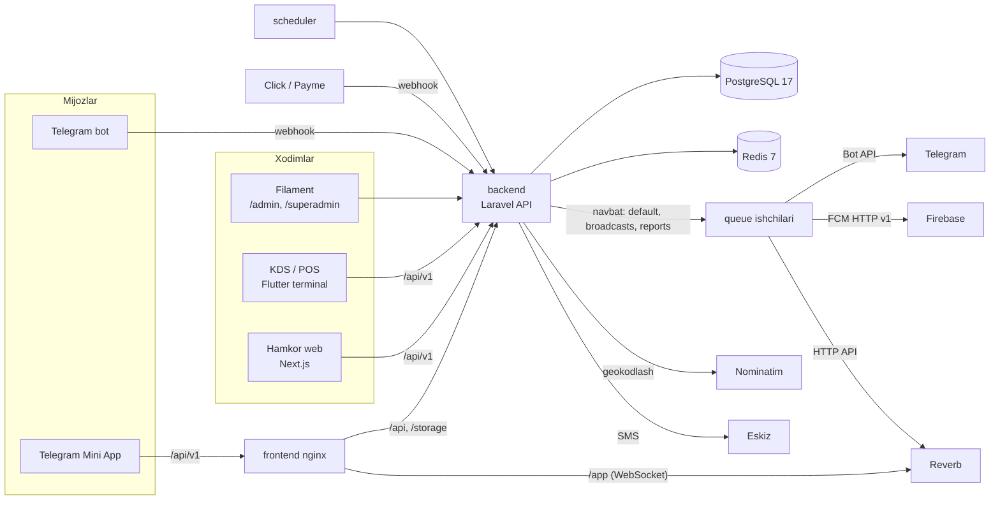
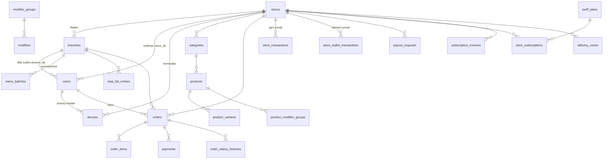
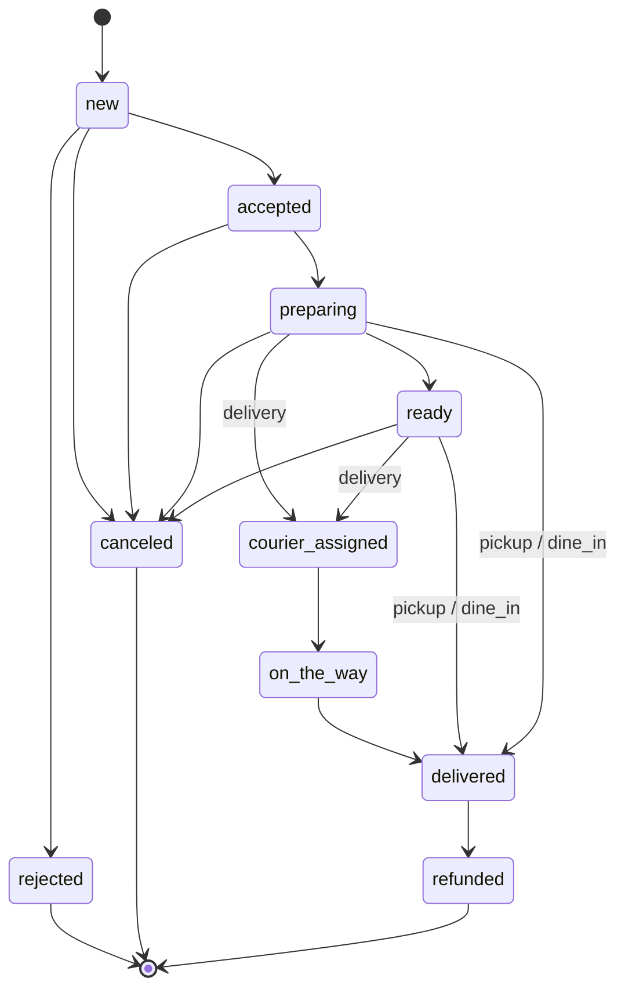

# Rizqim arxitekturasi

Bu hujjat butun platformani bir joyda ko'rsatadi: qaysi ilova nima qiladi, ular qanday bog'langan, ma'lumotlar qanday
saqlanadi va tizim qanday ishga tushadi. Tafsilotlar alohida hujjatlarda, bu yerda faqat umumiy rasm va havolalar.

Holati: 1 va 2-bosqichlar tugagan, 3-bosqich (POS, birinchi format — choyxona) boshlandi (oktabr 2026). Kod qanday
bo'lsa, shunday yozilgan; 3-bosqichda quriladigan qismlar "3-bosqich" deb belgilangan (4.1-bo'lim).

| Mavzu | Batafsil hujjat |
|---|---|
| Qarorlar, bosqichlar | [ROADMAP.md](ROADMAP.md), [PHASE1_PLAN.md](PHASE1_PLAN.md) |
| API'dan foydalanish | [API.md](API.md) |
| Kirish, rollar, qurilmalar | [AUTH.md](AUTH.md) |
| Menyu va buyurtma modeli | [MENU.md](MENU.md) |
| Yetkazib berish hududlari | [ZONES.md](ZONES.md) |
| Tariflar va obuna | [BILLING.md](BILLING.md) |
| Push xabarlar | [PUSH.md](PUSH.md) |
| Deploy, ekspluatatsiya | [DEPLOY.md](DEPLOY.md), [OPERATIONS.md](OPERATIONS.md) |
| Dizayn tizimi | [DESIGN.md](DESIGN.md) |
| POS spetsifikatsiyasi va 3-bosqich rejasi | [POS_SPEC.md](POS_SPEC.md), [PHASE3_PLAN.md](PHASE3_PLAN.md) |

## 1. Asosiy tamoyillar

- **Bitta backend, bitta API.** Barcha ilovalar (Mini App, hamkor paneli, POS, oshxona ekrani, kelajakdagi mobil
  ilovalar) bitta Laravel API'ga (`/api/v1`) ulanadi. Biznes mantiq faqat backend'da: narx, zaxira, komissiya, holat
  o'tishlari serverda hisoblanadi, ilova yuborgan narxga ishonilmaydi.
- **Bitta buyurtma, barcha kanallar.** Telegram, mobil ilova, POS (zal, olib ketish) va agregatordan kelgan buyurtma
  bitta `orders` jadvalida, farqi `channel` maydonida. Oshxona hammasini bir joyda ko'radi, stop-list hamma kanalga
  birdan tarqaladi.
- **Pul faqat aniq arifmetika bilan.** `App\Support\Money` (brick/math), har bir pul harakati jurnalga yoziladi
  (ledger). Float ishlatilmaydi.
- **Do'kon (tenant) bo'yicha ajratish.** Har bir xodim va har bir yozuv bitta do'konga tegishli. Boshqa do'kon
  ma'lumoti 404 yoki 403 bo'ladi. Filialga biriktirilgan xodim faqat o'z filialini ko'radi.
- **Faqat Docker bilan deploy.** Production va staging bir xil image'lardan.

## 2. Papkalar va ilovalar

```
rizqim/
├── backend/               Laravel 12 API + Filament panellari (/admin, /superadmin)      ishlayapti
├── customer/
│   ├── miniapp/           React: Telegram Mini App (mijoz va xodim ekranlari)            ishlayapti
│   └── mobile/            Flutter: mijoz ilovasi                                          6-bosqich
├── partner/
│   ├── web/               Next.js: hamkor veb-paneli (ega, menejer)                        skelet ishlayapti
│   └── mobile/            Flutter: ega va menejer ilovasi                                 5-bosqich
├── courier/               Flutter: kuryer ilovasi                                         4-bosqich
├── pos/
│   ├── apps/kds/          Flutter: oshxona ekrani                                         skelet (ulash ekrani)
│   ├── apps/cashier/      Flutter: kassa                                                  3-bosqich
│   ├── apps/waiter/       Flutter: ofitsiant                                              3-bosqich
│   ├── apps/customer_display/  Flutter: mijozga qaragan ekran                             3-bosqich
│   └── packages/          pos_core, pos_hardware, pos_ui; keyin pos_sync                 3-bosqich
├── packages/
│   ├── api-spec/          openapi.json — koddan yaratilgan API spetsifikatsiyasi
│   ├── ts/api-client/     @rizqim/api-client — OpenAPI'dan TypeScript turlari + fetch klient
│   ├── ts/ui/             @rizqim/ui — dizayn tokenlari va komponentlar (Mini App, hamkor web)
│   ├── dart/rizqim_api/   OpenAPI'dan Dart klient (Retrofit)
│   ├── dart/rizqim_core/  Money, holatlar, sana/til formatlari
│   └── dart/rizqim_ui/    Flutter komponentlari
├── services/              Python servislari (analitika, prognoz)                         7-bosqich
├── infra/                 backup image, staging yordamchilari
├── scripts/               zaxira va tiklash skriptlari
└── docs/
```

Ildizdagi `pubspec.yaml` — Dart workspace: barcha Dart paketlari bitta `pubspec.lock` bilan (`flutter pub get` bir
marta). Yangi Flutter ilovalar shu ro'yxatga qo'shiladi.

| Ilova | Kim ishlatadi | Qanday kiradi | Holati |
|---|---|---|---|
| Telegram Mini App (`customer/miniapp`) | mijoz; ega, menejer, kuryer, superadmin uchun ham ekranlar bor | Telegram `initData` | ishlayapti: yangi menyu (modifikator, kg, "tugadi", stop-list real-time), checkout'da hudud narxi, idempotent buyurtma. Xodim ekranlari Mini App'da **qoladi** (2-bosqichda web panelda ham quriladi, umumiy kod `packages/ts/staff`) |
| Do'kon paneli `/admin` (Filament) | ega, menejer | email/telefon + parol | ishlayapti |
| Superadmin paneli `/superadmin` (Filament) | Rizqim jamoasi | email/telefon + parol | ishlayapti |
| Hamkor veb-paneli (`partner/web`) | ega, menejer | telefon + SMS kod | skelet: xodimlar SMS bilan kiradi (bir nechta do'kon bo'lsa akkaunt tanlanadi), docker-compose'da `panel.<domen>`. To'liq ekranlar 2-bosqichda ([PHASE2_PLAN.md](PHASE2_PLAN.md)) |
| Oshxona ekrani (`pos/apps/kds`) | oshpaz | terminal ulash kodi, keyin PIN | skelet: ulash ekrani va bo'sh ro'yxat |
| Telegram bot | mijoz, xodimlar | webhook | ishlayapti: `/start` havolalari, buyurtma kartochkalari va tugmalari |
| Kassa, ofitsiant (`pos/apps/cashier`, `waiter`) | kassir, ofitsiant | terminal + PIN | 3-bosqichda quriladi (choyxona birinchi), [POS_SPEC.md](POS_SPEC.md). Mijoz ekrani — keyin |

## 3. Tizim sxemasi



`queue`, `queue-reports`, `scheduler` va `reverb` backend bilan **bir xil image va kod**dan ishlaydi, faqat buyrug'i
boshqa.

## 4. Backend ichki tuzilishi

Laravel 12, PHP 8.3. Kod `backend/app` ostida, vazifa bo'yicha:

| Papka | Nima bor |
|---|---|
| `Http/Controllers/Api/V1/*` | API controllerlari: `Auth`, `Device`, `Catalog`, `Menu`, `Order`, `Payment`, `Store` (ega ekranlari), `Delivery`, `Billing`, `Telegram`, `Superadmin`, `User` |
| `Http/Middleware` | `permission`, `role`, `staff.store`, `not-staff-session`, `EnsureIdempotency`, `AssignRequestId`, Telegram webhook secret |
| `Actions/Order/CreateOrderAction` | buyurtma yaratish: bitta tranzaksiya, narx va zaxira serverda; yetkazish narxi, minimal summa va filial hududdan (`DeliveryQuoter`), hudud buyurtmada snapshot qilinadi |
| `Services/Order` | `OrderStatusService` (yagona holat o'tish joyi), `OrderLineBuilder`, `DiningFeeCalculator`, so'rovlar, hisobotlar |
| `Services/Catalog` | mavjudlik (`MenuAvailability`), stop-list, qozon/partiya (`BatchService`), kanal menyusi, rasmlar |
| `Services/Finance` | `LedgerService` (komissiya, hisob-kitob, qarz/hamyon), obuna va hisob-fakturalar, daromad hisoboti |
| `Services/Auth` | tokenlar va refresh, qurilmalar, terminal ulash, PIN, ruxsatlar (`PermissionService`, `RolePermissions`), hisoblarni birlashtirish |
| `Services/Notifications`, `Push`, `Telegram`, `Sms` | xabarlarni kanallarga taqsimlash (`NotificationRouter`), FCM, Telegram bot, Eskiz SMS |
| `Services/Audit` | harakatlar jurnali va maxfiy ma'lumotni yashirish |
| `Domain/Delivery` | hududlar geometriyasi, hudud va filial tanlash, yetkazish narxi |
| `Domain/Fiscal`, `Domain/Pos/*` | fiskal qatlam va POS modullari (3-bosqich, pastda 4.1) |
| `Services/Ops`, `Domain/Ops` | Filament dashboard uchun operatsion ko'rsatkichlar (kechikish, oshxona yuklamasi) |
| `Events`, `Listeners`, `Events/Broadcast` | buyurtma hodisalari, Telegram/push xabarlari, Reverb hodisalari |
| `Jobs` | navbat ishlari (pastda, 8-bo'lim) |
| `Filament` | `/admin` (do'kon) va `/superadmin` panellari |
| `Features/Features.php` | feature flag'lar ro'yxati |
| `OpenApi` | Scramble sozlamalari (spetsifikatsiya eksporti) |

Marshrutlar: `routes/api.php` (asosiy), `api_access.php` (kirish, qurilmalar, ruxsatlar), `api_menu.php` (menyu),
`api_billing.php` (tarif), `channels.php` (real-time kanallar), `health.php`, `console.php` (rejalashtirilgan ishlar).
3-bosqichda har bir POS moduli o'z marshrut faylini oladi (`routes/api_pos_<soha>.php`).

### 4.1. Fiskal qatlam va POS modullari (3-bosqich)

Ish tartibi va kodlari: [PHASE3_PLAN.md](PHASE3_PLAN.md); qoidalar: [POS_SPEC.md](POS_SPEC.md). Modullar bir-biriga
`App\Domain\Pos\Contracts` dagi interfeyslar orqali bog'lanadi; har bir amalga oshirish o'z service provider'ida
bog'lanadi.

| Modul | Nima qiladi | Ish |
|---|---|---|
| `Domain/Fiscal` | **Fiskal qatlam.** Yagona kirish nuqtasi `FiscalIssuer` (`issue`, `recordExternal`, `hasPending`); `FiscalLineBuilder` (MXIK, birlik, QQS menyu va do'kon soliq rejimidan); provayderdan mustaqil `FiscalDocument`, `FiscalLine`, `FiscalPayment`; chek turlari `sale`, `refund`, `advance`, `credit`; to'lov shakli `cash`, `card`, `qr`, `mixed`. Provayderga xos qism — `FiscalGateway` drayveri: sandbox (pilotgacha), null (faqat demo), keyin haqiqiy provayder. `fiscal_receipts` jadvali va qayta yuborish navbati ("fiskal kutmoqda") | P3-11, P3-32 |
| `Domain/Pos/Contracts` | Modullar orasidagi kelishuv: `PosTender` (`cash`, `card`, `qr`, `prepayment`, `account`), `PosOrderOpener`, `KitchenStationResolver`, `AdvanceLedger`, `CustomerAccountLedger`, `ManagerApprovals` | P3-10 |
| `Domain/Pos/Hall` | Zallar va zonalar, stol, xona, tapchan, xona holatlari, xona tariflari, choy-non qoidasi | P3-12 |
| `Domain/Pos/Orders` | POS buyurtmasi: ochish (`PosOrderOpener`), bosqichlar, yuborish va "ushlab turish", o'chirish, ko'chirish va birlashtirish, xona puli va minimal summa qatorlari; `order.items_changed` | P3-12 |
| `Domain/Pos/Setup` | Sexlar va yo'naltirish (`KitchenStationResolver`), printerlar, filial POS sozlamalari, `GET /pos/bootstrap`, POS katalogi | P3-13 |
| `Domain/Pos/Booking` | Bron daftari, oldindan buyurtma, avans (bo'nak cheki), "Keldi" → buyurtma (`AdvanceLedger`) | P3-17 |
| `Domain/Pos/Accounts` | Mijoz hisoblari (nasiya): limit, qarz, to'lovlar kredit cheki bilan (`CustomerAccountLedger`) | P3-17 |
| `Domain/Pos/Billing` | Schyot, bo'lish, to'lov, fiskal chek bilan yopish, qaytarish, menejer tasdig'i (`ManagerApprovals`) | P3-18 |
| `Domain/Pos/Shifts` | Smena, kassaga kirim/chiqim, X va Z, biznes kun; `shift.changed` | P3-18 |
| `Payment` webhooklari | Payme va Click to'lovida fiskal ma'lumot; to'lov tizimi chiqargan chek `FiscalIssuer::recordExternal` bilan yoziladi | P3-14 |

```
POS amali (schyot yopish, qaytarish, bron avansi, nasiya to'lovi) yoki Payme/Click webhooki
   └─ FiscalIssuer ── fiscal_receipts (holat, fiskal belgi, QR, urinishlar)
        └─ FiscalGateway: Sandbox | Null | provayder drayveri (B) | o'z virtual kassasi (A, keyin)
             javob yo'q → "fiskal kutmoqda", navbat qayta yuboradi; kutayotgan chek bilan smena yopilmaydi
```

Fiskal qism alohida va kam o'zgaradi (virtual kassada fiskal qismdagi har o'zgarish qayta ekspertiza talab qiladi):
UI, menyu va POS oqimidagi o'zgarishlar `Domain/Fiscal` ga tegmaydi.

**Flutter POS paketlari** (`pos/packages/*`, P3-15): `pos_core` — zal, buyurtma, bron, smena va to'lov modellari;
`pos_hardware` — ESC/POS printerlar (LAN, USB Windows, Sunmi ichki), kassa qutisi, matnni rasm sifatida chop etish,
chek, schyot, marka va X/Z shablonlari; `pos_ui` — sensor ekran komponentlari, zal xaritasi, raqam va kg klaviaturasi.
Keyin `pos_sync` — internetsiz cheklangan rejim (SQLite navbat, P3-31). Ilovalar (`cashier`, `waiter`, `kds`) shu
paketlar va `packages/dart/rizqim_api` ustida quriladi.

## 5. Ma'lumotlar modeli

PostgreSQL 17. Asosiy jadvallar va bog'lanishlar:



### Do'kon, filial, foydalanuvchi

- `stores` — hamkor (restoran yoki tarmoq): holat (`active`, `payment_required`, `finance_hold` va boshq.), ish vaqti,
  to'lov sozlamalari (`payment_settings`, o'z merchant kalitlari), komissiya, `debt_balance` (platformaga qarz),
  `wallet_balance` (platforma yig'ib bergan pul), kredit limiti.
- `branches` — filial: koordinata, radius, ish vaqti, holat.
- `users` — barcha odamlar bitta jadvalda, `role` bilan: `super_admin`, `owner`, `manager`, `cashier`, `waiter`,
  `cook`, `courier`, `customer`. Xodimda `store_id` va ixtiyoriy `branch_id`. Telegram (`telegram_id`) va tasdiqlangan
  telefon (`phone_verified_at`), POS uchun `pin_hash` va `staff_code`, kuryer uchun `courier_type` (`own`/`fleet`).
- Ruxsatlar: `App\Enums\Permission` (ro'yxat [AUTH.md](AUTH.md), 6-bo'lim), standart jadval
  `App\Services\Auth\RolePermissions`, do'kon bo'yicha o'zgartirishlar `role_permission_overrides`.
- `audit_logs` — kim (foydalanuvchi va/yoki terminal), nima, qachon, oldin/keyin.

### Qurilmalar va tokenlar

- `devices` — `pos`, `kds` (do'kon terminali, odamga bog'lanmagan) va `courier`, `partner_mobile`, `customer_mobile`,
  `web` (shaxsiy ilova). `push_token`, `last_seen_at`, `revoked_at`.
- `device_pairing_codes` (8 belgili bir martalik kod, HMAC), `refresh_tokens` (SHA-256 xesh, "oila" bilan),
  `personal_access_tokens` (Sanctum; `device_id` bilan).
- Obuna uchun "terminal" — `pos` va `kds` qurilmalari ([BILLING.md](BILLING.md), 4-bo'lim).

### Menyu

- `categories` → `products` → `product_variants` (narx, `unit`: `piece`/`kg`/`l`, `quantity_step`, `min_quantity`,
  `stock` kasr bo'lishi mumkin).
- `modifier_groups`, `modifiers`, `product_modifier_groups` — modifikatorlar va taomga ulash qoidalari.
- `menu_batches` — qozon/partiya qoldig'i (filial + taom), `products.batch_tracked`.
- `stop_list_entries` — filialda vaqtincha yo'q mahsulot, variant yoki modifikator; `branch_product_variants` (eski
  almashtirgich, stop-list sifatida ko'rinadi).
- `channel_prices` — kanal bo'yicha narx va yashirish.
- `service_fee_settings` — xizmat haqi foizi va joy narxi (do'kon va filial bo'yicha).
- Batafsil: [MENU.md](MENU.md).

### Buyurtma

- `orders`: `uuid`, `short_code`, `store_id`, `branch_id`, `user_id` (mijoz), `courier_id`, `status`,
  `payment_status`, `payment_method`, `payment_owner` (`STORE` yoki `PLATFORM`), `order_type` (`delivery`, `pickup`,
  `dine_in`), `channel` (`telegram`, `mobile`, `pos_hall`, `pos_takeaway`, `aggregator`), `external_id`, summalar
  (`subtotal`, `discount`, `delivery_price`, `service_charge_amount`, `place_fee_amount`, `total_price`,
  `commission_amount`), POS uchun zaxira maydonlar (`guests_count`, `hall_ref`, `table_ref`), bekor qilish sababi,
  promo-kod, hisob-kitob xatosi maydonlari.
- `order_items` — narx va modifikatorlar **snapshot**'i (menyu keyin o'zgarsa ham tarix o'zgarmaydi), kasr miqdor,
  `batch_id`.
- `order_status_histories` — har bir o'tish (kimdan-kimga, kim, qachon). `order_assignments` — kuryer biriktirish.
- Holatlar va o'tishlar jadvali: [README.md](../README.md#buyurtma-holatlari); yagona o'tish joyi
  `OrderStatusService::transition` (qator qulfi ostida).



(Sxema soddalashtirilgan: `delivery` holati `on_the_way` bilan bir xil bosqich; to'liq jadval `app/Enums/OrderStatus.php`
da.)

### To'lov, ledger, pul yechish

- `payments` — buyurtmaga to'lov urinishi: `provider` (`click`, `payme`, `cash`, `keshbek`), summa, holat
  (`pending`, `paid`, `failed`, `cancelled`, `expired`, `refunded`), provayder tranzaksiyasi (`provider` +
  `provider_transaction_id` yagona), xom javob `payload`.
- `payment_providers` — platforma merchant kalitlari (superadmin).
- `store_transactions` — do'kon **qarz** jurnali (`commission`, `topup`, `refund`, `adjustment`, `subscription`).
- `store_wallet_transactions` — do'kon **hamyon** jurnali (`settlement`, `payout` va boshq.).
- `payout_requests`, `store_topup_requests` — pul yechish va to'ldirish so'rovlari.
- Hammasi `LedgerService` orqali yoziladi. Qoidalar: [README.md](../README.md#moliya).

### Tarif va obuna

`tariff_plans` (komissiya foizi, oylik asosiy to'lov, terminal narxi, sinov kunlari), `store_subscriptions`,
`subscription_invoices` (oylik, `OB-YYYYMM-...`, ledger'ga `subscription` sifatida). Batafsil: [BILLING.md](BILLING.md).

### Hududlar

`delivery_zones` — ko'pburchak (GeoJSON, `jsonb`), chegara to'rtburchagi indekslangan, narx, minimal buyurtma, bepul
yetkazish chegarasi, ustuvorlik, ixtiyoriy filial. PostGIS ishlatilmaydi. Batafsil: [ZONES.md](ZONES.md).
Buyurtma yaratish ham shu `DeliveryQuoter` dan foydalanadi (P1-32), shuning uchun narx taklifi va buyurtma doim bir xil.

### Xabarlar va boshqalar

- `notification_preferences` (tur × kanal sozlamalari), `notification_logs` (ilova ichidagi xabarlar ro'yxati),
  `telegram_actions` (bir martalik tugmalar).
- `idempotency_keys` (24 soat), `features` (Pennant), `settings` (tizim sozlamalari), `regions`, `districts`,
  `addresses`, `complaints`, `store_ratings`, `promo_codes`, `promos`, `phone_verifications`.

## 6. Real-time (Reverb)

Laravel Reverb — WebSocket serveri (Pusher protokoli). Ixtiyoriy qatlam: o'chiq bo'lsa ham buyurtma, to'lov va
Telegram xabarlari ishlaydi, ilovalar so'rov (polling) bilan yangilanadi.

```
OrderStatusService / CreateOrderAction / StopListService / BatchService
   └─ event (commit'dan keyin) → "broadcasts" navbati → backend Reverb HTTP API'siga yozadi
        └─ Reverb → obunachilarga WebSocket (wss://<domen>/app/<key>)
```

| Kanal | Kim | Hodisalar |
|---|---|---|
| `private-store.{storeId}` | ega, filialsiz menejer | `order.created`, `order.status_changed`, `order.assigned`, `menu.availability_changed` |
| `private-branch.{branchId}` | filial menejeri, ega | xuddi shu |
| `private-courier.{userId}` | kuryerning o'zi | `order.status_changed`, `order.assigned` |
| `private-user.{userId}` | mijozning o'zi | `order.status_changed` |
| `private-pos-branch.{branchId}` | filial terminali (terminal tokeni) va shu filialda `orders.view` bor xodim (P2-11) | `order.created`, `order.status_changed`, `order.assigned`, `kitchen.item_status_changed`, `menu.availability_changed`; 3-bosqichda `order.items_changed`, `shift.changed` |
| `menu.{storeId}` (ochiq) | hamma | `menu.availability_changed` |

Hodisalarda shaxsiy ma'lumot yo'q (faqat id, uuid, holat): ilova hodisani olgach ma'lumotni API'dan qayta so'raydi.
Obuna `POST /api/broadcasting/auth` (Sanctum token yoki terminal tokeni) bilan imzolanadi. Kassir, ofitsiant, oshpaz
va terminal `private-pos-branch.{branchId}` kanaliga qo'shiladi ([POS_SPEC.md](POS_SPEC.md), 1.1 va 12.2). Sozlash: [DEPLOY.md](DEPLOY.md), 9-bo'lim; nosozliklar:
[OPERATIONS.md](OPERATIONS.md), 6-bo'lim.

## 7. Xabarlar: Telegram, push, SMS

```
hodisa (yangi buyurtma, holat o'zgardi, kuryer biriktirildi)
  └─ NotificationRouter — foydalanuvchi sozlamasi (notification_preferences)
       ├─ Telegram → SendTelegramRequest (navbat, qayta urinish)
       ├─ Push     → SendPushNotification (FCM HTTP v1, yangi PHP paketsiz)
       └─ SMS      → faqat "muhim" va boshqa kanal yetmasa (hozir ishlatilmaydi)
```

Xabar turlari: `order_updates`, `staff_new_order`, `courier_tasks`, `promotions`. Push kaliti berilmasa push o'chiq,
xato chiqmaydi. Batafsil: [PUSH.md](PUSH.md). SMS (OTP) — Eskiz (`sms_driver = eskiz`) yoki `log`.

## 8. Navbatlar va rejalashtirilgan ishlar

Redis navbati, uchta nom:

| Navbat | Ishchi (compose xizmati) | Nima |
|---|---|---|
| `default` | `queue` | Telegram xabarlari (`SendTelegramRequest`), push (`SendPushNotification`), listenerlar, rasm kichraytirish |
| `broadcasts` | `queue` | Reverb hodisalari (bitta urinish) |
| `reports` | `queue-reports` | og'ir CSV hisobotlar (`SendOrderReport`), xabarlar ortida qolmasligi uchun alohida |

`scheduler` (`schedule:work`):

| Qachon | Ish |
|---|---|
| har daqiqa | to'lanmagan onlayn buyurtmalarni bekor qilish (`CancelUnpaidOnlineOrdersJob`), kuryer kechikishini tekshirish (`CheckUnacceptedAssignmentsJob`), muddati o'tgan stop-list yozuvlari (`menu:expire-stop-list`), scheduler yurak urishi (`/health` uchun) |
| har 10 daqiqa | hisob-kitobi yiqilgan yetkazilgan buyurtmalarni qayta yozish (`RetryFailedSettlementsJob`) |
| har kuni 00:15 (Toshkent) | oylik hisob-fakturalar (`BillSubscriptionsJob`, idempotent) |
| har kuni | eskirgan tokenlar (`auth:prune-tokens`, terminal tokenlariga tegmaydi), eski idempotency kalitlari |

## 9. Feature flag'lar

Laravel Pennant, `database` drayveri, **do'kon bo'yicha**. Ro'yxat bitta joyda: `backend/app/Features/Features.php`.
Yoqish/o'chirish: Superadmin > Sozlamalar > Feature flaglar. Ilovalar uchun `GET /api/v1/features`. Hozir faqat
namunaviy flag (`new-checkout-copy`). Batafsil: [OPERATIONS.md](OPERATIONS.md), 8-bo'lim.

## 10. API spetsifikatsiyasi va yaratiladigan klientlar

```
backend kodi (marshrut, validatsiya, model, #[...] izohlar)
   │  php artisan api-spec:export          (Scramble)
   ▼
packages/api-spec/openapi.json  ──────────────┬──────────────────────────────┐
   │  npm run generate (openapi-typescript)   │  tool/generate.sh            │
   ▼                                          ▼  (swagger_parser + build_runner)
packages/ts/api-client (@rizqim/api-client)  packages/dart/rizqim_api
   └─ partner/web                             └─ pos/apps/kds (keyin cashier, waiter, mobil ilovalar)
```

Uchala fayl ham commit qilinadi. CI spetsifikatsiya koddan, TS va Dart klientlar spetsifikatsiyadan orqada qolsa
yiqiladi. Mini App hozir `@rizqim/api-client` ni ishlatmaydi (o'z axios so'rovlari). Qayta yaratish buyruqlari:
[API.md](API.md), 10-bo'lim.

## 11. CI (`.github/workflows/ci.yml`)

Avval `changes` job o'zgargan papkalarni aniqlaydi, keyin faqat kerakli joblar ishlaydi:

| Job | Nima tekshiradi |
|---|---|
| Backend tests | PostgreSQL 17 bilan `php artisan test`; `api-spec:export --check` (spetsifikatsiya koddan orqada emasmi) |
| Backend static analysis | PHPStan/Larastan |
| Mini App | `eslint`, `vitest`, `build` |
| Mini App e2e | Playwright (Chromium) |
| Infra | `docker compose config` (production va staging), shellcheck, backend image'da `ext-uv`, backup image'da `pg_dump 17` |
| TS API client | yaratilgan turlar spetsifikatsiyaga mosmi, typecheck, build |
| Partner web | lint, typecheck, testlar, build |
| Partner web e2e (P2-31) | Playwright (Chromium), production build, soxta backend va soxta Reverb: kirish, doska, menyu, stop-list, xodimlar, hududlar, hisobotlar, yorug'/qorong'i mavzu |
| Cross-app e2e (P2-31, `e2e-stack`) | haqiqiy stack: PostgreSQL + Laravel + Reverb + partner web + Mini App, `scripts/e2e-stack.sh`: mijoz buyurtmasi → doska (real-time) → oshxona PIN sessiyasi → Mini App menejer ekrani |
| Flutter | `dart format`, `flutter analyze`, `flutter test` (KDS: haqiqiy HTTP/WebSocket integratsiya testi ham), Dart klient spetsifikatsiyaga mosmi |

## 12. Deploy (Docker)

`docker-compose.yml` xizmatlari:

| Xizmat | Vazifa |
|---|---|
| `postgres` (17) | asosiy baza (tashqariga ochilmaydi) |
| `redis` (7, AOF) | kesh, navbat, sessiya, rate limit |
| `backend` | nginx + php-fpm; har ishga tushganda migratsiya, kesh, Telegram webhook (`backend/docker/entrypoint.sh`) |
| `queue`, `queue-reports` | navbat ishchilari |
| `scheduler` | `schedule:work` |
| `reverb` | WebSocket serveri (`ext-uv`, `nofile` 65536) |
| `frontend` | Mini App statikasi; `/api/`, `/storage/` → backend, `/app/` → reverb |
| `backup` | Postgres zaxirasi (14 kun, ixtiyoriy S3) |
| `partner-web` | Hamkor veb-paneli (Next.js), `panel.<domen>`; port faqat `127.0.0.1` ga ochiladi, tashqi proksi orqali |

Staging — xuddi shu stek + `docker-compose.staging.yml` (alohida server, test bot, sandbox to'lov, SMS va e-pochta
`log`). Batafsil: [DEPLOY.md](DEPLOY.md), monitoring va zaxira: [OPERATIONS.md](OPERATIONS.md).

## 13. Xavfsizlik bo'yicha qisqacha

- Tokenlar: Sanctum (Mini App 30 kun; ilovalar 15 daqiqa + refresh), terminal tokeni (365 kun), xodim PIN sessiyasi
  (12 soat). Refresh qayta ishlatilsa butun "oila" bekor qilinadi.
- Xodim PIN sessiyasi pul, sozlamalar, xodimlar va qurilmalarga kira olmaydi (`not-staff-session`).
- Webhooklar: Telegram `secret_token`, Click imzo, Payme Basic; kalit yo'q bo'lsa rad etadi.
- `X-Request-Id` har bir javobda (mijoz o'zi bera olmaydi), Sentry'ga maxfiy ma'lumot yuborilmaydi.
- Batafsil: [AUTH.md](AUTH.md), [OPERATIONS.md](OPERATIONS.md).
