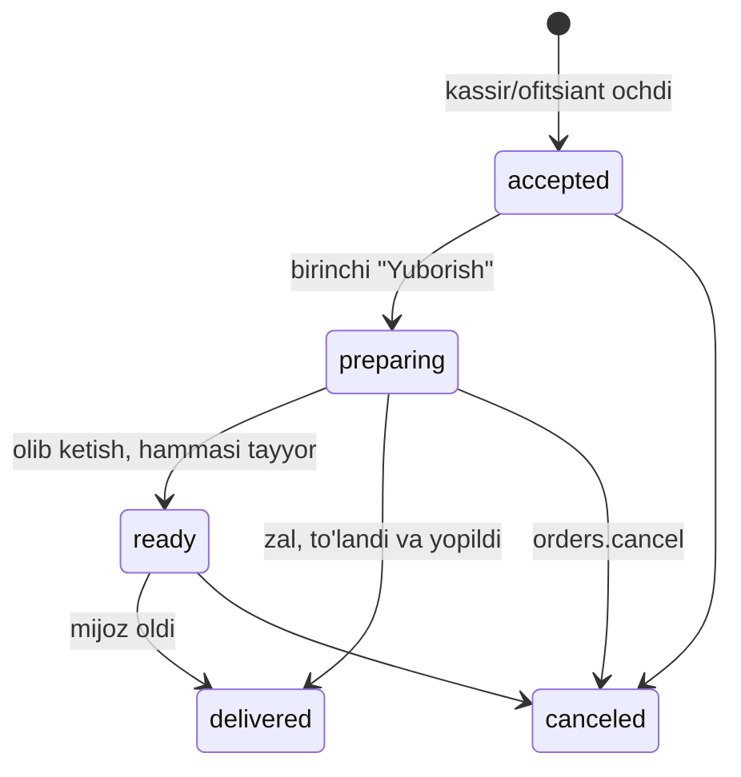
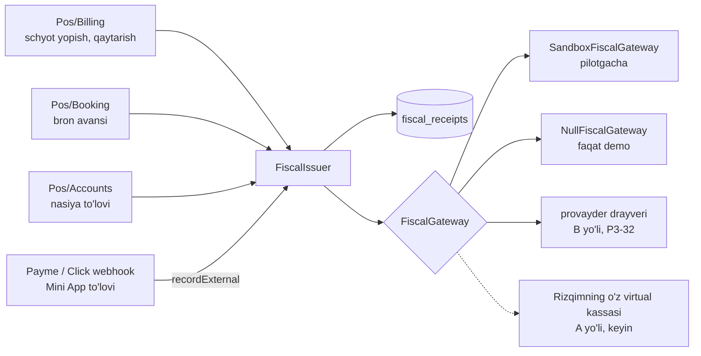
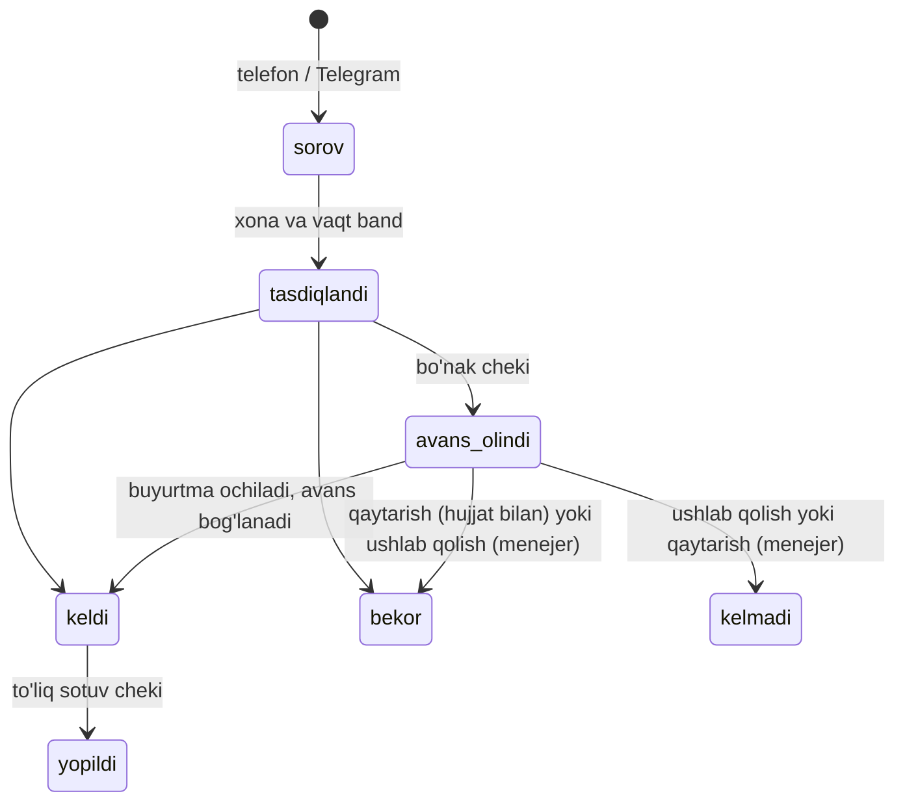

# POS spetsifikatsiyasi

> **Holati: tasdiqlangan (21.10.2026) — 3-bosqich shu hujjat asosida boradi.** Birinchi format — **choyxona** (egasi
> qarori); osh markazi uning ichki rejimi bo'lib qoladi. Ishlar tartibi va kodlari (`P3-11` va h.k.):
> [PHASE3_PLAN.md](PHASE3_PLAN.md). Hujjatda: umumiy yadro (2-bo'lim), fiskal qatlam (4), choyxona profili (6), keyingi
> formatlar profillari (7–8), ma'lumotlar modeli (10) va egasiga ochiq savollar (14). Qaror o'zgarsa, avval shu yerda
> yangilanadi.

Bog'liq hujjatlar: [PHASE3_PLAN.md](PHASE3_PLAN.md), [ROADMAP.md](ROADMAP.md) (3-bosqich),
[ARCHITECTURE.md](ARCHITECTURE.md), [API.md](API.md), [AUTH.md](AUTH.md) (terminal, PIN, ruxsatlar),
[MENU.md](MENU.md) (modifikator, kg, qozon, stop-list, xizmat haqi), [BILLING.md](BILLING.md) (terminal obunasi).
Tadqiqotlar:
[Choyxona ishlashi va POS talablari](research/reports/Choyxona%20ishlashi%20va%20POS%20talablari.md) (R1–R32 talablari,
T1–T9 tekshiruv nuqtalari),
[Ovqatlanish formatlari POS talablari](research/reports/Ovqatlanish%20formatlari%20POS%20talablari.md) (VM 393 va fiskal),
[Ovqatlanish tarmoqlari uchun POS talablari](research/reports/Ovqatlanish%20tarmoqlari%20uchun%20POS%20talablari.md).

## 0. Qabul qilingan qarorlar (qayta ko'rilmaydi)

| Mavzu | Qaror |
|---|---|
| Birinchi format | **Choyxona** (egasi qarori, 21.10.2026): bronsiz stol yoki tapchan, xona sessiyasi va oldindan buyurtma — uchta rejim bitta ekranda (6-bo'lim). Osh markazi choyxona ichidagi rejim |
| Fiskal chek | **v1 dan integratsiyalangan fiskal chek.** Rizqim POS chekni o'zi chiqaradi (fiskal qatlam orqali), restoranning alohida kassasiga tayanmaydi. Chek turlari: **sotuv, qaytarish, bo'nak** (avans) va **kredit** (nasiya). Fiskal yo'l — provayder orqali (B) yoki Rizqimning o'z virtual kassasi (A) — keyin tanlanadi; kod ikkalasiga ham tayyor. Provayder tanlanguncha **sandbox drayver** ishlaydi. Fiskalsiz drayver (`NullFiscalGateway`) faqat demo uchun. Rizqim chek chiqaradigan joyda eski kassa o'sha sotuvga chek chiqarmaydi (**ikki marta hisoblashdan himoya**). Batafsil 4-bo'lim |
| Yuridik xavf | VM 393-son qarori umumiy ovqatlanishda soliq organlari tizimi bilan integratsiya qilinmagan hisob va buyurtma dasturlarini taqiqlaydi; **22.10.2026 dan kuchda**. Jarima — oxirgi chorak sof tushumining 2%, takrorlansa 20%. "Integratsiya" ta'rifi va provayder orqali ulanish yetarliligi rasman tushuntirilmagan (T8). Egasi yozma so'rov yubormaslikka qaror qildi. Shuning uchun **real tushum bilan pilot faqat haqiqiy fiskal drayver bilan** (P3-32); sandbox drayverda faqat sinov ma'lumoti |
| To'lov va chek turlari | Har bir POS to'lovi chekdagi to'lov shakliga bog'lanadi: naqd, karta, QR yoki aralash. POS to'lov turlari (`PosTender`): `cash`, `card`, `qr`, `prepayment` (bron avansini ayirish), `account` (nasiyaga yopish). Karta to'lovida karta turi va tranzaksiya raqami majburiy |
| P2P o'tkazma | Shaxsiy kartaga o'tkazma (P2P) **to'lov turi emas** (soliq xavfi). Kassir ekranida uning o'rniga QR taklif qilinadi; dinamik UzQR provayderga bog'liq |
| Mini App to'lovlari | Payme yoki Click bilan to'langan Mini App buyurtmasining chekini to'lov tizimi chiqaradi, restoran STIRi komitent sifatida (P3-14). Natija `fiscal_receipts` ga yoziladi |
| Internetsiz ishlash | To'liq offline yo'q. Faqat **qisqa uzilishga chidaydigan cheklangan rejim** (5-bo'lim). Offlayn cheklar navbatda turadi; 48 soatlik chegaradan ancha oldin ogohlantirish |
| Bitta buyurtma modeli | POS buyurtmasi ham oddiy `orders` qatori (`channel = pos_hall` yoki `pos_takeaway`); oshxona, stop-list, hisobot va fiskal hamma kanal va rejim uchun bitta. Bron va oldindan buyurtma ham oxirida oddiy buyurtma bo'ladi |
| Stek | Flutter (bitta kod: Windows, Android planshet, Android POS terminal; iPad keyin), umumiy paketlar `pos/packages/*`, API klienti `packages/dart/rizqim_api` |
| Biznes mantiq | Faqat backend'da. Ilova narx, chegirma, xizmat haqi, xona puli va chek summasini o'zi hisoblamaydi (offline rejimdagi istisno 5-bo'limda). Fiskal qism alohida va kam o'zgaradigan modul: UI va menyu o'zgarishi unga tegmaydi |

## 1. Hozir kodda nima bor va nima yo'q

**Bor (1-bosqichda qurilgan):**

- Terminalni 8 belgili kod bilan ulash, terminal tokeni, xodimning PIN bilan kirishi va 12 soatlik sessiya, PIN
  bloklash ([AUTH.md](AUTH.md), 4–5-bo'lim). Oshxona ekrani skeleti (`pos/apps/kds`: ulash ekrani).
- Rollar `cashier`, `waiter`, `cook` va ruxsatlar, jumladan `pos.open_shift`, `pos.close_shift`, `pos.cash_in_out`,
  `pos.take_payment`, `pos.reprint_bill`, `tables.manage`, `kitchen.manage`, `orders.void_item`, `orders.discount`.
- `orders.channel` (`pos_hall`, `pos_takeaway`), `external_id`, `guests_count`, `hall_ref`, `table_ref`,
  `service_charge_amount`, `place_fee_amount`; `order_type = dine_in`.
- Menyu: modifikatorlar, kg/l va kasr miqdor, qozon/partiya qoldig'i, filial stop-listi va uning real-time tarqalishi,
  kanal narxi, xizmat haqi va joy narxi sozlamalari ([MENU.md](MENU.md)).
- `Idempotency-Key`, harakatlar jurnali (terminal bilan), terminal bo'yicha oylik obuna.

**Yo'q (shu spetsifikatsiya bo'yicha quriladi):**

- POS buyurtma endpointlari: hozir `POST /orders` faqat mijoz kanallari (`telegram`, `mobile`) uchun. ~~Kassir,
  ofitsiant, oshpaz buyurtmani ko'ra olmaydi~~ — **yopildi (P2-11)**, pastda 1.1.
- ~~Terminal va kassir/ofitsiant/oshpaz uchun real-time kanal~~ — **yopildi (P2-11)**, pastda 1.1.
- Zal va stollar, smena va kassa qutisi, schyot va hisobni bo'lish, POS to'lov turlari, printerlar va oshxona
  sexlari, qaytarish, offline navbat — jadvallar ham, API ham yo'q; 3-bosqichda quriladi (1.2, 10-bo'lim).
- Ilovalar: `pos/apps/cashier`, `waiter`, `customer_display` va `pos/packages/*` hali bo'sh.

### 1.1. 2-bosqichda yopilgan bo'shliqlar (P2-11)

- **Xodimlar buyurtmani ko'radi va oshxona ishini qiladi.** `GET /staff/orders` (filtrlar, kursor), `GET
  /staff/orders/{uuid}`, `POST /staff/orders/{uuid}/status` (rolga qarab), `GET /staff/kitchen/tickets`, taom qatorini
  "tayyor" deb belgilash va qaytarish (`order_items.kitchen_status`, `ready_at`). Oddiy kirish va terminaldagi PIN
  sessiyasi bilan ishlaydi; filial bo'yicha ajratilgan. Batafsil: [API.md](API.md), 9.1-bo'lim. Yangi buyurtma holati
  qo'shilmadi; 3-bo'limdagi qoida bajariladi (zal buyurtmasi hamma qator tayyor bo'lsa ham `preparing` da qoladi).
  12.1 dagi `/pos/*` endpointlari (buyurtma ochish, schyot, to'lov, smena) 3-bosqichda.
- **Filial real-time kanali.** `private-pos-branch.{branchId}` (12.2 dagi taklif): shu filialda `orders.view` bor xodim
  va shu filialning terminali (terminal tokeni bilan, `/api/broadcasting/auth` `auth:device` ni ham qabul qiladi).
  Hodisalar: `order.created`, `order.status_changed` (bekor qilish ham), `order.assigned`,
  `kitchen.item_status_changed`, `menu.availability_changed`; mazmuni faqat id va holat. `order.items_changed` va
  `shift.changed` 3-bosqichda.

2-bosqichda yopilgan bu ikki bo'shliq 3-bosqichda ham o'zgarmaydi: `/staff/*` endpointlari va javob shakllari qoladi
(Mini App, hamkor web va KDS ularga tayanadi), yangi POS endpointlari ular yonida qo'shiladi.

### 1.2. 3-bosqich nima qo'shadi

Ishlar va kodlari [PHASE3_PLAN.md](PHASE3_PLAN.md) da. Qisqacha:

- **Kontraktlar (P3-10, kodda bor).** `App\Domain\Fiscal`: `FiscalIssuer` (`issue`, `recordExternal`, `hasPending`),
  `FiscalLineBuilder` (`forOrderItem`, `forCharge`), `FiscalDocument`, `FiscalLine`, `FiscalPayment`,
  `FiscalReceiptType` (`sale`, `refund`, `advance`, `credit`), `FiscalPaymentForm` (`cash`, `card`, `qr`, `mixed`),
  `FiscalIssueResult`. `App\Domain\Pos\Contracts`: `PosTender`, `PosOrderOpener`, `KitchenStationResolver`,
  `AdvanceLedger`, `CustomerAccountLedger`, `ManagerApprovals`. Har bir ish shu nomlarga tayanadi.
- **Fiskal qatlam (P3-11):** to'rt chek turi, MXIK, birlik va QQS, `fiscal_receipts`, sandbox va null drayverlar,
  qayta yuborish navbati (4-bo'lim). Mini App to'lovlarida fiskal chek (P3-14).
- **Zal va xona hisobi (P3-12):** zallar va zonalar, xona, tapchan, stol; xona holatlari; bosqichma-bosqich buyurtma;
  xona puli, minimal summa, choy-non qoidasi; ko'chirish va birlashtirish.
- **POS sozlamalari (P3-13):** sexlar va yo'naltirish, printerlar, filial POS sozlamalari, `GET /pos/bootstrap`, POS
  katalogi.
- **Bron va nasiya (P3-17):** bron daftari, oldindan buyurtma, avans (bo'nak cheki bilan), mijoz hisoblari (nasiya,
  kredit cheklari).
- **Schyot va smena (P3-18):** schyot, bo'lish, to'lov, fiskal chek bilan yopish, qaytarish, smena, X/Z, menejer
  tasdig'i.
- **Ilovalar (to'lqin 2):** kassa (`pos/apps/cashier`), ofitsiant (`pos/apps/waiter`), KDS sexlari, web paneldagi POS
  sozlamalari; umumiy paketlar `pos_core`, `pos_hardware`, `pos_ui` (P3-15).
- **To'lqin 3:** internetsiz cheklangan rejim (`pos_sync`, P3-31), haqiqiy fiskal drayver (P3-32), e2e va pilot.

## 2. Umumiy yadro (barcha formatlar uchun)

### 2.1. Ilovalar

| Ilova | Kim | Qurilma | Vazifasi |
|---|---|---|---|
| **Kassa** (`cashier`) | kassir, menejer, ega | Windows monoblok, Android planshet, Sunmi turidagi terminal (iPad keyin) | zal xaritasi (xonalar), xona hisobi, buyurtma olish, barcha kanallar navbati, bron taqvimi, avans, schyot, to'lov, fiskal chek, nasiya, smena, kassa qutisi, hisobotlar |
| **Ofitsiant** (`waiter`) | ofitsiant | Android telefon (yoki planshet, qo'l terminali) | o'z xonalari va stollari, bosqich qo'shish, oshxonaga yuborish, schyot so'rash. Choyxonada **majburiy** (v1) |
| **Oshxona ekrani** (`kds`) | oshpaz, mangalchi | Android planshet yoki monitorli kompyuter | sex bo'yicha taomlar (osh, mangal, salat va bar, choy), oldindan buyurtmalar vaqt navbati, "tayyor" belgilash, qozon qoldig'i |
| **Mijoz ekrani** (`customer_display`) | — | kassaning ikkinchi ekrani (Sunmi D2, Windows ikkinchi monitor) yoki alohida planshet | joriy chek va summa; fast food'da "tayyor" raqamlar. **v1 ga kirmaydi** |

Kassa va ofitsiant bitta Flutter ilovasining ikki rejimi bo'lishi mumkin (umumiy kod `pos_core`, `pos_ui`); bu
texnik qaror, egasi uchun farqi yo'q.

### 2.2. Kirish va xodim almashtirish

1. Terminal bir marta ulanadi (panelda kod → terminalda kiritish). Terminal tokeni qurilmada xavfsiz saqlanadi.
2. Ish boshida xodim PIN (yoki `staff_code` + PIN) kiritadi. Ekran X daqiqa harakatsiz qolsa qulflanadi (sozlanadi),
   PIN bilan ochiladi. Boshqa xodim kirsa, oldingisining sessiyasi yopiladi.
3. Xavfli amalni (yuborilgandan keyin o'chirish, chegirma, qayta schyot va h.k.) huquqi yo'q xodim boshlasa, ilova
   **menejer PIN'ini** so'raydi: shu terminalda menejer o'z PIN'ini kiritadi, server bir martalik tasdiq beradi, jurnalga
   ikkalasi ham yoziladi (kim so'radi, kim tasdiqladi).

### 2.3. Smena va kassa qutisi

- **Smena** — bitta kassa (terminal) uchun ish davri. Ochishda boshlang'ich naqd kiritiladi (`pos.open_shift`).
- Smena davomida: naqd sotuv, qaytarish, **kassaga kirim/chiqim** (`pos.cash_in_out`) kategoriya va izoh bilan.
  Choyxona kategoriyalari: bozorlik, ish haqi, xodimga berilgan pul (avans). Xodimga berilgan pul xodimga bog'lanadi
  (kassa kamomadi "ish haqi" deb tushuntirilmasligi uchun).
- **X-hisobot** — smenani yopmasdan oraliq hisobot: to'lov turlari bo'yicha, kanal bo'yicha, chegirma, o'chirish,
  qaytarish, kirim/chiqim, kutilayotgan naqd. Avans ofseti (`prepayment`) va nasiyaga yopilgan summa (`account`)
  **alohida** qatorda: ular bugun kassaga tushgan pul emas.
- **Yopish (Z)** (`pos.close_shift`): kassir naqdni kupyura bo'yicha sanaydi, tizim kutilgan summa bilan solishtiradi,
  farq yoziladi. Ochiq buyurtma (xona, stol) qolsa smena yopilmaydi; menejer ularni boshqa smenaga o'tkazishi yoki
  majburan yopishi mumkin (sabab bilan). **Fiskal kutayotgan chek** (4.5) yoki offline'da kutib turgan amallar bo'lsa
  ham yopilmaydi (5-bo'lim).
- **Biznes kun** — kalendar kunidan alohida (standart 05:00 dan 05:00 gacha, `branches.business_day_starts_at`),
  yarim tundan o'tadigan smenalar uchun. Hisobotlar va navbat raqami biznes kun bo'yicha.
- Z-hisobot egaga Telegram'ga (va push'ga) qisqa xulosa bilan yuboriladi.

### 2.4. Zallar va stollar

- Filialda bir nechta **zal** yoki **zona** (ichki zal, hovli, yozgi zona, VIP). Mavsumiy zona (yozgi, suv bo'yidagi
  so'rilar) mavsum tugaganda o'chiriladi (`is_active`) va xaritadan yo'qoladi, tarixi saqlanadi.
- Zalda **stol**lar: nomi/raqami, o'rinlar soni, turi (`table` — stol, `room` — xona yoki kabinka, `tapchan`),
  xaritadagi joyi.
- **Holatlar** (xaritada rang bilan): bo'sh; band (ochiq buyurtma bor); bron kutilmoqda (yaqin vaqtga bron bor);
  schyot chiqdi; N soatdan uzoq ochiq (chegara sozlanadi). To'langan stol darhol bo'shaydi.
- **Xona tarifi.** Xonaga yoki xona turiga (oddiy, katta, billiard xona) tarif bog'lanadi: kun turi bo'yicha narx
  (hafta ichi, dam olish, bayram), nol ham bo'lishi mumkin (`room_tariffs`, 2.7). Xonada minimal summa ham bo'lishi
  mumkin.
- Stolda bir yoki bir nechta ochiq buyurtma bo'lishi mumkin. Stolni yoki xonani **ko'chirish** va **birlashtirish**
  (`tables.manage`); stolni boshqa ofitsiantga o'tkazish — menejer. Bronda bir nechta xona banket uchun birlashtiriladi.
- Zal yoki zona xizmat haqi va joy narxini o'zgartira oladi (masalan, VIP yoki kabinkada boshqa foiz, o'z-o'ziga xizmat
  zonasida 0%; `service_fee_settings.hall_id`).
- Stolsiz rejim (choyxonaning bronsiz kassasi, osh markazi, fast food) uchun zal ishlatilmaydi, buyurtma "olib ketish"
  yoki "zalda, stolsiz" bo'ladi.

### 2.5. Barcha kanallardan bitta navbat

Kassa ekranida bitta ro'yxat: POS buyurtmalari, Telegram Mini App, mobil ilova va (keyinchalik) agregatorlar. Har
birida kanal belgisi, turi (zal, olib ketish, yetkazish), holati va vaqti.

- Telegram/mobil buyurtma `new` holatda kelsa, kassir uni **qabul qiladi** yoki **rad etadi** (`orders.manage`;
  rad etish va bekor qilish `orders.cancel`). Click/Payme bilan to'langan buyurtma server tomonidan avtomatik
  `accepted` bo'ladi.
- Qabul qilingan onlayn buyurtmaning oshxona markasi filialning "chop etuvchi" kassasidan (2.11) avtomatik chiqadi va
  KDS'da paydo bo'ladi.
- Yangi onlayn buyurtma kelganda ovoz va belgi. Qabul qilinmagan buyurtma N daqiqadan oshsa, ogohlantirish.
- Agregator buyurtmasini qo'lda kiritish: kanal `aggregator`, tashqi raqam (`external_id`) majburiy.

### 2.6. Buyurtma tuzish

- Menyu: kategoriyalar, katta tugmalar, qidiruv, "tez-tez sotiladigan" panel. Narxlar **kanal narxi** bo'yicha
  (`channel_prices`: `pos_hall`, `pos_takeaway` uchun alohida narx yoki yashirish).
- **Modifikatorlar:** majburiy/ixtiyoriy guruhlar, min/max, narx qo'shimchasi — mavjud qoidalar
  ([MENU.md](MENU.md), 1-bo'lim).
- **Vazn va kasr:** kg/l taomlar uchun raqam klaviaturasi (`0.5`, `1.2`), qadam va minimal miqdor; donali taom butun.
  Kasr porsiya (1 / 0.75 / 0.7 / 0.5 / 2) — alohida variantlar, qozondan `batch_consumption` bo'yicha oladi. Tarozi
  integratsiyasi — keyinroq.
- **Birlik yorlig'i.** Choyxonada "1 kg osh" ko'pincha 1 kg guruchdan pishgan osh, osh markazida esa tayyor oshning
  og'irligi. Shuning uchun variantda yorliq bor: "kg (guruch)" yoki "kg (tayyor)" (`product_variants.unit_label`); u
  ekranda, schyotda va chekda ko'rinadi. Sifat darajalari (lazer, devzira; oddiy, birga-bir, sergo'sht), N kishilik set
  va lagan — variantlar.
- **"Xizmat" turidagi mahsulot** (`products.kind = service`): oshpaz xizmati, osh damlash (mijoz mahsulotidan), qozon
  yoki oshxona ijarasi, banket zali. Zaxiradan va qozondan ayirmaydi, oshxonaga marka chiqarmaydi (sozlanadi), MXIK
  xizmat guruhidan (4.3). Mijozning o'z mahsuloti chekka kirmaydi.
- **Choy va non** markasiz beriladi va ko'pincha hisobsiz qoladi. Shuning uchun: ekranda choy va non uchun **tez
  tugmalar**; yoki filial sozlasa, mehmon soniga qarab **avtomatik "choy-non" qatori** (`auto_guest_items`, 2.7).
- **Bosqichlar.** Xona hisobiga taom bir necha marta qo'shiladi (choy → salat va six → osh → yana choy). Har bir
  qo'shish — bosqich (`round_no`), vaqti va kim qo'shgani bilan.
- **Qozon/partiya:** qozon bo'yicha sotiladigan taomda qolgan porsiya katta raqam bilan ko'rinadi; tugasa taom
  "tugadi" bo'ladi va Telegram menyusida ham darhol yopiladi (mavjud mexanizm).
- **Stop-list:** "tugadi" belgisi va sababi ko'rinadi; tanlab bo'lmaydi.
- **Fiskal rejimda** MXIK kodi yo'q taom yoki xizmat sotilmaydi (4.3).
- Har bir qatorga izoh ("piyozsiz"), mehmon raqami (hisobni bo'lish uchun), **"hozir yuborish" yoki "ushlab turish"**
  (kurs: keyinroq yuborish; oldindan buyurtma qatori muddati bilan ushlab turiladi).
- Mehmonlar soni (xona puli yoki minimal summa "kishi boshiga" bo'lsa, choy-non avtomatik qatori bo'lsa majburiy).

### 2.7. Xona puli, minimal summa, xizmat haqi va joy narxi

- Mavjud sozlamalar (`service_fee_settings`): xizmat haqi foizi (0–30) va joy narxi (kishi boshiga yoki stol uchun),
  kanallar bo'yicha (standart faqat `pos_hall`). Telegram buyurtmalariga hech qachon qo'llanmaydi. 3-bosqichda zal
  bo'yicha almashtirish qo'shiladi (`hall_id`).
- **Xona puli** xona tarifidan olinadi (`room_tariffs`: xona yoki xona turi × kun turi — hafta ichi, dam olish,
  bayram). Nol bo'lishi mumkin; kishi boshiga model ham qoladi (mavjud `per_person`). Xona hisobi ochilganda **avtomatik
  qator** bo'lib qo'shiladi (`orders.room_fee_amount`). Soatbay xona tarifi va taymer — keyin (R5).
- **Minimal summa** ("obyazalovka") — xona uchun yoki kishi boshiga (`dining_tables.min_spend`, `min_spend_mode`).
  Taomlar yetmasa, schyotda **farq qatori** chiqadi (`orders.min_spend_topup_amount`). Uni olib tashlash faqat menejer
  PIN'i bilan.
- **Choy-non kishi boshiga.** Filial sozlasa, mehmon soniga qarab avtomatik qator (`auto_guest_items`): masalan, har
  mehmonga choy va non. Mehmon soni o'zgarsa qator ham o'zgaradi.
- **Oldindan e'lon qilinadi.** Xizmat haqi, xona puli va minimal summa menyuda, e'londa va **bron tasdig'i matnida**
  aniq summasi yoki foizi bilan aytiladi (Raqobat qo'mitasi talabi: oldindan e'lon qilish, majburlamaslik, ko'rsatilmagan
  xizmat uchun pul olmaslik).
- Schyotda va chekda har biri **alohida qator**, chekda o'z MXIK kodi bilan (4.3); schyot pastida "Xizmat haqi X%"
  yozuvi.
- Mehmon e'tiroz bildirsa, xizmat haqi yoki xona puli sabab bilan olib tashlanadi (`orders.discount`, jurnalga
  yoziladi, egaga ogohlantirish).
- Choy puli (ofitsiantga) — tushum emas, xizmat haqidan **alohida** maydon (ofitsiant hisobotida ko'rinadi, 2.13).

### 2.8. Oshxonaga yuborish, KDS, marka

- "Yuborish" bosilganda yuborilmagan qatorlar **sexlar** bo'yicha (oshxona, bar, osh tarqatish va h.k.) bo'linadi:
  har bir sexning **printeriga marka** chiqadi va/yoki **KDS ekraniga** tushadi. Qaysi taom qaysi sexga —
  kategoriya yoki taom bo'yicha sozlanadi.
- Markada: buyurtma/stol raqami, ofitsiant, vaqt, taomlar, modifikatorlar, izohlar, kurs.
- Yuborilgan taom o'chirilsa — o'sha sexga **"O'CHIRILDI"** markasi chiqadi va KDS'da qizil belgi.
- KDS: har bir qator `yuborildi → tayyor → berildi`; oshpaz "tayyor"ni qator yoki butun buyurtma bo'yicha bosadi
  (`kitchen.manage`); xato bosilgan "tayyor"ni qaytarish (recall). Kutish vaqti rang bilan (sariq/qizil chegaralar
  sozlanadi). Qozon qoldig'i paneli (`batches.manage`).
- Barcha kanallardan kelgan buyurtmalar (Telegram ham) KDS'da bitta oqimda, kanal belgisi bilan.
- Muddatli qatorlar (oldindan buyurtma, `due_at`) oshxonaga mehmon kelganda emas, muddatidan oldin, KDS'dagi alohida
  vaqt navbatida chiqadi (6.4).

### 2.9. Schyot, hisobni bo'lish, to'lov

- **Schyot (pre-check)**: mehmonga beriladigan, fiskal bo'lmagan oldindan hisob. Unda taomlar, xona puli, minimal
  summa farqi, xizmat haqi va joy narxi alohida qatorlarda, chegirma, olingan avans, to'lanadigan qoldiq, jami,
  **kishi boshiga summa** (jami ÷ mehmonlar soni) va **"Bu fiskal chek emas"** yozuvi.
- Birinchi schyot chiqqandan keyin buyurtma **qulflanadi**: taom qo'shish mumkin (yangi schyot kerak bo'ladi), lekin
  o'chirish va chegirma faqat menejer tasdig'i bilan. Schyotni qayta chiqarish — `pos.reprint_bill`, "NUSXA" belgisi
  bilan.
- **Hisobni bo'lish:** (a) taom bo'yicha (qatorlarni bir nechta schyotga taqsimlash, kasr miqdor ham), (b) mehmon
  bo'yicha (qatordagi mehmon raqami), (c) teng N ulushga (qoldiq tiyin birinchi schyotga). Xona puli, xizmat haqi va
  joy narxi schyotlar orasida proporsional bo'linadi. Har bir schyot alohida to'lanadi va **har biri alohida sotuv
  cheki** oladi.
- **To'lov** (`pos.take_payment`): bitta schyotga bir nechta to'lov turi (aralash; chekda to'lov shakli "aralash"):
  - **naqd** (`cash`) — berilgan summa va qaytim hisoblanadi;
  - **karta** (`card`) — bankning **alohida** terminali, kassir summani o'zi teradi va "to'landi"ni tasdiqlaydi. Karta
    turi va terminal tranzaksiya raqami **majburiy** (chek rekvizitlari talabi);
  - **QR** (`qr`) — **dinamik UzQR** (schyot summasiga QR, avtomatik tasdiq va fiskal chek) provayder orqali, imkon
    bo'lsa P3-32 da; ungacha **statik QR** — kassir qo'lda tasdiqlaydi;
  - **avans** (`prepayment`) — bron avansidan ayirish (`AdvanceLedger`). Yopishda avtomatik taklif qilinadi. Sotuv cheki
    baribir **to'liq summaga** chiqadi, avans qismi unda "oldindan to'langan" deb belgilanadi (4.4);
  - **nasiyaga yopish** (`account`) — telefon bilan aniqlangan mijoz yoki guruh hisobiga, limit ichida, har doim
    menejer tasdig'i bilan (`CustomerAccountLedger`). Kassaga pul tushmaydi. Sotuv cheki to'liq summaga chiqadi, qarz
    to'langanda kredit cheki (4.4).
  - **P2P o'tkazma to'lov turi emas** (0-bo'lim); kassir ekranida o'rniga QR taklif qilinadi.
  Bank terminaliga summani avtomatik yuborish — keyingi bosqich (ochiq protokol yo'q).
- **Chek chiqmaguncha sotuv yopilmaydi.** Schyot to'langach backend sotuv chekini so'raydi (`FiscalIssuer`). Provayder
  javob bermasa, buyurtma **"fiskal kutmoqda"** holatida qoladi, chek navbatda qayta yuboriladi (4.5).
- Hamma schyot to'langan va cheklari chiqqan bo'lsa, buyurtma **yopiladi**: holati `delivered`, `payment_status =
  paid`, stol bo'shaydi.
- POS to'lovlari doim do'konga tushadi (`payment_owner = STORE`); platforma hisob-kitobi (settlement) yo'q.
  POS kanallaridan komissiya olinmaydi (tarif obuna orqali) — egasi tasdiqlaydi (14-bo'lim).

### 2.10. Bekor qilish, o'chirish, chegirma, qaytarish

| Amal | Shart | Ruxsat |
|---|---|---|
| Oshxonaga **yuborilmagan** qatorni o'chirish | — | `orders.manage` |
| **Yuborilgan** qatorni o'chirish | sabab majburiy, "O'CHIRILDI" markasi | `orders.void_item` (yo'q bo'lsa menejer PIN) |
| Butun buyurtmani bekor qilish | sabab majburiy; to'lov bo'lsa avval qaytarish | `orders.cancel` |
| Chegirma (summa yoki %) / xizmat haqini olib tashlash | sabab majburiy | `orders.discount` |
| Xona puli yoki minimal summa farqini olib tashlash | sabab majburiy | `orders.discount` (yo'q bo'lsa menejer PIN) |
| Schyotni qayta chiqarish | "NUSXA" belgisi | `pos.reprint_bill` |
| Yopilgan buyurtma bo'yicha pul qaytarish (smena ichida, naqd yoki karta) | sabab, qaysi to'lovdan; **qaytarish cheki** asl sotuv chekiga bog'lanadi | **yangi** `pos.refund` (P3-18) |
| To'langan buyurtmani bekor qilish | faqat qaytarish cheki bilan | `orders.cancel` + `pos.refund` |
| Bron avansini qaytarish (bron bekor) | sabab; hujjatlar: ariza, shaxsni tasdiqlovchi hujjat nusxasi, qaytarish dalolatnomasi, naqd bo'lsa chiqim orderi, asl bo'nak cheki. Chek chiqmaydi (4.4) | `bookings.manage` |
| Bron avansini ushlab qolish (mehmon kelmadi yoki kech bekor qildi) | sabab; menejer tasdig'i; chek turi buxgalter bilan tekshiriladi (T3) | `bookings.manage` + menejer tasdig'i |
| Onlayn to'langan / yetkazilgan buyurtmani platforma hisobida qaytarish | mavjud tartib | `orders.refund` (faqat superadmin, o'zgarmaydi) |

Hammasi harakatlar jurnaliga (kim, qaysi terminal, kim tasdiqladi, sabab, summa). Egaga Telegram/push ogohlantirishi:
yuborilgandan keyingi o'chirish, X% dan katta chegirma, buyurtmani bekor qilish, qaytarish, avansni ushlab qolish,
nasiyaga yopish, xona puli yoki xizmat haqini olib tashlash, choy va nonsiz yopilgan xona, N soatdan ko'p ochiq xona
yoki stol (chegaralar sozlanadi).

### 2.11. Chop etish

- Printerlar: 80 mm (yoki 58 mm) ESC/POS — LAN (Wi-Fi/Ethernet), USB (Windows), Sunmi ichki printeri.
- Hujjatlar: oshxona/bar/mangal markasi (mangalda six soni va turi), "O'CHIRILDI" markasi, schyot, **fiskal chek**
  (sotuv va qaytarish chekida fiskal belgi va QR; bo'nak va kredit cheklarida ular yo'q), smena X/Z hisoboti, navbat
  raqami talonchasi (fast food). Chek qog'ozi eni kamida 55 mm (58 yoki 80 mm printer mos), chek matni asosan davlat
  tilida.
- **"Bu fiskal chek emas"** yozuvi faqat schyotda (pre-check). To'lovdan keyin chop etiladigan chek — fiskal chekning
  o'zi; alohida fiskal bo'lmagan to'lov kvitansiyasi chiqmaydi.
- **Chop etishni qurilmaning o'zi bajaradi** (LAN yoki USB orqali), server emas: shunda internet uzilganda ham
  marka chiqadi.
- Har bir filialda bitta kassa **"chop etuvchi"** deb belgilanadi: u onlayn kanallardan qabul qilingan buyurtmalar
  markasini chiqaradi. U o'chiq bo'lsa, onlayn buyurtmalar faqat KDS'da ko'rinadi (ogohlantirish bilan).
- Kassa qutisi printer orqali ochiladi (naqd to'lov va kirim/chiqimda).
- Matn kodlash muammosi bo'lsa (printer shriftlari), matn rasm sifatida chop etiladi.

### 2.12. Qurilmalar

| Qurilma | Nima bilan ishlaydi | Eslatma |
|---|---|---|
| Windows monoblok | USB va LAN printer, printer orqali kassa qutisi, ikkinchi monitor — mijoz ekrani | bozorda eng ko'p; elektr o'chsa UPS kerak |
| Android planshet | LAN (va Bluetooth) printer | batareya bilan uzilishga chidamli; ofitsiant va KDS uchun ham |
| Sunmi turidagi Android terminal (Sunmi, PAX, iMin) | ichki printer (ishlab chiqaruvchi SDK), D2 turida ikkinchi ekran | qo'l terminali ofitsiantga ham mos |
| iPad | faqat LAN printer (USB yo'q) | eng past ustuvorlik; v1 ga kirmaydi |

Uskunaga bog'liq kod faqat `pos_hardware` paketida (drayverlar: ESC/POS LAN, ESC/POS USB Windows, Sunmi). Skaner va
tarozi — keyinroq. Pilot uchun tavsiya: Android planshet yoki Sunmi + bitta LAN printer (arzon, batareyali) va ofitsiantlar uchun 1–2
Android telefon.

### 2.13. Hisobotlar (v1)

- Smena X/Z (2.3); kunlik xulosa egaga Telegram'ga: tushum to'lov turi va kanal bo'yicha, o'rtacha chek, chegirma,
  o'chirish, qaytarish, kassa farqi, avans va nasiya alohida.
- **Ofitsiant bo'yicha sotuv**: har bir qator va hisob ofitsiantga biriktiriladi; hisobotda "sotuv × foiz" va "garant"
  (kafolatlangan summa) — ofitsiantlarga o'z sotuvidan foiz to'lanadigan joylar uchun; choy puli alohida.
- **Nasiya qarzdorlari**: mijoz yoki guruh, qarz, oxirgi to'lov, limit.
- **Avans qoldiqlari**: olingan, lekin hali ayirilmagan, qaytarilmagan yoki ushlab qolinmagan avanslar.
- **Choy va non nisbati**: sotilgan choynak va non soni mehmonlar soniga nisbatan (hisobsiz berilganini ko'rish uchun).
- Fiskal cheklar: chek turi va holati bo'yicha, "fiskal kutmoqda" va xatolar.
- Istisnolar jurnali (o'chirish, chegirma, bekor qilish, xona puli va xizmat haqini olib tashlash); qozon bo'yicha
  sotilgan porsiya.
- Mavjud ega analitikasi (`GET /owner/analytics`) kanal bo'yicha (`by_channel`) POS'ni ham ko'rsatadi.

## 3. Buyurtma holatlari POS'da

Yangi holat qo'shilmaydi, mavjud `OrderStatus` ishlatiladi. Oshxona bosqichlari **qator darajasida** (yangi maydon,
10-bo'lim) kuzatiladi.

| Holat | POS'da ma'nosi |
|---|---|
| `accepted` | xodim buyurtma ochdi (POS buyurtmasi qabul qilish bosqichisiz shu holatda yaratiladi) |
| `preparing` | kamida bitta qator oshxonaga yuborilgan; zal stoli yopilguncha shu holatda qoladi (yangi qatorlar qo'shilsa ham) |
| `ready` | olib ketish/fast food: hamma qator tayyor, mijoz chaqiriladi |
| `delivered` | hammasi to'langan va buyurtma yopilgan (stol bo'shadi / mijoz oldi) |
| `canceled` | bekor qilindi (sabab bilan) |

Onlayn buyurtmalar (Telegram, mobil) avvalgidek `new` dan boshlanadi.

- **"Fiskal kutmoqda"** yangi `OrderStatus` emas. Bu — to'langan, lekin sotuv cheki hali tasdiqlanmagan buyurtma:
  u `delivered` ga o'tmaydi, kassada alohida ro'yxatda turadi va chek chiqqach yopiladi (4.5).
- **Bron** o'z holatlariga ega (6.1) va buyurtma emas. "Keldi" bosilganda oddiy POS buyurtmasi `accepted` holatida
  ochiladi (`PosOrderOpener`), oldindan buyurtma qatorlari "ushlab turish"da va muddati bilan qo'shiladi.

## 4. Fiskal: v1 dan, provayderga bog'liq bo'lmagan qatlam

### 4.1. Nega v1 dan

- **VM 393** (943-son qarorga o'zgartirish) **22.10.2026 dan** umumiy ovqatlanishda soliq organlari tizimi bilan
  integratsiya qilinmagan hisob va buyurtma dasturlarini taqiqlaydi. Avvalgi "fiskalsiz v1" qarori (POS buyurtmani
  yuritadi, chekni restoranning alohida kassasi chiqaradi) aynan shu taqiqlangan holat. Jarimani restoran to'laydi:
  oxirgi chorak sof tushumining 2%, takrorlansa 20%.
- Choyxonaga sotuv chekidan tashqari **bo'nak** (bron avansi) va **kredit** (nasiya) cheklari kerak. 943-son qaror
  chekdagi to'lov turlarini sanaydi: sotuv, qaytarish, bo'nak, bo'lib to'lash, kredit. To'lov shakli: naqd, bank
  kartasi, QR yoki aralash. Chekda MXIK, birlik, miqdor, narx, QQS stavkasi va summasi, karta turi, to'lov shakli va
  to'lov turi bo'ladi.
- Shuning uchun fiskal qatlam v1 ning bir qismi. Qaysi yo'l bilan ulanishi (4.8) hali tanlanmagan, lekin kod ikkala
  yo'lga bir xil tayyorlanadi.

### 4.2. Qatlam tuzilishi

Backend'dagi hamma joy chekni bitta kirish nuqtasi orqali so'raydi — `App\Domain\Fiscal\FiscalIssuer`. Provayder bilan
to'g'ridan-to'g'ri hech kim gaplashmaydi.

| Qism | Vazifasi |
|---|---|
| `FiscalIssuer` | Yagona kirish nuqtasi. `issue(FiscalDocument)` — chekni ro'yxatdan o'tkazadi yoki shu idempotentlik kaliti bilan avval chiqqan chekni qaytaradi. `recordExternal(...)` — to'lov tizimi o'zi chiqargan chekni yozadi (Payme `SetFiscalData`, Click fiskal ma'lumoti). `hasPending(...)` — chek hali provayder javobini kutyaptimi (smena yopilishini to'xtatadi) |
| `FiscalLineBuilder` | POS qatoridan chek qatorini quradi: `forOrderItem` (taom yoki uning bo'lingan ulushi), `forCharge` (`room_fee`, `place_fee`, `min_spend_topup`, `service_charge`, `deposit`, `booking_fee`, `credit`, `delivery`). MXIK, birlik va QQS menyudan va do'kon soliq rejimidan olinadi. Fiskal rejim o'chiq do'konda MXIK'siz qator ham quriladi (chek `non_fiscal`), fiskal rejimda MXIK majburiy |
| `FiscalDocument` | Provayderdan mustaqil chek: tur (`FiscalReceiptType`: `sale`, `refund`, `advance`, `credit`), do'kon, filial, terminal, qatorlar, to'lovlar, jami, idempotentlik kaliti, asl chek (qaytarish uchun), mavzu (buyurtma, schyot, bron to'lovi, nasiya yozuvi) |
| `FiscalLine` | Chek qatori: nom, MXIK, qadoq kodi, birlik, miqdor, narx, summa, QQS stavkasi va summasi, komitent STIRi, markirovka kodi |
| `FiscalPayment` | To'lov: shakl (`FiscalPaymentForm`: `cash`, `card`, `qr`, `mixed`), summa, karta turi, tranzaksiya raqami; `prepayment` belgisi — avval bo'nak cheki bilan olingan avans qismi (bugun olingan pul emas); `credit` belgisi — nasiyaga sotilgan qism (pul keyin kredit cheklari bilan keladi). Ikkalasi ham faqat sotuv chekida va bitta to'lovda bittasi |
| `FiscalIssueResult` | Natija: chek `uuid`'i, holat (`issued` yoki kutilmoqda), fiskal belgi, QR havola, xato |
| `FiscalGateway` (drayver) | Provayderga xos qism. `SandboxFiscalGateway` provayderga o'xshab ishlaydi (fiskal belgi, QR, xato va kechikishlar ham) — pilotgacha shu. `NullFiscalGateway` — faqat demo. Haqiqiy provayder drayveri — P3-32. Qaysi drayver ishlashi do'kon sozlamasida (`stores.fiscal_settings`) |

Fiskal qism **alohida va kam o'zgaradi**: virtual kassada fiskal qismdagi har o'zgarish qayta ekspertiza talab qiladi.
UI, menyu va POS oqimidagi o'zgarishlar `App\Domain\Fiscal` ga tegmasligi kerak.

### 4.3. Fiskal ma'lumot: MXIK, birlik, QQS, soliq rejimi

- **Mahsulotda** (P3-11): `kind` (`dish` yoki `service`), `mxik_code`, `package_code`, `vat_rate` (bo'sh bo'lsa do'kon
  standarti); variantda `unit_label`. Chekdagi nom menyudagi nom bilan bir xil bo'ladi.
- **Do'konda**: `tin` (STIR), `tax_regime` — `vat` (QQS 12%), `vat_simplified` (soddalashtirilgan, QQS 6%; ixtiyoriy,
  2030-yil 1-yanvargacha), `turnover` (aylanma soliq — chekda QQS yo'q). Rejim oy boshidan almashadi.
  `fiscal_settings`: drayver, yoqilganmi, menyuda bo'lmagan qatorlar (xona puli, joy narxi, minimal summa farqi, xizmat
  haqi, avans) uchun MXIK kodlari va birliklar.
- **QQS narx ichida**: QQS = summa × stavka / (100 + stavka), tiyingacha yaxlitlanadi. Misol: 4 480 000 so'mlik chekda
  12% QQS — 480 000.
- **Fiskal rejimda MXIK'siz taom yoki xizmat sotilmaydi.** Web panelda MXIK, birlik va QQS ommaviy tahrirlanadi
  (P3-23).
- Taklif qilingan MXIK bog'lanishi (tadqiqotdan; go-live'dan oldin tasnif.soliq.uz va buxgalter bilan tekshiriladi, T1):

| Tushum qatori | Guruh yoki kod |
|---|---|
| Choy, non, osh, shashlik va boshqa taomlar | 10202001 (taomnoma) guruhidagi sinflar |
| N kishilik set | 10202001002000000, birlik "dona (to'plam)" — tekshiriladi |
| Bron xizmati (alohida haq olinsa), ushlab qolingan avans | 10202002003000002 "boshqa bron va joy band qilish xizmatlari" |
| Avans | bo'nak cheki; qator kodi 10202002004000001 (majburiy depozit uchun oldindan to'lov) yoki bron kodi |
| Xona puli, joy narxi, xizmat haqi | 10202002 guruhi, aniq kod noma'lum |
| Oshpaz xizmati, qozon yoki oshxona ijarasi, banket | 10202002 yoki 10202003, aniq kod noma'lum |

### 4.4. Chek turlari va ketma-ketliklar

| Chek | `FiscalReceiptType` | Qachon | Qaysi qism chaqiradi | QR va fiskal belgi |
|---|---|---|---|---|
| Sotuv | `sale` | schyot to'langanda — har bir bo'lingan schyotga alohida; nasiyaga yopilgan schyot ham **to'liq summaga** | `Pos/Billing` (P3-18) | bor |
| Qaytarish | `refund` | smena ichida pul qaytarilganda; asl sotuv chekiga bog'lanadi | `Pos/Billing` | bor |
| Bo'nak | `advance` | bron avansi olinganda | `Pos/Booking` (P3-17) | yo'q |
| Kredit | `credit` | nasiya qarzi to'langanda, har bir to'lovga alohida | `Pos/Accounts` (P3-17) | yo'q |

**Bron avansi: bo'nak → sotuv.** Avans olinganda olingan summaga bo'nak cheki chiqadi (u soliq hisobotiga tushmaydi).
Yopishda **to'liq summaga** sotuv cheki chiqadi, avans uning to'lov qismida "oldindan to'langan" bo'ladi. Shuning uchun
ikki marta hisoblanish yo'q. Misol: 12 kishilik guruh payshanbaga kabinka band qiladi va 1 000 000 so'm avansni Click
orqali to'laydi. Payshanba hisobi: taomlar 3 800 000, xona puli 300 000, xizmat haqi 10% (taomlardan) 380 000, jami
**4 480 000 so'm**.

| Qadam | Chek | Summa | Qatorlar | To'lov |
|---|---|---|---|---|
| Bron kuni | **Bo'nak** | 1 000 000 | 1 qator: "Avans (bron)" | QR |
| Payshanba, yopish | **Sotuv** | **4 480 000** (to'liq) | taomlar 10202001 kodlari bilan; xona puli va xizmat haqi 10202002 qatorlari; QQS 12% bo'lsa ichida 480 000 | 1 000 000 avans hisobidan + 3 480 000 bugun (naqd va karta bo'lsa "aralash") |
| Bron bekor, avans qaytarildi | chek yo'q (buxgalter.uz tavsiyasi) | −1 000 000 | — | hujjatlar: ariza, shaxsni tasdiqlovchi hujjat nusxasi, qaytarish dalolatnomasi, naqd bo'lsa chiqim orderi, asl bo'nak cheki |
| Mehmon kelmadi, avans ushlab qolindi | ehtimol **sotuv** (bron xizmati), T3 | 1 000 000 | 10202002003000002 | — |

**Nasiya: sotuv → kredit.** Xizmat ko'rsatilgan kuni to'liq summaga sotuv cheki chiqadi (to'lovgacha kechiktirilmaydi).
Qarzning har bir to'lovida kredit cheki chiqadi. Misol: hisob 850 000 so'm, mijoz 350 000 ni naqd to'laydi, 500 000 ni
keyingi haftaga qoldiradi.

| Qadam | Chek | Summa | Izoh |
|---|---|---|---|
| Xizmat ko'rsatilgan kun | **Sotuv** | **850 000** (to'liq) | fiskal, QR bilan; 350 000 naqd, 500 000 nasiyaga (to'lov qismida `credit` belgisi; mijoz hisobida qarz) |
| Bir hafta o'tib | **Kredit** | 500 000 | QR va fiskal belgisiz; qarz yopiladi |
| Bo'lib to'lansa | **Kredit** (har biri) | 200 000 + 300 000 | har bir to'lovga alohida chek |

Bo'nak va kredit cheklari fiskal belgisiz, shuning uchun avans qoldig'i va nasiya qarzi POS ichidagi daftarda yashaydi
(`booking_payments`, `customer_account_entries`). Bu daftar Rizqim ichida, chek oqimi bilan bitta tizimda yuritiladi.
Sotuv chekida avans qismi qanday ko'rsatilishi (T2) va to'liq to'lanmagan sotuv chekida to'lov shakli (T4) provayder
bilan aniqlanadi.

### 4.5. Qayta yuborish va "fiskal kutmoqda"

- Har bir chek idempotentlik kaliti bilan so'raladi: qayta so'rov yangi chek yaratmaydi, avvalgisini qaytaradi.
- Provayder javob bermasa yoki xato bersa, chek `fiscal_receipts` da kutilmoqda holatida qoladi va navbat uni qayta
  yuboradi. Sotuv yo'qolmaydi.
- Chek chiqmaguncha buyurtma yopilmaydi: kassada **"fiskal kutmoqda"** ro'yxati ko'rinadi.
- Kutayotgan chek bor bo'lsa **smena yopilmaydi** (`FiscalIssuer::hasPending`).
- Xato chek (MXIK, birlik, miqdor, summa yoki QQS) tuzatish cheki bilan to'g'rilanadi — nomuvofiqlik topilgan oy uchun
  soliq hisoboti muddatigacha. Uni qanday chiqarish provayder tanlangach aniqlanadi.

### 4.6. Internet uzilishi va 48 soat

Virtual kassa talabi: 48 soat offlayndan keyin kassa avtomatik bloklanadi; real vaqtda yuborib bo'lmagan birinchi
offlayn chek operatorga 48 soat ichida yetishi kerak. Choyxonada hisob 5–6 soat ochiq turadi, shuning uchun qisqa
uzilish bu chegaraga yetmaydi. Lekin ochiq xona hisoblari qurilmada saqlanadi, offlayn cheklar navbatda turadi va kassa
48 soatdan **ancha oldin** ogohlantiradi (5-bo'lim). Bulutli provayder offlaynda chek chiqara oladimi — provayder bilan
tekshiriladi.

### 4.7. Ikki marta hisoblashdan himoya

Agar bitta korxona cheklarni ham Rizqim'dan, ham alohida onlayn-NKMdan chiqarsa, aylanma va QQS hisobotida sotuv ikki
marta hisoblanadi. Shuning uchun Rizqim chek chiqaradigan joyda eski kassa **o'sha sotuvga** chek chiqarmaydi. Bu
o'rnatish yo'riqnomasiga va ega qo'llanmasiga yoziladi (P3-34). Mini App'ning Payme/Click cheki ham bitta marta:
to'lov tizimi chiqargan chek `recordExternal` bilan yoziladi, POS u buyurtmaga qayta chek chiqarmaydi.

### 4.8. Fiskal yo'l: B yoki A

| Yo'l | Mazmuni | Holat |
|---|---|---|
| **B. Provayder orqali** | Reyestrdagi virtual kassa provayderi (masalan, Rahmat/Multikassa, REGOS, E-POS) Rizqim buyurtmasidan API orqali chek chiqaradi | Provayder hali tanlanmagan. Asosiy shart: **bo'nak va kredit cheklarini API orqali qo'llashi** (T7). Hujjat va sinov kalitlari kelsa — P3-32. Xavf: 943-son qarorning 16¹ va 25-bandlari "QR chek chiqarish uchun ulangan ikkilamchi tizim"ni nishonga oladi (T8) |
| **A. Rizqimning o'z virtual kassasi** | OFD bilan shartnoma, OFD va Kiberxavfsizlik markazi xulosalari, davlat reyestri, hamkor TXKM | Keyinroq qaror. Real muddat taxminan 3–6 oy; fiskal qismdagi har o'zgarish qayta xulosa talab qiladi |

Provayder tanlanguncha sandbox drayver ishlaydi va **real tushum bilan pilot boshlanmaydi**. Egasi Soliq qo'mitasi va
OFD'ga yozma so'rov yubormaslikka qaror qildi; shuning uchun integratsiya yetarliligi provayderning hujjati va
kafolatiga tayanadi.

### 4.9. Buxgalter va provayder bilan tekshiriladigan nuqtalar

| # | Nima | Nega muhim | Kim yopadi |
|---|---|---|---|
| T1 | Choy, non, asosiy taomlar, xizmat haqi, joy puli, kabinka ijarasi, oshpaz xizmati, qozon ijarasi uchun aniq 17 xonali MXIK kodlari va birliklar | Fiskal rejimda MXIK'siz sotib bo'lmaydi | Buxgalter, tasnif.soliq.uz, provayder |
| T2 | Sotuv chekida avans qismi qanday ko'rsatiladi (alohida maydonmi yoki to'lov shakli ichidami) | Avans ofseti chekda to'g'ri chiqishi | Provayder |
| T3 | Ushlab qolingan avansga qanday chek chiqadi | Kelmagan bron | Soliq maslahatchisi |
| T4 | To'liq to'lanmagan (nasiya) sotuv chekida to'lov shakli | Nasiya oqimi | Provayder |
| T5 | Ovqatsiz xona yoki hovli ijarasi ovqatlanish xizmatimi yoki mulk ijarasimi | Kod va soliq tartibi o'zgarishi mumkin | Soliq maslahatchisi |
| T6 | Aylanma soliq chegarasi: 1 mlrd so'm (Soliq kodeksi) yoki 12 000 BHM (PF-100) | Rejim va QQS sozlamasi | Buxgalter |
| T7 | Tanlangan provayder bo'nak va kredit cheklarini API orqali qo'llaydimi | v1 ning asosiy talabi | Provayder (P3-32) |
| T8 | VM 393 bo'yicha "integratsiya" ta'rifi va provayder orqali ulanish yetarliligi | Butun POS ning qonuniyligi | Provayderning yozma kafolati (egasi rasmiy so'rov yubormaydi) |
| T9 | Markirovkali ichimliklar ovqatlanishda stolda skanerlanadimi (PF-175) | Suv va ichimlik sotuvi | Provayder, buxgalter |

## 5. Internetsiz ishlash: cheklangan rejim

Egasi to'liq offline'ni "fantastika" deb atagan. Shuning uchun maqsad oddiy: **qisqa uzilishda (bir necha daqiqadan
1–2 soatgacha) kassa savdoni to'xtatmasin va hech narsa yo'qolmasin**. Bu to'liq offline tizim emas.

### 5.1. Nima ishlab turadi

Shart: qurilma va LAN (router, printer) elektr bilan ishlayapti, faqat internet (yoki server) yo'q.

| Ilova | Uzilishda nima qila oladi |
|---|---|
| **Kassa** | O'zi ochgan va uzilishdan oldin yuklangan buyurtmalar bilan ishlash; **ochiq xona hisoblari qurilmada saqlanadi** (uzilishdan oldingi oxirgi holat), ularga bosqich qo'shish mumkin; yangi buyurtma (olib ketish, zal); LAN printerga marka va schyot chiqarish; **naqd** va **alohida karta terminali** orqali to'lov. To'langan buyurtmaning fiskal cheki **navbatga** yoziladi va aloqa qaytgach chiqadi; ungacha buyurtma "fiskal kutmoqda" (4.5). Hammasi lokal navbatga yoziladi |
| **Ofitsiant** | Faqat ko'rish (oxirgi holat), "Aloqa yo'q" belgisi. Yangi taomni kassada kiritadi (P3-25 qarori) |
| **KDS** | Oxirgi holatni ko'rsatadi, "Aloqa yo'q" belgisi. Yangi taomlar oshxonaga **printer markasi** orqali boradi |
| **Mijoz ekrani** | Kassadan lokal (bir qurilmaning ikkinchi ekrani) ishlayveradi |

Uzilish paytida ishlamaydi: Telegram, mobil va agregator buyurtmalari (ular serverga kelmaydi yoki kelib server
navbatida kutadi), Click/Payme/UzQR onlayn tasdig'i, stop-list va qozon qoldig'ining boshqa qurilmalar bilan
almashinuvi, yangi xodimning kirishi, smenani yopish va Z-hisobot.

### 5.2. Qanday ishlaydi

- Har bir qurilmada lokal baza (SQLite, `pos_sync` paketi). Har bir yozuv amali (buyurtma ochish, qator qo'shish,
  yuborish, schyot, to'lov, yopish) **amal** sifatida navbatga yoziladi: `op_id` (UUID), qurilma, ketma-ket raqam
  (`seq`), vaqt, xodim, mazmuni. Elektr to'satdan o'chsa ham navbat diskda qoladi; ilova qayta ochilganda davom etadi.
- Offline yaratilgan buyurtma o'z UUID'si bilan (`external_id`) yaratiladi va mijozga **lokal raqam** beriladi:
  qurilma prefiksi bilan (`K1-017`). Server shu raqamni saqlaydi, takror bo'lmaydi.
- Narx: qurilmadagi oxirgi menyu nusxasi (snapshot) bo'yicha. Ilova offline'da faqat oddiy narx qoidalarini qo'llaydi:
  qator narxi, modifikatorlar, xizmat haqi, joy narxi va xona puli (sozlamalar nusxasidan), chegirma faqat menejer
  PIN'i bilan qurilmada keshlangan menejer sessiyasi bo'lsa.
- Internet qaytgach navbat **tartib bilan** `POST /pos/sync` ga yuboriladi (bir paketda ko'pi bilan N amal). Har bir
  amal idempotent (`op_id`): ikki marta yuborilsa ham bir marta qo'llanadi.
- **Fiskal navbat.** Offline yopilgan sotuvlarning cheklari serverga yetgach `FiscalIssuer` orqali chiqadi (idempotentlik
  kaliti — amalning `op_id`'si). Virtual kassa 48 soat offlayndan keyin bloklanadi va birinchi offlayn chek operatorga
  48 soat ichida yetishi kerak (4.6). Shuning uchun kassa navbatdagi eng eski chekning yoshini ko'rsatadi va 48 soatdan
  ancha oldin ogohlantiradi (aniq chegaralar P3-31 da).

### 5.3. To'qnashuvlarni hal qilish

Asosiy qoida: **server haqiqat manbai, lekin bo'lib o'tgan sotuv va olingan pul hech qachon rad etilmaydi.**

| Holat | Qaror |
|---|---|
| Offline buyurtma ikki marta keldi | `op_id` va `external_id` bo'yicha bitta bo'ladi |
| Offline narx serverdagi joriy narxdan farq qiladi | Offline narx qabul qilinadi (mijoz shuni to'lagan), buyurtma "offline narx" belgisi bilan. Menyu nusxasi 24 soatdan eski bo'lsa — menejer ko'rib chiqishi uchun belgilanadi |
| Qozon yoki zaxira yetmadi (boshqa kanal sotib bo'lgan) | Sotuv qabul qilinadi, qoldiq 0 ga tushadi, yetmagan miqdor "ortiqcha sotilgan" sifatida jurnalga yoziladi va menejerga ko'rsatiladi |
| Buyurtma serverda shu orada o'zgargan (masalan, onlayn buyurtmani mijoz bekor qilgan) | Server holati ustun. Qurilma amali rad etiladi va kassada **"Sinxronlash xatolari"** ro'yxatiga tushadi, menejer qo'lda hal qiladi |
| Offline to'lov bekor qilingan buyurtmaga tushdi | To'lov baribir yoziladi, buyurtma "qaytarish kerak" belgisini oladi |
| Bir buyurtmani ikki qurilma o'zgartirdi | Onlayn rejimda buyurtma versiyasi (`version`) tekshiriladi: eskisi 409 oladi, ilova qayta yuklab qayta qo'llaydi. Offline'da faqat buyurtmani ochgan qurilma uni o'zgartiradi |
| Qurilma soati noto'g'ri | Server o'z vaqtini (`synced_at`) ham yozadi; farq 5 daqiqadan katta bo'lsa ogohlantirish |

### 5.4. Chegaralar

- Offline sotuvni boshlash uchun: terminal so'nggi 24 soat ichida server bilan bog'langan va menyu nusxasi 24 soatdan
  yangi bo'lishi kerak. Aks holda kassa "Internet kerak" deydi.
- Faqat uzilishdan oldin kirgan xodim(lar) ishlaydi; yangi xodim PIN bilan kira olmaydi (PIN tekshiruvi serverda).
- Ogohlantirishlar: 15 daqiqa — sariq belgi; 2 soat — qizil, menejerga eslatma. Navbatda 500 tadan ortiq buyurtma
  bo'lsa yangi buyurtma bloklanadi (ma'lumotlar jimgina to'planib qolmasligi uchun).
- Navbat bo'sh bo'lmaguncha va "fiskal kutmoqda" cheklar qolguncha smena yopilmaydi va Z-hisobot chiqmaydi.
- Offlayn chek navbati 48 soatlik chegaraga yaqinlashsa — qizil ogohlantirish, menejer va egaga xabar (fiskal
  bloklanishdan oldin).
- Qurilmalar orasida LAN orqali sinxronlash **yo'q**: har bir qurilma faqat o'z navbatini saqlaydi.

### 5.5. Doiradan tashqarida (v1 da qilinmaydi)

- Restorandagi lokal server yoki qurilmalar orasida LAN orqali sinxronlash ("lokal hub").
- Kunlab yoki bir smenadan uzoq offline ishlash.
- Offline onlayn to'lovlar (QR, Click, Payme), offline'da bank terminaliga summa yuborish.
- Offline'da yangi xodim kirishi, menyu va narxlarni tahrirlash, stop-list va qozon qoldig'ini boshqa qurilmalarga
  tarqatish.
- Offline'da Telegram/agregator buyurtmalarini qabul qilish.
- Elektr uzilishiga dasturiy yechim: buning uchun UPS (router, printer, Windows kassa) va batareyali qurilmalar
  tavsiya etiladi.

## 6. Choyxona (birinchi format)

Bugungi choyxona — oldindan band qilinadigan xona va kilogramm bilan buyuriladigan osh. Savdo birligi — **xona yoki
tapchan va guruh**. Pul formulasi: **xona puli + kg taomlar + choy, non va salat** (+ xizmat haqi) **− avans**. Xona
hisobi kechqurun 4–6 soat ochiq turadi, taom bosqichma-bosqich qo'shiladi (choy → salat va six → osh → yana choy).
Pilot nishoni: Toshkentdagi xonali choyxona, 8–20 xona.

### 6.1. Uch buyurtma rejimi

Bitta choyxonada uchta rejim birga yashaydi. POS hammasini bitta ekranda ko'taradi; har biri oxirida oddiy `orders`
qatori bo'ladi, shuning uchun oshxona, stop-list, hisobot va fiskal hamma rejim uchun bir xil.

| | **1. Bronsiz stol yoki tapchan** | **2. Xona (kabinka) sessiyasi** | **3. Oldindan buyurtma** |
|---|---|---|---|
| Qachon | Kunduz va kechqurun, yozda ochiq zona; payshanba oshi | Kechqurun 4–6 soat; payshanba–shanba to'la | Bir yoki bir necha kun oldin; nahor oshi, ma'raka, guruh oshi |
| Nima sotiladi | Porsiya osh qozondan, choy, non, salat, six | Xona puli + kg taomlar + bosqichma-bosqich choy, non, salat, six | N kg osh, qozon kabob, N kishilik set, lagan |
| Hisob | Qisqa; odatda xona pulisiz; xizmat haqi zona bo'yicha | Uzoq ochiq hisob, xona puli avtomatik, minimal summa, avans ayiriladi; ko'pincha teng bo'linadi yoki bitta odam to'laydi | Muddat bilan, avans bilan; kelganda xona hisobiga yoki olib ketishga o'tadi |
| Oshxona | Qozondan tarqatish, mangal markasi | Har bosqich sexlarga; osh xonaning qozonidan belgilangan vaqtda | KDS'da vaqt bo'yicha alohida navbat |
| Fiskal | Yopishda sotuv cheki | Bronda bo'nak cheki → yopishda to'liq sotuv cheki | Avansga bo'nak cheki → topshirishda sotuv cheki |
| Rizqim'da | `orders` (`pos_hall`, stolsiz yoki `table_id` = tapchan), `menu_batches` | `orders` (`pos_hall`, `table_id` = xona, `guests_count`, `booking_id`), `order_bills`, `payments` | `bookings`, `booking_items`; olib ketishda `orders` (`pos_takeaway`, `due_at`) |

1. **Stol yoki tapchan.** Kassir yoki ofitsiant xaritadan stolni bosadi, buyurtma darhol ochiladi. Xona puli
   qo'llanmaydi (ega tapchanga alohida joy puli qo'ymagan bo'lsa). Porsiya osh ochiq qozondan ayiriladi.
2. **Xona sessiyasi.** Bron bo'lsa, mehmon kelganda kassir **"Keldi"**ni bosadi: buyurtma ochiladi, xona `table_id`
   bo'ladi, mehmon soni ko'chadi, oldindan buyurtma qatorlari "ushlab turish"da va muddati bilan qo'shiladi, avans
   buyurtmaga bog'lanadi. Xona puli qatori tarif bo'yicha avtomatik qo'shiladi. Bronsiz kelgan guruh uchun xuddi shu
   oqim bronsiz boshlanadi. Har bir qo'shimcha buyurtma — vaqti va ofitsianti bilan alohida bosqich.
3. **Oldindan buyurtma.** Bron yoki olib ketish buyurtmasi kelajakdagi muddat bilan yaratiladi. Oshxona uni muddatidan
   oldin o'z navbatida ko'radi. Olib ketish bo'lsa, muddat kelganda oddiy `pos_takeaway` buyurtma sifatida yopiladi.

**Bron holatlari:**

**Bron daftari:** xona × sana × vaqt, to'qnashuv taqiqlanadi, telefon bo'yicha qidirish, tadbir turi, mehmonlar soni,
aloqa, manba, minimal summa. Standart slot **4–6 soat** (sozlanadi). Banket uchun bir nechta xona birlashtiriladi. Bron
tasdig'i matnida xona puli, minimal summa va xizmat haqi foizi aytiladi (2.7).

### 6.2. Xona puli modellari

| Model | Mazmuni | v1 |
|---|---|---|
| Qat'iy xona puli | Xona yoki xona turi (oddiy, katta, billiard xona) uchun; hafta ichi, dam olish va bayram kunlari uchun alohida narx (dam olish kuni ko'pincha ikki barobar) | ha (`room_tariffs`) |
| Minimal summa | Xona uchun yoki kishi boshiga; taomlar yetmasa farq qatori | ha (oddiy qoida) |
| Kishi boshiga | Mehmon soniga qarab joy narxi | ha (mavjud `per_person`) |
| Nol | Xona puli yo'q | ha |
| Soatbay | Start/stop taymer, yaxlitlash qadami, minimal davomiylik | keyin (R5) |

### 6.3. Osh uch xil sotiladi

| Rejim | Mazmuni | POS qatori |
|---|---|---|
| Choyxona oshi | Porsiya, kg (guruch), lagan yoki N kishilik; sifat darajalari | Taom; qozon yoki variant bo'yicha zaxiradan ayiriladi |
| "Mahsulot bizdan emas" | Guruh go'sht, guruch va sabzini olib keladi, oshpaz haq evaziga pishiradi | Xizmat qatori "osh damlash xizmati", miqdori kg guruch; mijoz mahsuloti chekka kirmaydi |
| "O'zi pishiradi" | Guruh qozon, o'choq yoki oshxonani ijaraga oladi (ko'pincha xona bilan birga) | Xizmat qatori "qozon yoki oshxona ijarasi"; choy, non, salat va ichimlik alohida sotiladi |

### 6.4. Oshxona va oldindan buyurtma vaqti

- **Sexlar:** osh va qozon, mangal, salat va bar, choy. Har biriga marka printeri yoki KDS (P3-13, P3-24).
- **Mangal sexi:** markada six soni va turi. Kun oxirida mangal sanog'ini schyotdagi sixlar bilan solishtirish —
  keyin.
- **Xona qozoni:** osh ko'pincha bitta xona uchun alohida qozonda, belgilangan vaqtga pishiriladi.
- **Oldindan buyurtma vaqti:** qator "pishib bo'lish vaqti" (`due_at`) bilan saqlanadi. Oshxona uni darhol emas,
  muddatidan oldin (masalan, osh uchun 2 soat oldin) KDS'dagi vaqt navbatida ko'radi. "Keldi" bosilganda qatorlar
  ushlab turilgan holda xona hisobiga o'tadi.

### 6.5. Profil

| Nima | Qanday |
|---|---|
| Asosiy ekran | Kassa: **zal xaritasi** (xona holatlari, bron belgisi, necha soat ochiq). Tez kassa (bronsiz stol, porsiya osh) — ikkinchi rejim |
| Zal | Zallar va zonalar (ichki, hovli, yozgi — mavsumda yopiladi); xona, tapchan, stol; o'rin soni (2.4) |
| Xona puli | 6.2 dagi modellar; avtomatik qator; oldindan e'lon qilinadi (2.7) |
| Menyu | Kg taomlar birlik yorlig'i bilan ("kg (guruch)" / "kg (tayyor)"), sifat darajalari, N kishilik set, lagan, qo'shimchalar (qazi, go'sht, bedana tuxumi), xizmat qatorlari (2.6) |
| Choy va non | Tez tugmalar yoki kishi boshiga avtomatik qator; choy-nonsiz yopilgan xona haqida ogohlantirish |
| Bron | Bron daftari va taqvim (6.1), oldindan buyurtma, avans bo'nak cheki bilan |
| Hisobni bo'lish | Teng N va taom bo'yicha; schyotda kishi boshiga summa; har bo'lingan schyot — alohida sotuv cheki |
| To'lov | Naqd, karta, QR, aralash; avans ofseti; **nasiya v1 da** — kredit cheki bilan mijoz hisobi; **P2P to'lov turi emas**, o'rniga QR |
| Ofitsiant | **Majburiy** (telefonda): o'z xonalari, bosqich qo'shish, yuborish, schyot so'rash; offlaynda faqat ko'rish |
| Nazorat | PIN, menejer tasdig'i, harakatlar jurnali; egaga ogohlantirishlar (2.10) |
| Smena | Chiqim kategoriyalari (bozorlik, ish haqi, xodimga berilgan pul), X/Z; ofitsiant bo'yicha sotuv va foiz (2.13) |

### 6.6. Osh markazi — choyxona ichidagi rejim

Osh markazi alohida format sifatida keyin keladi (9-bo'lim), lekin uning oqimi choyxonaning 1-rejimida allaqachon bor:
mijoz kassada buyurtma beradi va **oldindan to'laydi**, keyin zalda o'tiradi yoki olib ketadi; ba'zan ofitsiant
schyot olib keladi, mijoz markaziy kassada to'laydi (gibrid). Osh tushgacha tugaydi, cho'qqi 3–4 soat.

| Nima | Qanday |
|---|---|
| Ekran | Tez kassa: katta tugmalar, 1–3 bosishda buyurtma, **qozon hisoblagichlari** ekranning yuqorisida (qozon raqami, qolgan porsiya) |
| Qozon | Mavjud `menu_batches`: qozon ochiladi (porsiya soni), har sotuv ulushga qarab kamaytiradi (1 / 0.75 / 0.7 / 0.5 / 2), nolda "tugadi" — kassada, ofitsiantda va Telegram menyusida bir vaqtda. Kg bilan olib ketish ham qozondan kamayadi |
| Stol | Ixtiyoriy: stolsiz ("zalda") yoki oddiy stol raqami |
| Xizmat haqi, joy narxi | Odatda yo'q, ba'zan bor |
| Biznes kun | Osh tongda tayyor bo'ladi: biznes kun erta boshlanishi mumkin (masalan, 04:00) |
| Onlayn | Telegram olib ketish va yetkazish; qozon tugasa Telegram'da ham yopiladi |

## 7. Format profili: restoran (zal + ofitsiant) — keyingi format

Choyxona uchun qurilgan zal, ofitsiant rejimi, schyot va bo'lish shu yerda qayta ishlatiladi (tartib 9-bo'limda).

Savdo birligi — stol, zal, VIP kabina. Oqim: ofitsiant buyurtma oladi → sexlarga marka → schyot → kassir yoki ofitsiant
yopadi.

| Nima | Qanday |
|---|---|
| Ofitsiant ilovasi | **Majburiy**: o'z stollari, buyurtma, kurslar ("ushlab turish", keyin yuborish), schyot so'rash |
| Zallar | Bir nechta zal, stol xaritasi, holatlar, ko'chirish, birlashtirish, boshqa ofitsiantga o'tkazish |
| Sexlar | Oshxona va bar alohida printer/KDS |
| Schyot | Qulflash, qayta chiqarish faqat menejer, hisobni taom/mehmon/teng bo'yicha bo'lish |
| O'g'irlikka qarshi | Yuborilgandan keyin o'chirish — menejer PIN va sabab, "O'CHIRILDI" markasi; chegirma faqat menejer; ochiq stol bilan smena yopilmaydi; egaga ogohlantirishlar |
| Xizmat haqi | 10–15% alohida qator, olib tashlash sabab bilan |
| To'lov | Aralash; ofitsiant to'lov qabul qiladimi — 14-bo'limdagi savol |
| Offline | Eng sezgir format: ko'p qurilma, ofitsiantlar bir vaqtda ishlaydi. v1 cheklangan rejimida ofitsiant uzilishda faqat ko'radi (5-bo'lim) |

## 8. Format profili: fast food (kassa + KDS + navbat raqami) — keyingi format

Savdo birligi — buyurtma raqami. Oqim: kassa → oldindan to'lov → KDS sexlari → mijoz ekranida "tayyor" raqami →
mijoz oladi. Telegram va agregatorlardan katta oqim.

| Nima | Qanday |
|---|---|
| Kassa | Tez kassa rejimi, stol yo'q, oldindan to'lov |
| Navbat raqami | Biznes kun bo'yicha qayta boshlanadi; talonchada va mijoz ekranida |
| KDS | **Majburiy**, sexlar (grill, fritur, ichimlik), tayyorlash vaqti va rang chegaralari |
| Mijoz ekrani | "Tayyorlanmoqda" / "Tayyor" raqamlar ro'yxati |
| Kombo | Hozirgi menyu modelida yo'q. Vaqtincha: taom + majburiy modifikator guruhlari ("ichimlik tanlang", narx qo'shimchasi bilan). To'liq kombo konstruktori — keyin |
| Qadoq | Olib ketish va yetkazishda qadoqni avtomatik qo'shish — keyin |
| Smena | 24/7 nuqtalar uchun yarim tundan o'tadigan smena, biznes kun |
| Kanallar | Telegram + agregator buyurtmalari bitta navbatda; stop-list hamma kanalga darhol |
| Xizmat haqi | Yo'q |

## 9. Qaror: choyxona birinchi

**Choyxona birinchi format** (egasi qarori, 21.10.2026). Avvalgi qoralamada tavsiya osh markazi edi; egasi choyxonani
tanladi, osh markazi esa uning ichki rejimi bo'lib qoladi (6.6). Hech narsa tashlanmaydi: qozon, stop-list, smena,
sexlar va internetsiz rejim choyxonada ham kerak.

Nega choyxona (tadqiqotdan):

1. **Bozorda bo'sh joy.** Choyxona pul formulasini (xona puli + taomlar + xizmat haqi − avans, 4–6 soat ochiq guruh
   hisobi) tayyor holda sotadigan dastur topilmadi; mahalliy POS'larda u "maxsus taom" yoki qo'lda chegirma bilan
   aylanib o'tiladi.
2. **Farqlovchi to'plam.** Xona obyekti (sig'im, kun turi bo'yicha tarif, minimal summa), avansni bo'nak cheki bilan
   olish va avtomatik ayirish, kg va daraja bo'yicha osh, nasiya kredit cheki bilan.
3. **Segment katta.** Respublikada taxminan 8–15 ming choyxona va osh markazi tipidagi nuqta; Toshkentdan boshlash
   mantiqli (chek yuqori, karta va QR ko'p).
4. **Mavjud qismlar ishlatiladi.** Qozon qoldig'i, kasr porsiya, stop-list va Telegram menyusiga real-time — osh
   markazi rejimi uchun tayyor.

**Xavflar** (ochiq yoziladi):

- **Fiskal oqim murakkabroq:** sotuvdan tashqari bo'nak va kredit cheklari; provayder ularni API orqali qo'llashi
  shart (T7). Xizmat qatorlari uchun MXIK kodlari hali tekshirilmagan (T1).
- **Bir nechta qurilma bir vaqtda:** kassa va 2+ ofitsiant telefoni bitta xona hisobini o'zgartiradi (`version`, 409),
  shuning uchun internetsiz rejim osh markazidagidan sezgirroq.
- **v1 kattaroq:** zal xaritasi, ofitsiant ilovasi, bron, hisobni bo'lish, nasiya — osh markazi rejasida keyinga
  qoldirilgan qismlar v1 ga o'tdi.
- **Dalil eski:** xona puli, avans va nasiya amaliyoti bo'yicha manbalarning ko'pi 2019–2023 yillardan; pilotdan oldin
  2–3 choyxona egasi bilan suhbat va bitta payshanba oqshomi kuzatuvi kerak.
- Nasiya va internetsiz ishlash raqobatchida (Biznex) allaqachon e'lon qilingan — bu "gigiyena" darajasidagi talab.

**Keyingi formatlar tartibi** (pilot natijasiga qarab, har biri alohida reja bilan, [PHASE3_PLAN.md](PHASE3_PLAN.md)):

1. Choyxona v1.1: doimiy guruhlar, Mini App'da xona broni va avans to'lash, nasiya eslatmalari, soatbay xona taymeri,
   ertangi xarid ro'yxati.
2. Osh markazi, somsaxona, tamaddixona: tez kassa yadrosi, navbat raqami, mijoz ekrani.
3. Restoran va kafe (kabobxona va baliqxona bilan): kurslar, tarozi, mijoz ekrani (7-bo'lim).
4. Fast food: kombo, Yandex Eats va Uzum Tezkor API (8-bo'lim).
5. Stolovaya va qahvaxona, keyin to'yxona va banket.
6. Rizqimning o'z virtual kassasi (A yo'li), agar tanlansa.

## 10. Ma'lumotlar modeli: nima qo'shiladi

Mavjud jadvallarga bog'langan holda. Hammasi qo'shimcha (mavjud ustunlar va javoblar o'zgarmaydi; yangi ustunlar
nullable yoki standart qiymatli). Pul — `decimal(12,2)` va `Money`; miqdor — `decimal(12,3)` va `Quantity`.

Jadval va ustun **nomlari** to'lqin 1 da qat'iy (har birining egasi — "Kim" ustunida, faqat egasi yaratadi yoki
o'zgartiradi). "Asosiy ustunlar" — taklif; aniq ko'rinishi migratsiyalarda va [API.md](API.md) da.

### 10.1. Mavjudlari va qanday ishlatiladi

| Jadval / ustun | POS'da |
|---|---|
| `orders.channel` = `pos_hall` / `pos_takeaway` / `aggregator` | POS buyurtmasi kanali |
| `orders.order_type` = `dine_in` / `pickup` | zal / olib ketish |
| `orders.external_id` | qurilma yaratgan UUID (offline ham), do'kon + kanal ichida yagona |
| `orders.guests_count`, `hall_ref`, `table_ref` | mehmonlar soni; zal va stol nomi **snapshot** sifatida (yangi FK yonida qoladi) |
| `orders.service_charge_amount`, `place_fee_amount`, `discount` | jami summalar (schyotlar yig'indisi) |
| `order_items` (snapshot, `unit`, `modifiers`, `quantity` kasr, `batch_id`, `kitchen_status`, `ready_at`) | buyurtma qatori; `kitchen_status` va `ready_at` 2-bosqichda qo'shilgan (P2-11) |
| `payments` (`provider`, `amount`, `status`) | POS to'lovlari ham shu yerda, yangi ustunlar bilan |
| `service_fee_settings` | xizmat haqi va joy narxi; zal bo'yicha almashtirish qo'shiladi |
| `menu_batches`, `stop_list_entries`, `channel_prices` | qozon, stop-list, POS kanal narxi |
| `devices` (`pos`, `kds`) | terminallar |
| `users.pin_hash`, `staff_code` | PIN kirish |
| `audit_logs` (`device_id`) | barcha xavfli amallar |
| `idempotency_keys` | POS o'zgartiruvchi so'rovlari |

### 10.2. Yangi jadvallar

| Jadval | Kim | Asosiy ustunlar | Vazifasi |
|---|---|---|---|
| `fiscal_receipts` | P3-11 | `uuid`, `store_id`, `branch_id`, `device_id`, tur (`sale`/`refund`/`advance`/`credit`), mavzu (buyurtma, schyot, bron to'lovi, nasiya yozuvi, onlayn to'lov), to'lov shakli, jami, drayver yoki provayder, holat (kutilmoqda, chiqdi, xato), fiskal belgi, QR havola, xato, urinishlar soni, asl chek (qaytarish uchun), idempotentlik kaliti | barcha cheklar va qayta yuborish navbati (4-bo'lim) |
| `halls` | P3-12 | `store_id`, `branch_id`, `name`, `sort_order`, `is_active` (mavsumiy zona ham) | zallar va zonalar |
| `dining_tables` | P3-12 | `branch_id`, `hall_id`, `name`, `seats`, `kind` (`table`/`room`/`tapchan`), xarita joyi (`x`, `y`, `w`, `h`), `is_active`, `min_spend`, `min_spend_mode` (xona uchun yoki kishi boshiga) | stollar, xonalar, tapchanlar |
| `room_tariffs` | P3-12 | xona (`table_id`) yoki xona turi, kun turi (hafta ichi, dam olish, bayram), narx, amal qilish sanalari | xona puli (2.7, 6.2) |
| `auto_guest_items` | P3-12 | filial yoki zal, variant (choy, non), mehmon boshiga miqdor, yoqilganmi | kishi boshiga avtomatik choy-non qatori |
| `kitchen_stations` | P3-13 | `branch_id`, `name`, `sort_order` | sexlar (osh va qozon, mangal, salat va bar, choy) |
| `kitchen_station_routes` | P3-13 | `station_id`, `category_id` yoki `product_id` | qaysi taom qaysi sexga |
| `printers` | P3-13 | `branch_id`, `name`, `purpose` (`receipt`, `kitchen`, `label`), `connection` (`lan`, `usb`, `builtin`, `bluetooth`), `address`, `paper_width` (58/80), `station_id`, `device_id` (USB/ichki printer qaysi terminalda) | printerlar sozlamasi (terminal almashsa ham saqlanadi) |
| `bookings` | P3-17 | `uuid`, `branch_id`, `table_id`, `starts_at`, `ends_at`, `guests_planned`, `event_type`, `contact_name`, `contact_phone`, `source`, `status`, `min_spend`, `order_id`, `note` | bron daftari (6.1) |
| `booking_items` | P3-17 | bron, variant, miqdor, modifikatorlar, izoh, `due_at` | oldindan buyurtma qatorlari |
| `booking_payments` | P3-17 | bron, summa, usul, `fiscal_receipt_id` (bo'nak cheki), holat: olingan, ayirilgan, qaytarilgan, ushlab qolingan | avans va uning taqdiri |
| `customer_accounts` | P3-17 | telefon, ism, guruh nomi, limit, qarz, holat | nasiya hisobi (mijoz yoki guruh) |
| `customer_account_entries` | P3-17 | hisob, tur (qarz, to'lov), summa, schyot, `fiscal_receipt_id` (kredit cheki), kim tasdiqladi | nasiya daftari |
| `order_bills` | P3-18 | `uuid`, `order_id`, `number`, `status` (`open`, `printed`, `paid`, `void`), `subtotal`, `discount`, `service_charge_amount`, `place_fee_amount`, `total`, `printed_count`, `printed_at`, `paid_at` | schyotlar (bo'lingan hisob — bir nechta) |
| `order_bill_items` | P3-18 | `bill_id`, `order_item_id`, `quantity` | qaysi qator qaysi schyotda (kasr ulush ham) |
| `pos_shifts` | P3-18 | `uuid`, `store_id`, `branch_id`, `device_id`, `business_date`, `opened_by`, `opened_at`, `opening_cash`, `closed_by`, `closed_at`, `expected_cash`, `counted_cash`, `counted_breakdown` (jsonb, kupyuralar), `difference`, `status`, `z_number` | smena va Z-hisobot |
| `cash_movements` | P3-18 | `uuid`, `shift_id`, `type` (`opening`, `sale`, `refund`, `cash_in`, `cash_out`), `amount`, `category` (bozorlik, ish haqi, xodimga berilgan pul va h.k.), `note`, `payment_id`, `user_id`, xodim (kimga berilgan), `device_id`, `approved_by` | kassa qutisi harakatlari |
| `pos_refunds` | P3-18 | `uuid`, `order_id`, `payment_id`, `shift_id`, `amount`, `method`, `reason`, `user_id`, `approved_by`, qaytarish cheki | smena ichidagi qaytarishlar |
| `pos_approvals` | P3-18 | token, ruxsat, terminal, so'ragan va tasdiqlagan xodim, muddati, ishlatilganmi | menejer PIN'i bilan bir martalik tasdiq (`ManagerApprovals`) |
| `pos_sync_operations` | P3-31 | `device_id`, `op_id` (yagona), `seq`, `type`, `payload`, `status` (`applied`, `rejected`, `conflict`), `error`, `received_at`, `applied_at` | offline navbatdan kelgan amallar jurnali va "Sinxronlash xatolari" |

Keyin (v1.1): `regular_groups` (doimiy guruh: jo'ra boshi, odatiy kun, xona va menyu, takrorlanuvchi bron).

### 10.3. Mavjud jadvallarga yangi ustunlar

| Jadval | Ustunlar | Kim | Nima uchun |
|---|---|---|---|
| `products` | `kind` (`dish`/`service`, standart `dish`), `mxik_code`, `package_code`, `vat_rate` (bo'sh = do'kon standarti) | P3-11 | fiskal ma'lumot, xizmat turidagi mahsulot |
| `product_variants` | `unit_label` ("kg (guruch)") | P3-11 | birlik yorlig'i |
| `stores` | `tin`, `tax_regime` (`vat`/`vat_simplified`/`turnover`), `fiscal_settings` (jsonb: drayver, yoqilganmi, xona puli, joy narxi, minimal summa farqi, xizmat haqi va avans uchun MXIK, birliklar) | P3-11 | STIR, soliq rejimi, fiskal sozlamalar |
| `orders` | `hall_id`, `table_id` (FK, nullable), `waiter_id`, `device_id` (qaysi terminal ochgan), `version` (optimistik qulf), `room_fee_amount`, `min_spend_topup_amount` | P3-12 | zal va xona, ofitsiant, xona puli, minimal summa |
| `orders` | `booking_id`, `due_at` | P3-17 | bron va oldindan buyurtma |
| `orders` | `shift_id`, `business_date`, `queue_number`, `bill_locked_at`, `closed_at` | P3-18 | smena, biznes kun, schyot qulfi |
| `order_items` | `round_no`, `fire_mode` (`now`/`hold`), `station_id`, `sent_at`, `due_at`, `added_by`, `voided_at`, `voided_by`, `void_reason`, `seat_no`; `kitchen_status` ga yangi qiymatlar `sent`, `served`, `void` (mavjud `pending` va `ready` ma'nosi o'zgarmaydi) | P3-12 | bosqichlar, kurslar, sexlar, o'chirish, hisobni bo'lish |
| `payments` | `bill_id`, `shift_id`, `device_id`, `received_by`, `tendered_amount`, `change_amount`, `card_type`, `transaction_id`, `reference`. `provider` ga POS qiymatlari — `PosTender`: `cash`, `card` (alohida terminal), `qr`, `prepayment` (avans ofseti), `account` (nasiya). `p2p` qiymati **yo'q** | P3-18 | aralash va bo'lingan to'lov, chek rekvizitlari |
| `service_fee_settings` | `hall_id` (nullable) | P3-12 | zal yoki zona bo'yicha boshqa foiz |
| `branches` | `business_day_starts_at` (vaqt, standart 05:00), `pos_settings` (jsonb: rejim, navbat raqami, "chop etuvchi" kassa, ekran qulfi vaqti, ogohlantirish chegaralari) | P3-13 | filial POS sozlamalari |
| `orders`, `order_items`, `payments`, `menu_batches` | `local_number` (offline `K1-017`), `offline_created_at`, `synced_at`; `price_source` (`online`/`offline_snapshot`); `offline`; `oversold_quantity` | P3-31 (taklif) | internetsiz rejim |

`DeviceType` ga yangi tur qo'shish shart emas: mijoz ekrani odatda kassaning ikkinchi ekrani. Alohida planshet bo'lsa —
14-bo'limdagi savol (u obunada terminal hisoblanadimi).

## 11. Rollar bo'yicha ruxsatlar

Mavjud `App\Enums\Permission` nomlari va standart jadval (`RolePermissions`). Ega har birini do'kon bo'yicha
o'zgartira oladi. Huquqi yo'q xodim menejer PIN'i bilan tasdiq so'raydi (`POST /pos/approvals`, `ManagerApprovals`).
3-bosqichda uchta yangi ruxsat qo'shiladi: `bookings.manage`, `customer_accounts.manage` (P3-17) va `pos.refund`
(P3-18); standart rollari pastdagi jadvaldagidek (`RolePermissions`, [AUTH.md](AUTH.md)).

| Amal | Ruxsat | Ega | Menejer | Kassir | Ofitsiant | Oshpaz |
|---|---|:-:|:-:|:-:|:-:|:-:|
| Buyurtmalarni ko'rish (navbat, stollar, KDS) | `orders.view` | ✓ | ✓ | ✓ | ✓ | ✓ |
| Buyurtma ochish, qator qo'shish, yuborish, birinchi schyot, onlayn buyurtmani qabul qilish | `orders.manage` | ✓ | ✓ | ✓ | ✓ |  |
| Stol tanlash, ko'chirish, birlashtirish | `tables.manage` | ✓ | ✓ | ✓ | ✓ |  |
| Yuborilgan qatorni o'chirish | `orders.void_item` | ✓ | ✓ |  |  |  |
| Buyurtmani bekor qilish, onlayn buyurtmani rad etish | `orders.cancel` | ✓ | ✓ |  |  |  |
| Chegirma, xizmat haqi, xona puli yoki minimal summa farqini olib tashlash | `orders.discount` | ✓ | ✓ |  |  |  |
| Schyotni qayta chiqarish | `pos.reprint_bill` | ✓ | ✓ |  |  |  |
| To'lov qabul qilish, hisobni bo'lish | `pos.take_payment` | ✓ | ✓ | ✓ |  |  |
| Smenani ochish | `pos.open_shift` | ✓ | ✓ | ✓ |  |  |
| Smenani yopish, X/Z hisobot | `pos.close_shift` | ✓ | ✓ | ✓ |  |  |
| Kassaga kirim/chiqim | `pos.cash_in_out` | ✓ | ✓ |  |  |  |
| Nasiyaga yopish (`account` to'lov turi) | `pos.take_payment` + har doim menejer tasdig'i | ✓ | ✓ | ✓ |  |  |
| Smena ichida pul qaytarish (qaytarish cheki bilan) | **`pos.refund` (yangi)** | ✓ | ✓ |  |  |  |
| Bron yaratish, o'zgartirish, "Keldi", avans olish va qaytarish; oldindan buyurtma | **`bookings.manage` (yangi)** | ✓ | ✓ | ✓ |  |  |
| Avansni ushlab qolish | `bookings.manage` + menejer tasdig'i | ✓ | ✓ |  |  |  |
| Nasiya hisoblari: ochish, limit, qarz to'lovini qabul qilish (kredit cheki), qarzdorlar | **`customer_accounts.manage` (yangi)** | ✓ | ✓ |  |  |  |
| KDS: "tayyor", qaytarish | `kitchen.manage` | ✓ | ✓ |  |  | ✓ |
| Qozon ochish, to'ldirish, yopish | `batches.manage` | ✓ | ✓ |  |  | ✓ |
| Stop-list | `stoplist.manage` | ✓ | ✓ |  |  |  |
| Kuryer biriktirish (yetkazish buyurtmasi) | `orders.assign_courier` | ✓ | ✓ |  |  |  |
| Menyuni ko'rish | `menu.view` | ✓ | ✓ | ✓ | ✓ | ✓ |
| Hisobotlar (kunlik, ofitsiantlar, qarzdorlar, avans qoldiqlari, fiskal cheklar) | `reports.view` | ✓ | ✓ |  |  |  |
| Menyuning fiskal maydonlari (MXIK, birlik, QQS, "xizmat" turi) | `menu.manage` | ✓ | ✓ |  |  |  |
| POS sozlamalari web panelda (zallar va xonalar, xona tariflari, sexlar, printerlar, STIR va soliq rejimi) | mavjud ruxsatlar (`settings.manage`, `tables.manage`, `kitchen.manage`); aniq bo'linishi [API.md](API.md) da | ✓ | ✓ |  |  |  |

Qo'shimcha qoidalar:

- Ofitsiant standart bo'yicha faqat **o'z** xona va stollarini o'zgartiradi; boshqasinikini — menejer tasdig'i bilan
  (ega yoki menejerning `orders.manage` uchun bir martalik tasdig'i). Ofitsianti yo'q buyurtma uning birinchi
  o'zgarishida unga o'tadi ([API.md](API.md), "Zal va xona hisobi").
- Zal xaritasini (zal, stol, xona, tapchan, joylashuv) web panelda faqat ega va menejer o'zgartiradi: `tables.manage`
  kassir va ofitsiantda ham bor (POS'da stol tanlash, ko'chirish, birlashtirish), shuning uchun boshqaruv endpointlari
  yana ega yoki menejer rolini talab qiladi.
- Terminaldagi PIN sessiyasi moliya, sozlamalar, xodimlar va qurilmalarga kira olmaydi (mavjud qoida).
- Filialga biriktirilgan xodim faqat o'z filiali terminalida ishlaydi (mavjud qoida).
- `orders.refund` (platforma hisobidagi qaytarish) o'zgarmaydi: faqat superadmin.

## 12. API, real-time va sinxronlash qoidalari

### 12.1. Yangi endpointlar (resurslar bo'yicha qisqacha)

Bu bo'lim faqat umumiy rasm. Har bir endpoint, so'rov va javob shakli, ruxsati va xatolari [API.md](API.md) da (har
bir ish o'z bo'limini qo'shadi).

Umumiy qoidalar: POS endpointlari `/api/v1/pos/*` ostida, terminaldagi xodim PIN sessiyasi bilan ham, oddiy xodim
kirishi bilan ham ishlaydi (`/staff/*` kabi), filial bo'yicha ajratilgan (terminal sessiyasi faqat o'z filiali).
O'zgartiruvchi so'rovlar `Idempotency-Key` bilan; buyurtmani o'zgartirish `version` bilan (eskisi 409). Web panel uchun
boshqaruv endpointlari mavjud `/owner/*` prefiksida. Mavjud javob shakllari o'zgarmaydi.

| Resurs | Nima | Ish |
|---|---|---|
| Bootstrap va katalog | `GET /pos/bootstrap` (filial, zallar va xonalar, sexlar, printerlar, POS sozlamalari, xodimlar, joriy smena, `menu_version`); `GET /catalog?channel=pos_hall` (yoki `pos_takeaway`) | P3-13 |
| Zallar, xonalar, tariflar (boshqaruv) | zallar va zonalar, stollar, xonalar va tapchanlar, xona tariflari, zal bo'yicha xizmat haqi, choy-non qoidasi — `/owner/*` | P3-12, P3-13 |
| Sexlar va printerlar (boshqaruv) | sexlar, yo'naltirish, printerlar, filial POS sozlamalari — `/owner/*` | P3-13 |
| POS buyurtmalari | ochish (stol, xona yoki stolsiz), ochiq buyurtmalar ro'yxati, bosqich qo'shish, yuborish va "ushlab turish", qatorni o'chirish, ko'chirish va birlashtirish, onlayn buyurtmani qabul qilish yoki rad etish, chegirma va xizmat haqini olib tashlash | P3-12 |
| Bronlar | bron daftari va taqvim, to'qnashuv tekshiruvi, oldindan buyurtma qatorlari, avans (bo'nak cheki), qaytarish va ushlab qolish, "Keldi" → buyurtma | P3-17 |
| Mijoz hisoblari (nasiya) | hisoblar, limit, qarz va to'lovlar (kredit cheki), qarzdorlar | P3-17 |
| Schyotlar va to'lovlar | schyot yaratish va bo'lish, chiqarish (qulflash), to'lov (aralash, avans ofseti, nasiyaga yopish), yopish fiskal chek orqali, bekor qilish, qaytarish | P3-18 |
| Smena | ochish, joriy smena, kassaga kirim/chiqim, X-hisobot, yopish (Z) | P3-18 |
| Menejer tasdig'i | `POST /pos/approvals` — menejer PIN'i bilan bir martalik tasdiq (bitta ruxsat va bitta terminal uchun, qisqa muddatli) | P3-18 |
| Fiskal cheklar | chek holati va "fiskal kutmoqda" ro'yxati, qayta yuborish; web panelda cheklar va xatolar | P3-11 |
| KDS | sex bo'yicha taomlar, oldindan buyurtmalar vaqt navbati, "tayyor", qaytarish (mavjud `/staff/kitchen/*` asosida) | P3-12, P3-24 |
| Sinxronlash | `POST /pos/sync` — offline navbatdan amallar paketi | P3-31 |

### 12.2. Real-time

- Private kanal `pos-branch.{branchId}` 2-bosqichda qo'shilgan (1.1): shu filial terminal tokeni va shu filialda
  `orders.view` huquqi bor xodim sessiyasi.
- Hodisalar: mavjud `order.created`, `order.status_changed`, `order.assigned`, `kitchen.item_status_changed`,
  `menu.availability_changed` + 3-bosqichda `order.items_changed` (P3-12) va `shift.changed` (P3-18). Mazmuni
  avvalgidek faqat id va holat. Boshqa yangi hodisalar bo'lsa — [API.md](API.md), 8-bo'lim.

### 12.3. Sinxronlash qoidalari (onlayn rejim)

1. Har bir yozuv amali — API so'rovi; server javobi haqiqat. Ilova natijani javobdan oladi, o'zi hisoblamaydi.
2. Har bir o'zgartiruvchi so'rovda `Idempotency-Key` (= amalning `op_id`): uzilish va qayta yuborish dublikat
   yaratmaydi.
3. Buyurtmani o'zgartirish `version` bilan; 409 bo'lsa ilova buyurtmani qayta yuklaydi, amalni yangi holatga qo'llaydi
   yoki xodimga ko'rsatadi.
4. Real-time hodisa kelsa — tegishli buyurtmani qayta so'rash. WebSocket yo'q bo'lsa — har 10 soniyada ochiq
   buyurtmalarni so'rash. Qayta ulanganda — to'liq qayta yuklash.
5. Menyu: ishga tushganda va `menu_version` o'zgarganda to'liq; `menu.availability_changed` da faqat mavjudlik.
6. Aloqa yo'qolsa — 5-bo'limdagi cheklangan rejim, qaytganda avval `POST /pos/sync`, keyin to'liq qayta yuklash.

## 13. Ekranlar ro'yxati

**Kassa**

1. Terminalni ulash (kod) — mavjud KDS ekraniga o'xshash.
2. PIN klaviaturasi va ekran qulfi; menejer tasdig'i oynasi.
3. Smenani ochish (boshlang'ich naqd).
4. Asosiy ekran: zal xaritasi (xona holatlari, bron belgisi, necha soat ochiq); tez kassa (bronsiz stol) — ikkinchi
   rejim.
5. Barcha kanallar navbati (yangi onlayn buyurtmalar, qabul/rad etish).
6. Buyurtma muharriri: menyu panjarasi, qidiruv, modifikator oynasi, kg/kasr klaviaturasi, qozon qoldig'i va "tugadi"
   belgilari, choy-non tez tugmalari, izoh, mehmon raqami, "hozir yuborish / ushlab turish"; bosqichlar ro'yxati.
7. Schyot va hisobni bo'lish (taom, mehmon, teng ulush; kishi boshiga summa).
8. To'lov (aralash turlar, qaytim, karta turi va tranzaksiya raqami, QR, avans ofseti, nasiyaga yopish) va fiskal chek.
9. Chegirma va xizmat haqini olib tashlash (sabab).
10. Qaytarish.
11. Kassaga kirim/chiqim.
12. X-hisobot va smenani yopish (kupyura bo'yicha sanash, farq).
13. Qozon va stop-list tez paneli.
14. Offline holat va navbat; "Sinxronlash xatolari"; "fiskal kutmoqda" ro'yxati.
15. Bron taqvimi (xona × vaqt), bron yaratish, avans olish, "Keldi".
16. Nasiya hisoblari va qarz to'lovi.
17. Sozlamalar: printerlar (sinov chop etish), ovoz.

**Ofitsiant**: PIN; mening xonalarim va stollarim; buyurtma va bosqich qo'shish (muharrir 6-banddagi kabi); oshxonaga
yuborish; schyot so'rash; offline belgisi (offlaynda faqat ko'rish).

**KDS**: ulash (mavjud); PIN (oshpaz); sex tanlash (mangal sexida six soni va turi); oldindan buyurtmalar vaqt
navbati; buyurtmalar taxtasi (yangi, tayyorlanmoqda, kechikkan — rang bilan);
qator/buyurtma "tayyor", qaytarish; "O'CHIRILDI" belgilari; qozon qoldig'i paneli; offline belgisi.

**Mijoz ekrani** (v1 ga kirmaydi): joriy chek va summa (kassa bilan bir vaqtda); to'lov holati; fast food'da "tayyorlanmoqda / tayyor"
raqamlar.

## 14. Egasi uchun ochiq savollar

Javob olganlari olib tashlandi: birinchi format (choyxona), yuridik javob (yozma so'rov yuborilmaydi, real tushum faqat
haqiqiy fiskal drayver bilan), "fiskal chekni kassangizdan chiqaring" eslatmasi (fiskal v1 dan, kerak emas), P2P (to'lov
turi emas), nasiya (v1 da, kredit cheki bilan), joy narxi choyxonada (xona yoki xona turi × kun turi, 6.2), ofitsiant
uzilishda (faqat ko'radi), iPad (v1 da yo'q).

**Fiskal va soliq**

1. **Fiskal provayder:** qaysi provayder (masalan, Rahmat/Multikassa, REGOS, E-POS)? Asosiy shart — bo'nak va kredit
   cheklarini API orqali qo'llashi (T7); API hujjati va sinov kalitlari kerak (to'lqin 3, P3-32). Provayderdan
   "Rizqim + provayder = soliq tizimi bilan integratsiya qilingan" degan yozma kafolat olinadimi (T8)?
2. **A yo'li:** Rizqimning o'z virtual kassasi bo'yicha qaror — qachon, kim mas'ul, qanday byudjet? Ungacha B yo'li.
3. **Pilot choyxona:** qaysi (Toshkent, 8–20 xona), uning soliq rejimi (QQS 12%, 6% yoki aylanma soliq), hozirgi
   kassasi va uskunasi (Windows monoblok, Android, Sunmi), printerlar soni? Rizqim chek chiqarganda eski kassa o'sha
   sotuvga chek chiqarmasligini kim nazorat qiladi?
4. **Xizmatlar uchun MXIK kodlari** (T1, T5): xona puli, joy narxi, xizmat haqi, minimal summa farqi, oshpaz xizmati,
   qozon yoki oshxona ijarasi — buxgalter tasnif.soliq.uz bo'yicha tasdiqlaydi.
5. **Ushlab qolingan avans cheki** (T3): mehmon kelmasa, ushlab qolingan avansga sotuv cheki (bron xizmati) chiqadimi?
   Avans qaytarilganda chek chiqmaydi (tavsiya) — buxgalter tasdiqlaydimi?

**Choyxona amaliyoti** (suhbat va payshanba oqshomi kuzatuvida aniqlanadi)

6. **Avans qoidasi:** standart miqdor (kishi boshiga yoki jami), bekor qilish va kelmaslik qoidasi, bron tasdig'i
   matni.
7. **Choy va non:** tez tugma yoki kishi boshiga avtomatik qator — qaysi biri standart? Choy xona puliga kiradimi?
8. **Xizmat haqi:** standart foiz, qaysi zal yoki zonalarda, kim olib tashlay oladi (faqat menejer — taklif)?
9. **Ofitsiant to'lov qabul qiladimi** (`pos.take_payment` ofitsiantga)? Hisobni kim ochadi va kim yopadi?
10. **QR turlari:** statik QR qaysilari (UzQR, Click, Payme, Uzum QR) — dinamik UzQR provayder orqali kelguncha?

**Umumiy**

11. **Printer majburiymi:** uzilishda oshxonaga marka faqat printer orqali boradi. Har bir sexda printer bo'lishi
    shartmi yoki KDS yetarlimi?
12. **Komissiya:** POS orqali o'tgan buyurtmalardan komissiya olinmaydi, faqat terminal obunasi — tasdiqlaysizmi?
    Qo'lda kiritilgan agregator buyurtmalari-chi?
13. **Teng bo'lishda qoldiq** (tiyin/so'm) birinchi schyotga — mosmi?
14. **Navbat raqami:** har biznes kunida 1 dan; bir nechta kassa bo'lsa har biriga oraliq (masalan 1–499, 500–999)?
15. **Biznes kun boshlanishi:** soat nechada (taklif 05:00)?
16. **Egaga ogohlantirish chegaralari:** necha so'mdan katta o'chirish, necha foizdan katta chegirma, necha soat ochiq
    xona?
17. **Mijoz ekrani** (v1 dan keyin): faqat kassaning ikkinchi ekrani yoki alohida planshet ham? Alohida bo'lsa obunada
    terminal hisoblanadimi?
18. **KDS obunada:** hozir KDS ham terminal sifatida to'lanadi ([BILLING.md](BILLING.md)). Shunday qoladimi? Ofitsiant
    telefoni-chi?
19. **Interfeys tillari:** o'zbek lotin va rus yetarlimi, kirill ham kerakmi? (Fiskal chek matni asosan davlat tilida.)
