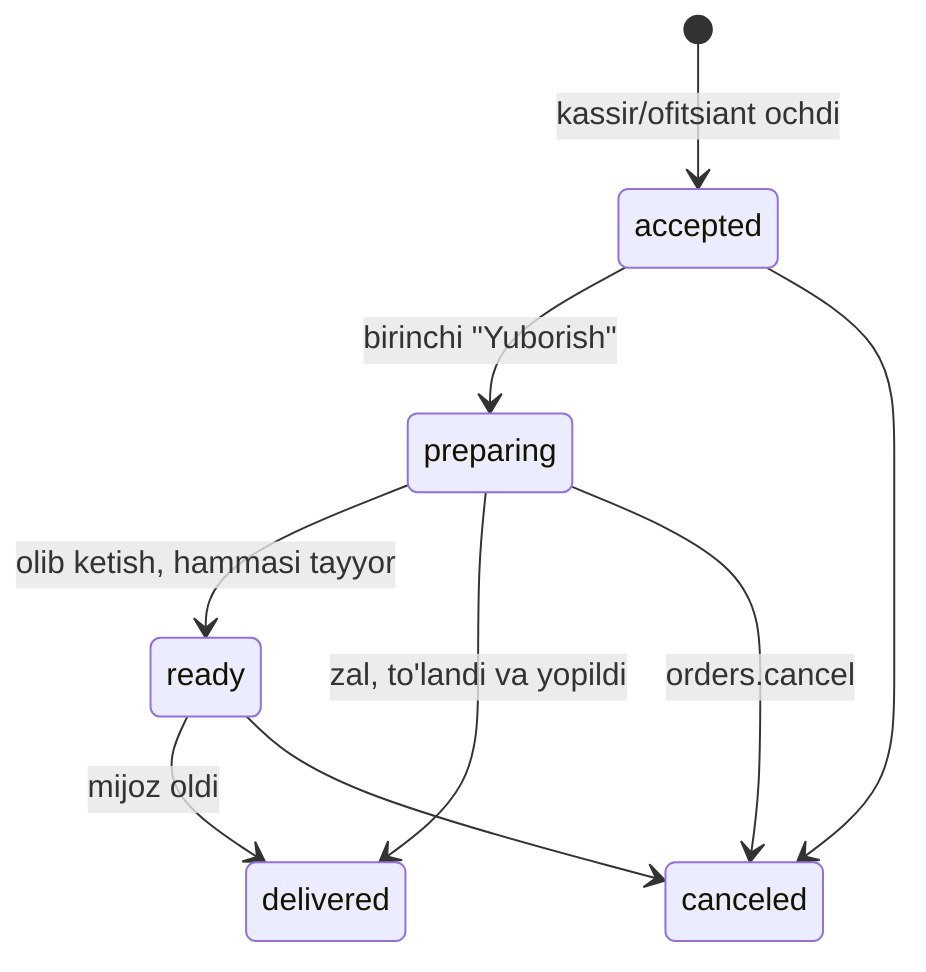

# POS spetsifikatsiyasi

> **Holati: QORALAMA — egasining tasdig'i uchun.** Birinchi bo'lib qaysi format (osh markazi/choyxona, restoran yoki
> fast food) qurilishi hali tanlanmagan. Shuning uchun hujjat avval hamma formatlar uchun **umumiy yadro**ni, keyin har
> bir format uchun qisqa **profil**ni va qaysi biridan boshlash bo'yicha **tavsiya**ni beradi. Oxirida egasiga savollar
> (14-bo'lim). Egasi tasdiqlagach, holat "tasdiqlangan" deb o'zgaradi va 3-bosqich shu hujjat bo'yicha boshlanadi.

Bog'liq hujjatlar: [ROADMAP.md](ROADMAP.md) (3-bosqich), [ARCHITECTURE.md](ARCHITECTURE.md), [API.md](API.md),
[AUTH.md](AUTH.md) (terminal, PIN, ruxsatlar), [MENU.md](MENU.md) (modifikator, kg, qozon, stop-list, xizmat haqi),
[BILLING.md](BILLING.md) (terminal obunasi), tadqiqot:
[Ovqatlanish tarmoqlari uchun POS talablari](research/reports/Ovqatlanish%20tarmoqlari%20uchun%20POS%20talablari.md).

## 0. Qabul qilingan qarorlar (qayta ko'rilmaydi)

| Mavzu | Qaror |
|---|---|
| Fiskal chek | Birinchi versiya **fiskalsiz**. Fiskal chekni restoranning o'z kassa apparati (onlayn-NKM) alohida chiqaradi. Rizqim POS unga ulanmaydi va fiskal chek raqamini o'zida saqlamaydi. Kodda fiskal modul uchun alohida joy (interfeys) qoldiriladi (4-bo'lim) |
| Yuridik xavf | VM 393-son qarori umumiy ovqatlanishda soliq tizimi bilan integratsiya qilinmagan buyurtma dasturlarini taqiqlaydi; kuchga kirish sanasi aniq emas. Real restoranlarga sotishdan oldin yuridik javob olinadi ([ROADMAP.md](ROADMAP.md)) |
| Internetsiz ishlash | To'liq offline yo'q. Faqat **qisqa uzilishga chidaydigan cheklangan rejim** (5-bo'lim) |
| Bitta buyurtma modeli | POS buyurtmasi ham oddiy `orders` qatori (`channel = pos_hall` yoki `pos_takeaway`); oshxona, stop-list va hisobotlar hamma kanal uchun bitta |
| Stek | Flutter (bitta kod: Windows, Android planshet, Android POS terminal, iPad), umumiy paketlar `pos/packages/*`, API klienti `packages/dart/rizqim_api` |
| Biznes mantiq | Faqat backend'da. Ilova narx, chegirma, xizmat haqini o'zi hisoblamaydi (offline rejimdagi istisno 5-bo'limda) |

## 1. Hozir kodda nima bor va nima yo'q

**Bor (1-bosqichda qurilgan):**

- Terminalni 8 belgili kod bilan ulash, terminal tokeni, xodimning PIN bilan kirishi va 12 soatlik sessiya, PIN
  bloklash ([AUTH.md](AUTH.md), 4–5-bo'lim). Oshxona ekrani skeleti (`pos/apps/kds`: ulash ekrani).
- Rollar `cashier`, `waiter`, `cook` va ruxsatlar, jumladan `pos.open_shift`, `pos.close_shift`, `pos.cash_in_out`,
  `pos.take_payment`, `pos.reprint_bill`, `tables.manage`, `kitchen.manage`, `orders.void_item`, `orders.discount`.
- `orders.channel` (`pos_hall`, `pos_takeaway`), `external_id`, `guests_count`, `hall_ref`, `table_ref`,
  `service_charge_amount`, `place_fee_amount`; `order_type = dine_in`.
- Menyu: modifikatorlar, kg/l va kasr miqdor, qozon/partiya qoldig'i, filial stop-listi va uning real-time tarqalishi,
  kanal narxi, xizmat haqi va joy narxi sozlamalari ([MENU.md](MENU.md)).
- `Idempotency-Key`, harakatlar jurnali (terminal bilan), terminal bo'yicha oylik obuna.

**Yo'q (shu spetsifikatsiya bo'yicha quriladi):**

- POS buyurtma endpointlari: hozir `POST /orders` faqat mijoz kanallari (`telegram`, `mobile`) uchun, `/orders/*`
  faqat ega, menejer, kuryer va mijozga ochiq. Kassir, ofitsiant, oshpaz buyurtmani ko'ra olmaydi.
- Terminal va kassir/ofitsiant/oshpaz uchun real-time kanal (hozirgi kanallar faqat ega va menejerga).
- Zal va stollar, smena va kassa qutisi, schyot va hisobni bo'lish, POS to'lov turlari, printerlar va oshxona
  sexlari, qaytarish, offline navbat — jadvallar ham, API ham yo'q (10-bo'lim).
- Ilovalar: `pos/apps/cashier`, `waiter`, `customer_display` va `pos/packages/*` hali bo'sh.

## 2. Umumiy yadro (barcha formatlar uchun)

### 2.1. Ilovalar

| Ilova | Kim | Qurilma | Vazifasi |
|---|---|---|---|
| **Kassa** (`cashier`) | kassir, menejer, ega | Windows monoblok, Android planshet, Sunmi turidagi terminal, iPad | buyurtma olish, barcha kanallar navbati, stol xaritasi, schyot, to'lov, smena, kassa qutisi, hisobotlar |
| **Ofitsiant** (`waiter`) | ofitsiant | Android telefon yoki planshet, qo'l terminali | o'z stollari, buyurtma olish, oshxonaga yuborish, schyot so'rash |
| **Oshxona ekrani** (`kds`) | oshpaz | Android planshet yoki monitorli kompyuter | sex bo'yicha taomlar, "tayyor" belgilash, qozon qoldig'i |
| **Mijoz ekrani** (`customer_display`) | — | kassaning ikkinchi ekrani (Sunmi D2, Windows ikkinchi monitor) yoki alohida planshet | joriy chek va summa; fast food'da "tayyor" raqamlar |

Kassa va ofitsiant bitta Flutter ilovasining ikki rejimi bo'lishi mumkin (umumiy kod `pos_core`, `pos_ui`); bu
texnik qaror, egasi uchun farqi yo'q.

### 2.2. Kirish va xodim almashtirish

1. Terminal bir marta ulanadi (panelda kod → terminalda kiritish). Terminal tokeni qurilmada xavfsiz saqlanadi.
2. Ish boshida xodim PIN (yoki `staff_code` + PIN) kiritadi. Ekran X daqiqa harakatsiz qolsa qulflanadi (sozlanadi),
   PIN bilan ochiladi. Boshqa xodim kirsa, oldingisining sessiyasi yopiladi.
3. Xavfli amalni (yuborilgandan keyin o'chirish, chegirma, qayta schyot va h.k.) huquqi yo'q xodim boshlasa, ilova
   **menejer PIN'ini** so'raydi: shu terminalda menejer o'z PIN'ini kiritadi, server bir martalik tasdiq beradi, jurnalga
   ikkalasi ham yoziladi (kim so'radi, kim tasdiqladi).

### 2.3. Smena va kassa qutisi

- **Smena** — bitta kassa (terminal) uchun ish davri. Ochishda boshlang'ich naqd kiritiladi (`pos.open_shift`).
- Smena davomida: naqd sotuv, qaytarish, **kassaga kirim/chiqim** (masalan, bozorga pul olish — kategoriya va izoh
  bilan, `pos.cash_in_out`).
- **X-hisobot** — smenani yopmasdan oraliq hisobot: to'lov turlari bo'yicha, kanal bo'yicha, chegirma, o'chirish,
  qaytarish, kirim/chiqim, kutilayotgan naqd.
- **Yopish (Z)** (`pos.close_shift`): kassir naqdni kupyura bo'yicha sanaydi, tizim kutilgan summa bilan solishtiradi,
  farq yoziladi. Ochiq buyurtma (stol) qolsa smena yopilmaydi; menejer ularni boshqa smenaga o'tkazishi yoki majburan
  yopishi mumkin (sabab bilan). Offline'da kutib turgan amallar bo'lsa ham yopilmaydi (5-bo'lim).
- **Biznes kun** — kalendar kunidan alohida (masalan 05:00 dan 05:00 gacha), yarim tundan o'tadigan smenalar uchun.
  Hisobotlar va navbat raqami biznes kun bo'yicha.
- Z-hisobot egaga Telegram'ga (va push'ga) qisqa xulosa bilan yuboriladi.

### 2.4. Zallar va stollar

- Filialda bir nechta **zal** (asosiy zal, ayvon, VIP). Zalda **stol**lar: nomi/raqami, o'rinlar soni, turi (`stol`,
  `xona`, `tapchan`), xaritadagi joyi.
- Stol holati: bo'sh, band (ochiq buyurtma bor), schyot chiqarilgan, to'langan (tozalash kutilmoqda).
- Stolda bir yoki bir nechta ochiq buyurtma bo'lishi mumkin. Stolni **ko'chirish** va **birlashtirish**
  (`tables.manage`); stolni boshqa ofitsiantga o'tkazish — menejer.
- Zal xizmat haqi va joy narxini o'zgartira oladi (masalan, VIP'da boshqa foiz).
- Stolsiz format (fast food, osh markazi kassasi) uchun zal ishlatilmaydi, buyurtma "olib ketish" yoki "zalda,
  stolsiz" bo'ladi.

### 2.5. Barcha kanallardan bitta navbat

Kassa ekranida bitta ro'yxat: POS buyurtmalari, Telegram Mini App, mobil ilova va (keyinchalik) agregatorlar. Har
birida kanal belgisi, turi (zal, olib ketish, yetkazish), holati va vaqti.

- Telegram/mobil buyurtma `new` holatda kelsa, kassir uni **qabul qiladi** yoki **rad etadi** (`orders.manage`;
  rad etish va bekor qilish `orders.cancel`). Click/Payme bilan to'langan buyurtma server tomonidan avtomatik
  `accepted` bo'ladi.
- Qabul qilingan onlayn buyurtmaning oshxona markasi filialning "chop etuvchi" kassasidan (2.11) avtomatik chiqadi va
  KDS'da paydo bo'ladi.
- Yangi onlayn buyurtma kelganda ovoz va belgi. Qabul qilinmagan buyurtma N daqiqadan oshsa, ogohlantirish.
- Agregator buyurtmasini qo'lda kiritish: kanal `aggregator`, tashqi raqam (`external_id`) majburiy.

### 2.6. Buyurtma tuzish

- Menyu: kategoriyalar, katta tugmalar, qidiruv, "tez-tez sotiladigan" panel. Narxlar **kanal narxi** bo'yicha
  (`channel_prices`: `pos_hall`, `pos_takeaway` uchun alohida narx yoki yashirish).
- **Modifikatorlar:** majburiy/ixtiyoriy guruhlar, min/max, narx qo'shimchasi — mavjud qoidalar
  ([MENU.md](MENU.md), 1-bo'lim).
- **Vazn va kasr:** kg/l taomlar uchun raqam klaviaturasi (`0.5`, `1.2`), qadam va minimal miqdor; donali taom butun.
  Kasr porsiya (1 / 0.75 / 0.7 / 0.5) — alohida variantlar, qozondan `batch_consumption` bo'yicha oladi. Tarozi
  integratsiyasi — keyinroq.
- **Qozon/partiya:** qozon bo'yicha sotiladigan taomda qolgan porsiya katta raqam bilan ko'rinadi; tugasa taom
  "tugadi" bo'ladi va Telegram menyusida ham darhol yopiladi (mavjud mexanizm).
- **Stop-list:** "tugadi" belgisi va sababi ko'rinadi; tanlab bo'lmaydi.
- Har bir qatorga izoh ("piyozsiz"), mehmon raqami (hisobni bo'lish uchun), **"hozir yuborish" yoki "ushlab turish"**
  (kurs: keyinroq yuborish).
- Mehmonlar soni (joy narxi "kishi boshiga" bo'lsa majburiy).

### 2.7. Xizmat haqi va joy narxi

- Mavjud sozlamalar (`service_fee_settings`): xizmat haqi foizi (0–30) va joy narxi (kishi boshiga yoki stol uchun),
  kanallar bo'yicha (standart faqat `pos_hall`). Telegram buyurtmalariga hech qachon qo'llanmaydi.
- Schyotda va chekda **alohida qator**; schyot pastida "Xizmat haqi X%" yozuvi (Raqobat qo'mitasi talabi: oldindan
  e'lon qilish, majburlamaslik).
- Mehmon e'tiroz bildirsa, xizmat haqi sabab bilan olib tashlanadi (`orders.discount`, jurnalga yoziladi).
- Choy puli (ofitsiantga) — tushum emas, alohida maydon (ixtiyoriy, 14-bo'limdagi savol).

### 2.8. Oshxonaga yuborish, KDS, marka

- "Yuborish" bosilganda yuborilmagan qatorlar **sexlar** bo'yicha (oshxona, bar, osh tarqatish va h.k.) bo'linadi:
  har bir sexning **printeriga marka** chiqadi va/yoki **KDS ekraniga** tushadi. Qaysi taom qaysi sexga —
  kategoriya yoki taom bo'yicha sozlanadi.
- Markada: buyurtma/stol raqami, ofitsiant, vaqt, taomlar, modifikatorlar, izohlar, kurs.
- Yuborilgan taom o'chirilsa — o'sha sexga **"O'CHIRILDI"** markasi chiqadi va KDS'da qizil belgi.
- KDS: har bir qator `yuborildi → tayyor → berildi`; oshpaz "tayyor"ni qator yoki butun buyurtma bo'yicha bosadi
  (`kitchen.manage`); xato bosilgan "tayyor"ni qaytarish (recall). Kutish vaqti rang bilan (sariq/qizil chegaralar
  sozlanadi). Qozon qoldig'i paneli (`batches.manage`).
- Barcha kanallardan kelgan buyurtmalar (Telegram ham) KDS'da bitta oqimda, kanal belgisi bilan.

### 2.9. Schyot, hisobni bo'lish, to'lov

- **Schyot (pre-check)**: mehmonga beriladigan, fiskal bo'lmagan oldindan hisob. Unda taomlar, xizmat haqi va joy
  narxi alohida qatorlarda, chegirma, jami va **"Bu fiskal chek emas"** yozuvi.
- Birinchi schyot chiqqandan keyin buyurtma **qulflanadi**: taom qo'shish mumkin (yangi schyot kerak bo'ladi), lekin
  o'chirish va chegirma faqat menejer tasdig'i bilan. Schyotni qayta chiqarish — `pos.reprint_bill`, "NUSXA" belgisi
  bilan.
- **Hisobni bo'lish:** (a) taom bo'yicha (qatorlarni bir nechta schyotga taqsimlash, kasr miqdor ham), (b) mehmon
  bo'yicha (qatordagi mehmon raqami), (c) teng N ulushga (qoldiq tiyin birinchi schyotga). Xizmat haqi va joy narxi
  schyotlar orasida proporsional bo'linadi. Har bir schyot alohida to'lanadi.
- **To'lov** (`pos.take_payment`): bitta schyotga bir nechta to'lov turi (aralash):
  - naqd — berilgan summa va qaytim hisoblanadi;
  - karta — bankning **alohida** terminali, kassir summani o'zi teradi va "to'landi"ni qo'lda tasdiqlaydi (karta oxirgi
    4 raqami yoki terminal cheki raqami ixtiyoriy);
  - QR (UzQR, Click, Payme statik QR) — qo'lda tasdiqlash;
  - boshqa turlar (P2P o'tkazma va h.k.) — egasi qaror qiladi (14-bo'lim).
  Bank terminali va QR'ga summani avtomatik yuborish — keyingi bosqich (ochiq protokol yo'q).
- Hamma schyot to'langach buyurtma **yopiladi**: holati `delivered`, `payment_status = paid`, stol bo'shaydi.
- POS to'lovlari doim do'konga tushadi (`payment_owner = STORE`); platforma hisob-kitobi (settlement) yo'q.
  POS kanallaridan komissiya olinmaydi (tarif obuna orqali) — egasi tasdiqlaydi (14-bo'lim).

### 2.10. Bekor qilish, o'chirish, chegirma, qaytarish

| Amal | Shart | Ruxsat |
|---|---|---|
| Oshxonaga **yuborilmagan** qatorni o'chirish | — | `orders.manage` |
| **Yuborilgan** qatorni o'chirish | sabab majburiy, "O'CHIRILDI" markasi | `orders.void_item` (yo'q bo'lsa menejer PIN) |
| Butun buyurtmani bekor qilish | sabab majburiy; to'lov bo'lsa avval qaytarish | `orders.cancel` |
| Chegirma (summa yoki %) / xizmat haqini olib tashlash | sabab majburiy | `orders.discount` |
| Schyotni qayta chiqarish | "NUSXA" belgisi | `pos.reprint_bill` |
| Yopilgan buyurtma bo'yicha pul qaytarish (smena ichida, naqd yoki karta) | sabab, qaysi to'lovdan | **yangi** `pos.refund` (taklif, 11-bo'lim) |
| Onlayn to'langan / yetkazilgan buyurtmani platforma hisobida qaytarish | mavjud tartib | `orders.refund` (faqat superadmin, o'zgarmaydi) |

Hammasi harakatlar jurnaliga (kim, qaysi terminal, kim tasdiqladi, sabab, summa). Egaga Telegram/push ogohlantirishi:
yuborilgandan keyingi o'chirish, X% dan katta chegirma, buyurtmani bekor qilish, qaytarish, N soatdan ko'p ochiq stol
(chegaralar sozlanadi).

### 2.11. Chop etish

- Printerlar: 80 mm (yoki 58 mm) ESC/POS — LAN (Wi-Fi/Ethernet), USB (Windows), Sunmi ichki printeri.
- Hujjatlar: oshxona/bar markasi, "O'CHIRILDI" markasi, schyot, to'lov kvitansiyasi (fiskal emas), smena X/Z
  hisoboti, navbat raqami talonchasi (fast food).
- **Chop etishni qurilmaning o'zi bajaradi** (LAN yoki USB orqali), server emas: shunda internet uzilganda ham
  marka chiqadi.
- Har bir filialda bitta kassa **"chop etuvchi"** deb belgilanadi: u onlayn kanallardan qabul qilingan buyurtmalar
  markasini chiqaradi. U o'chiq bo'lsa, onlayn buyurtmalar faqat KDS'da ko'rinadi (ogohlantirish bilan).
- Kassa qutisi printer orqali ochiladi (naqd to'lov va kirim/chiqimda).
- Matn kodlash muammosi bo'lsa (printer shriftlari), matn rasm sifatida chop etiladi.

### 2.12. Qurilmalar

| Qurilma | Nima bilan ishlaydi | Eslatma |
|---|---|---|
| Windows monoblok | USB va LAN printer, printer orqali kassa qutisi, ikkinchi monitor — mijoz ekrani | bozorda eng ko'p; elektr o'chsa UPS kerak |
| Android planshet | LAN (va Bluetooth) printer | batareya bilan uzilishga chidamli; ofitsiant va KDS uchun ham |
| Sunmi turidagi Android terminal (Sunmi, PAX, iMin) | ichki printer (ishlab chiqaruvchi SDK), D2 turida ikkinchi ekran | qo'l terminali ofitsiantga ham mos |
| iPad | faqat LAN printer (USB yo'q) | eng past ustuvorlik; fiskal yo'qligi sababli v1 da texnik to'siq yo'q |

Uskunaga bog'liq kod faqat `pos_hardware` paketida (drayverlar: ESC/POS LAN, ESC/POS USB Windows, Sunmi). Skaner va
tarozi — keyinroq. Pilot uchun tavsiya: Android planshet yoki Sunmi + bitta LAN printer (arzon, batareyali).

### 2.13. Hisobotlar (v1)

- Smena X/Z (2.3); kunlik xulosa egaga Telegram'ga: tushum to'lov turi va kanal bo'yicha, o'rtacha chek, chegirma,
  o'chirish, qaytarish, kassa farqi.
- Ofitsiant bo'yicha sotuv; istisnolar jurnali (o'chirish, chegirma, bekor qilish); qozon bo'yicha sotilgan porsiya.
- Mavjud ega analitikasi (`GET /owner/analytics`) kanal bo'yicha (`by_channel`) POS'ni ham ko'rsatadi.

## 3. Buyurtma holatlari POS'da

Yangi holat qo'shilmaydi, mavjud `OrderStatus` ishlatiladi. Oshxona bosqichlari **qator darajasida** (yangi maydon,
10-bo'lim) kuzatiladi.

| Holat | POS'da ma'nosi |
|---|---|
| `accepted` | xodim buyurtma ochdi (POS buyurtmasi qabul qilish bosqichisiz shu holatda yaratiladi) |
| `preparing` | kamida bitta qator oshxonaga yuborilgan; zal stoli yopilguncha shu holatda qoladi (yangi qatorlar qo'shilsa ham) |
| `ready` | olib ketish/fast food: hamma qator tayyor, mijoz chaqiriladi |
| `delivered` | hammasi to'langan va buyurtma yopilgan (stol bo'shadi / mijoz oldi) |
| `canceled` | bekor qilindi (sabab bilan) |

Onlayn buyurtmalar (Telegram, mobil) avvalgidek `new` dan boshlanadi.

## 4. Fiskal: v1 da yo'q, joyi qoldiriladi

**Birinchi versiyada:**

- Rizqim POS fiskal chek chiqarmaydi, onlayn-NKM yoki virtual kassaga ulanmaydi, fiskal chek raqamini saqlamaydi.
- Restoran har bir sotuvni o'zining fiskal kassasida alohida rasmiylashtiradi. Bu restoranning o'z majburiyati.
- Rizqim chiqaradigan har bir qog'ozda (schyot, to'lov kvitansiyasi) **"Bu fiskal chek emas"** yozuvi bo'ladi.

**Kodda qoldiriladigan joy (seam):**

- Ilovada: `pos/packages/pos_fiscal` — `FiscalGateway` interfeysi: `register(SaleDocument)`, `refund(...)`,
  `capabilities`. v1 dagi yagona amalga oshirish `NoFiscalGateway` (har doim "qo'llanmaydi" qaytaradi). `SaleDocument`
  yopilgan schyotdan quriladi: qatorlar (nom, miqdor, birlik, narx, summa), to'lovlar turi bo'yicha. Keyinchalik unga
  MXIK, qadoq kodi va QQS stavkasi qo'shiladi.
- Backend'da: `App\Domain\Fiscal\FiscalGateway` kontrakti va `NullFiscalGateway` (konteynerga bog'langan). POS
  buyurtmani yopish oqimi shu interfeysni chaqiradi; v1 da u hech narsa qilmaydi.
- v1 da fiskal jadval va ustunlar **yaratilmaydi** (keraksiz ma'lumot yig'ilmasin). Fiskal modul alohida va kam
  o'zgaradigan qilib quriladi: keyin UI yoki menyu o'zgarishi fiskal qismni qayta ekspertizaga tushirmasligi uchun.

**Xavf (ROADMAP'dan):** VM 393-son qarori umumiy ovqatlanish korxonalariga soliq organlari tizimi bilan integratsiya
qilinmagan buyurtma hisobi dasturlaridan foydalanishni taqiqlaydi; kuchga kirish sanasi aniq emas (21.07.2026 yoki
22.10.2026), buzish jarimasi oxirgi chorak sof tushumining 2% (takrorlansa 20%). Shuning uchun Rizqim POS real
restoranlarga **sotilishidan oldin** yurist yoki buxgalterdan yozma javob olinadi. Pilot ham shu savol hal bo'lmaguncha
restoranning rasmiy tushum hisobi sifatida ishlatilmasligi tavsiya etiladi (tadqiqotdagi fiskal brifing tavsiyasi).

## 5. Internetsiz ishlash: cheklangan rejim

Egasi to'liq offline'ni "fantastika" deb atagan. Shuning uchun maqsad oddiy: **qisqa uzilishda (bir necha daqiqadan
1–2 soatgacha) kassa savdoni to'xtatmasin va hech narsa yo'qolmasin**. Bu to'liq offline tizim emas.

### 5.1. Nima ishlab turadi

Shart: qurilma va LAN (router, printer) elektr bilan ishlayapti, faqat internet (yoki server) yo'q.

| Ilova | Uzilishda nima qila oladi |
|---|---|
| **Kassa** | O'zi ochgan va uzilishdan oldin yuklangan buyurtmalar bilan ishlash; yangi buyurtma (olib ketish, zal); qator qo'shish; LAN printerga marka va schyot chiqarish; **naqd** va **alohida karta terminali** orqali to'lov; buyurtmani yopish. Hammasi lokal navbatga yoziladi |
| **Ofitsiant** | Faqat ko'rish (oxirgi holat), "Aloqa yo'q" belgisi. Yangi taomni kassada kiritish tavsiya etiladi (14-bo'limdagi savol) |
| **KDS** | Oxirgi holatni ko'rsatadi, "Aloqa yo'q" belgisi. Yangi taomlar oshxonaga **printer markasi** orqali boradi |
| **Mijoz ekrani** | Kassadan lokal (bir qurilmaning ikkinchi ekrani) ishlayveradi |

Uzilish paytida ishlamaydi: Telegram, mobil va agregator buyurtmalari (ular serverga kelmaydi yoki kelib server
navbatida kutadi), Click/Payme/UzQR onlayn tasdig'i, stop-list va qozon qoldig'ining boshqa qurilmalar bilan
almashinuvi, yangi xodimning kirishi, smenani yopish va Z-hisobot.

### 5.2. Qanday ishlaydi

- Har bir qurilmada lokal baza (SQLite, `pos_sync` paketi). Har bir yozuv amali (buyurtma ochish, qator qo'shish,
  yuborish, schyot, to'lov, yopish) **amal** sifatida navbatga yoziladi: `op_id` (UUID), qurilma, ketma-ket raqam
  (`seq`), vaqt, xodim, mazmuni. Elektr to'satdan o'chsa ham navbat diskda qoladi; ilova qayta ochilganda davom etadi.
- Offline yaratilgan buyurtma o'z UUID'si bilan (`external_id`) yaratiladi va mijozga **lokal raqam** beriladi:
  qurilma prefiksi bilan (`K1-017`). Server shu raqamni saqlaydi, takror bo'lmaydi.
- Narx: qurilmadagi oxirgi menyu nusxasi (snapshot) bo'yicha. Ilova offline'da faqat oddiy narx qoidalarini qo'llaydi:
  qator narxi, modifikatorlar, xizmat haqi va joy narxi (sozlamalar nusxasidan), chegirma faqat menejer PIN'i bilan
  qurilmada keshlangan menejer sessiyasi bo'lsa.
- Internet qaytgach navbat **tartib bilan** `POST /pos/sync` ga yuboriladi (bir paketda ko'pi bilan N amal). Har bir
  amal idempotent (`op_id`): ikki marta yuborilsa ham bir marta qo'llanadi.

### 5.3. To'qnashuvlarni hal qilish

Asosiy qoida: **server haqiqat manbai, lekin bo'lib o'tgan sotuv va olingan pul hech qachon rad etilmaydi.**

| Holat | Qaror |
|---|---|
| Offline buyurtma ikki marta keldi | `op_id` va `external_id` bo'yicha bitta bo'ladi |
| Offline narx serverdagi joriy narxdan farq qiladi | Offline narx qabul qilinadi (mijoz shuni to'lagan), buyurtma "offline narx" belgisi bilan. Menyu nusxasi 24 soatdan eski bo'lsa — menejer ko'rib chiqishi uchun belgilanadi |
| Qozon yoki zaxira yetmadi (boshqa kanal sotib bo'lgan) | Sotuv qabul qilinadi, qoldiq 0 ga tushadi, yetmagan miqdor "ortiqcha sotilgan" sifatida jurnalga yoziladi va menejerga ko'rsatiladi |
| Buyurtma serverda shu orada o'zgargan (masalan, onlayn buyurtmani mijoz bekor qilgan) | Server holati ustun. Qurilma amali rad etiladi va kassada **"Sinxronlash xatolari"** ro'yxatiga tushadi, menejer qo'lda hal qiladi |
| Offline to'lov bekor qilingan buyurtmaga tushdi | To'lov baribir yoziladi, buyurtma "qaytarish kerak" belgisini oladi |
| Bir buyurtmani ikki qurilma o'zgartirdi | Onlayn rejimda buyurtma versiyasi (`version`) tekshiriladi: eskisi 409 oladi, ilova qayta yuklab qayta qo'llaydi. Offline'da faqat buyurtmani ochgan qurilma uni o'zgartiradi |
| Qurilma soati noto'g'ri | Server o'z vaqtini (`synced_at`) ham yozadi; farq 5 daqiqadan katta bo'lsa ogohlantirish |

### 5.4. Chegaralar

- Offline sotuvni boshlash uchun: terminal so'nggi 24 soat ichida server bilan bog'langan va menyu nusxasi 24 soatdan
  yangi bo'lishi kerak. Aks holda kassa "Internet kerak" deydi.
- Faqat uzilishdan oldin kirgan xodim(lar) ishlaydi; yangi xodim PIN bilan kira olmaydi (PIN tekshiruvi serverda).
- Ogohlantirishlar: 15 daqiqa — sariq belgi; 2 soat — qizil, menejerga eslatma. Navbatda 500 tadan ortiq buyurtma
  bo'lsa yangi buyurtma bloklanadi (ma'lumotlar jimgina to'planib qolmasligi uchun).
- Navbat bo'sh bo'lmaguncha smena yopilmaydi va Z-hisobot chiqmaydi.
- Qurilmalar orasida LAN orqali sinxronlash **yo'q**: har bir qurilma faqat o'z navbatini saqlaydi.

### 5.5. Doiradan tashqarida (v1 da qilinmaydi)

- Restorandagi lokal server yoki qurilmalar orasida LAN orqali sinxronlash ("lokal hub").
- Kunlab yoki bir smenadan uzoq offline ishlash.
- Offline onlayn to'lovlar (QR, Click, Payme), offline'da bank terminaliga summa yuborish.
- Offline'da yangi xodim kirishi, menyu va narxlarni tahrirlash, stop-list va qozon qoldig'ini boshqa qurilmalarga
  tarqatish.
- Offline'da Telegram/agregator buyurtmalarini qabul qilish.
- Elektr uzilishiga dasturiy yechim: buning uchun UPS (router, printer, Windows kassa) va batareyali qurilmalar
  tavsiya etiladi.

## 6. Format profili: choyxona va osh markazi

**Osh markazi.** Savdo birligi — porsiya ulushi va qozon. Oqim: mijoz kassada buyurtma beradi va **oldindan to'laydi**,
keyin zalda o'tiradi yoki olib ketadi; ba'zan ofitsiant stolda oladi, to'lov kassada (gibrid). Osh tushgacha tugaydi,
3–4 soatlik cho'qqi.

| Nima | Qanday |
|---|---|
| Asosiy ekran | Kassa: katta tugmalar, 1–3 bosishda buyurtma, **qozon hisoblagichlari** ekranning yuqorisida (qozon raqami, qolgan porsiya) |
| Qozon | Mavjud `menu_batches`: oshpaz/menejer qozon ochadi (porsiya soni), har sotuv ulushga qarab kamaytiradi (1 / 0.75 / 0.7 / 0.5), nolda "tugadi" — kassada, ofitsiantda va Telegram menyusida bir vaqtda. "Qozon tugadi" tugmasi |
| Stol | Ixtiyoriy: stolsiz ("zalda") yoki oddiy stol raqami |
| To'lov | Asosan kassada, buyurtma bilan birga (oldindan). Naqd ko'p |
| Oshxona | Osh tarqatish joyida marka printeri yoki oddiy KDS; salat/ichimlik alohida sex bo'lishi mumkin |
| Xizmat haqi, joy narxi | Odatda yo'q |
| Navbat raqami | Ixtiyoriy (olib ketish uchun) |
| Onlayn | Telegram olib ketish va yetkazish — osh eng ko'p buyuriladigan taom; qozon tugasa Telegram'da ham yopiladi |

**Choyxona.** Savdo birligi — **xona yoki tapchan** va guruh. Hisob soatlab ochiq turadi, taomlar bosqichma-bosqich
qo'shiladi (choy → salat va non → osh → yana choy).

| Nima | Qanday |
|---|---|
| Zal | Xonalar va tapchanlar stol sifatida (`turi = xona/tapchan`), o'rin soni |
| Joy narxi | Mavjud joy narxi: xona uchun (`per_table`) yoki kishi boshiga (`per_person`); hafta kuniga qarab farq — 14-bo'limdagi savol |
| Guruh taomi | "Osh 5 kg", "10 kishilik lagan" — kg yoki alohida variant sifatida; "faqat pishirish xizmati" — oddiy xizmat taomi |
| Uzoq ochiq hisob | Stol ko'p soat ochiq turadi; N soatdan keyin egaga eslatma |
| Hisobni bo'lish | Teng N ulush va taom bo'yicha — muhim |
| To'lov | Ko'p naqd va P2P o'tkazma; nasiya (qarzga) — v1 da yo'q, 14-bo'limdagi savol |
| Ofitsiant | Ko'pincha bor (xona xizmati) |

## 7. Format profili: restoran (zal + ofitsiant)

Savdo birligi — stol, zal, VIP kabina. Oqim: ofitsiant buyurtma oladi → sexlarga marka → schyot → kassir yoki ofitsiant
yopadi.

| Nima | Qanday |
|---|---|
| Ofitsiant ilovasi | **Majburiy**: o'z stollari, buyurtma, kurslar ("ushlab turish", keyin yuborish), schyot so'rash |
| Zallar | Bir nechta zal, stol xaritasi, holatlar, ko'chirish, birlashtirish, boshqa ofitsiantga o'tkazish |
| Sexlar | Oshxona va bar alohida printer/KDS |
| Schyot | Qulflash, qayta chiqarish faqat menejer, hisobni taom/mehmon/teng bo'yicha bo'lish |
| O'g'irlikka qarshi | Yuborilgandan keyin o'chirish — menejer PIN va sabab, "O'CHIRILDI" markasi; chegirma faqat menejer; ochiq stol bilan smena yopilmaydi; egaga ogohlantirishlar |
| Xizmat haqi | 10–15% alohida qator, olib tashlash sabab bilan |
| To'lov | Aralash; ofitsiant to'lov qabul qiladimi — 14-bo'limdagi savol |
| Offline | Eng sezgir format: ko'p qurilma, ofitsiantlar bir vaqtda ishlaydi. v1 cheklangan rejimida ofitsiant uzilishda faqat ko'radi (5-bo'lim) |

## 8. Format profili: fast food (kassa + KDS + navbat raqami)

Savdo birligi — buyurtma raqami. Oqim: kassa → oldindan to'lov → KDS sexlari → mijoz ekranida "tayyor" raqami →
mijoz oladi. Telegram va agregatorlardan katta oqim.

| Nima | Qanday |
|---|---|
| Kassa | Tez kassa rejimi, stol yo'q, oldindan to'lov |
| Navbat raqami | Biznes kun bo'yicha qayta boshlanadi; talonchada va mijoz ekranida |
| KDS | **Majburiy**, sexlar (grill, fritur, ichimlik), tayyorlash vaqti va rang chegaralari |
| Mijoz ekrani | "Tayyorlanmoqda" / "Tayyor" raqamlar ro'yxati |
| Kombo | Hozirgi menyu modelida yo'q. Vaqtincha: taom + majburiy modifikator guruhlari ("ichimlik tanlang", narx qo'shimchasi bilan). To'liq kombo konstruktori — keyin |
| Qadoq | Olib ketish va yetkazishda qadoqni avtomatik qo'shish — keyin |
| Smena | 24/7 nuqtalar uchun yarim tundan o'tadigan smena, biznes kun |
| Kanallar | Telegram + agregator buyurtmalari bitta navbatda; stop-list hamma kanalga darhol |
| Xizmat haqi | Yo'q |

## 9. Tavsiya: qaysi formatdan boshlash

**Tavsiya: osh markazi (kassa + oddiy zal, gibrid oqim), keyin shu profilni choyxonaga kengaytirish.** Qaror egasiniki.

Nega:

1. **Eng ko'p tayyor qism.** Qozon/partiya qoldig'i, kasr porsiya, stop-list va uning Telegram menyusiga real-time
   tarqalishi backend'da allaqachon bor. Tadqiqotga ko'ra, raqobatchilarda (Reca, Biznex, Mison, VKassa) bu funksiyalar
   ko'rsatilmagan — bu Rizqimning ajralib turadigan joyi.
2. **Eng oddiy oqim.** Oldindan to'lov: buyurtma darhol yopiladi, ochiq stollar kam. Hisobni bo'lish, ofitsiantlar
   ilovasi, stol ko'chirish kabi murakkab qismlar birinchi versiyaga shart emas.
3. **Internetsiz rejim eng oson.** Asosiy ishni bitta kassa bajaradi; v1 cheklangan rejimi (5-bo'lim) aynan shunga mos.
   Restoranda esa ko'p qurilma bir vaqtda ishlaydi va uzilish og'irroq.
4. **Arzon pilot.** 1 kassa (planshet yoki Sunmi) + 1 printer (+ ixtiyoriy KDS).
5. **Telegram bilan sinergiya.** Osh — eng ko'p buyuriladigan taom; qozon tugasa Telegram'da ham darhol yopilishi egaga
   ko'rinadigan foyda.

Kamchiliklari va xavflari: cho'qqi soatlarda juda tez ishlash kerak (UI tezligini pilotda o'lchash shart); o'rtacha chek
kichik (30–60 ming so'm), demak narxga sezgir; fiskal yuridik xavf hamma formatda bir xil.

Nega boshqalari keyin: **restoran** eng ko'p funksiya va eng og'ir offline talab qiladi (ofitsiant ilovasi, hisobni
bo'lish, ko'chirish, o'g'irlikka qarshi nazorat); **fast food** kombo konstruktori, sexli KDS va agregator integratsiyasini
talab qiladi, yirik tarmoqlar esa allaqachon iiko/r_keeper ishlatadi.

Taklif qilingan tartib: osh markazi → choyxona (xonalar, joy narxi, uzoq hisob, hisobni bo'lish) → restoran → fast food.

## 10. Ma'lumotlar modeli: nima qo'shiladi

Mavjud jadvallarga bog'langan holda. Hammasi qo'shimcha (mavjud ustunlar va javoblar o'zgarmaydi). Pul — `decimal(12,2)`
va `Money`; miqdor — `decimal(12,3)` va `Quantity`.

### 10.1. Mavjudlari va qanday ishlatiladi

| Jadval / ustun | POS'da |
|---|---|
| `orders.channel` = `pos_hall` / `pos_takeaway` / `aggregator` | POS buyurtmasi kanali |
| `orders.order_type` = `dine_in` / `pickup` | zal / olib ketish |
| `orders.external_id` | qurilma yaratgan UUID (offline ham), do'kon + kanal ichida yagona |
| `orders.guests_count`, `hall_ref`, `table_ref` | mehmonlar soni; zal va stol nomi **snapshot** sifatida (yangi FK yonida qoladi) |
| `orders.service_charge_amount`, `place_fee_amount`, `discount` | jami summalar (schyotlar yig'indisi) |
| `order_items` (snapshot, `modifiers`, `quantity` kasr, `batch_id`) | buyurtma qatori |
| `payments` (`provider`, `amount`, `status`) | POS to'lovlari ham shu yerda, yangi ustunlar bilan |
| `service_fee_settings` | xizmat haqi va joy narxi; zal bo'yicha almashtirish qo'shiladi |
| `menu_batches`, `stop_list_entries`, `channel_prices` | qozon, stop-list, POS kanal narxi |
| `devices` (`pos`, `kds`) | terminallar |
| `users.pin_hash`, `staff_code` | PIN kirish |
| `audit_logs` (`device_id`) | barcha xavfli amallar |
| `idempotency_keys` | POS o'zgartiruvchi so'rovlari |

### 10.2. Yangi jadvallar

| Jadval | Asosiy ustunlar | Vazifasi |
|---|---|---|
| `halls` | `store_id`, `branch_id`, `name`, `sort_order`, `is_active` | zallar |
| `dining_tables` | `branch_id`, `hall_id`, `name`, `seats`, `kind` (`table`/`room`/`tapchan`), xarita joyi (`x`, `y`, `w`, `h`), `is_active` | stollar, xonalar, tapchanlar |
| `pos_shifts` | `uuid`, `store_id`, `branch_id`, `device_id`, `business_date`, `opened_by`, `opened_at`, `opening_cash`, `closed_by`, `closed_at`, `expected_cash`, `counted_cash`, `counted_breakdown` (jsonb, kupyuralar), `difference`, `status`, `z_number` | smena va Z-hisobot |
| `cash_movements` | `uuid`, `shift_id`, `type` (`opening`, `sale`, `refund`, `cash_in`, `cash_out`), `amount`, `category`, `note`, `payment_id`, `user_id`, `device_id`, `approved_by` | kassa qutisi harakatlari |
| `order_bills` | `uuid`, `order_id`, `number`, `status` (`open`, `printed`, `paid`, `void`), `subtotal`, `discount`, `service_charge_amount`, `place_fee_amount`, `total`, `printed_count`, `printed_at`, `paid_at` | schyotlar (bo'lingan hisob — bir nechta) |
| `order_bill_items` | `bill_id`, `order_item_id`, `quantity` | qaysi qator qaysi schyotda (kasr ulush ham) |
| `pos_refunds` | `uuid`, `order_id`, `payment_id`, `shift_id`, `amount`, `method`, `reason`, `user_id`, `approved_by` | smena ichidagi qaytarishlar |
| `kitchen_stations` | `branch_id`, `name`, `sort_order` | sexlar (oshxona, bar, osh tarqatish) |
| `kitchen_station_routes` | `station_id`, `category_id` yoki `product_id` | qaysi taom qaysi sexga |
| `printers` | `branch_id`, `name`, `purpose` (`receipt`, `kitchen`, `label`), `connection` (`lan`, `usb`, `builtin`, `bluetooth`), `address`, `paper_width` (58/80), `station_id`, `device_id` (USB/ichki printer qaysi terminalda) | printerlar sozlamasi (terminal almashsa ham saqlanadi) |
| `pos_sync_operations` | `device_id`, `op_id` (yagona), `seq`, `type`, `payload`, `status` (`applied`, `rejected`, `conflict`), `error`, `received_at`, `applied_at` | offline navbatdan kelgan amallar jurnali va "Sinxronlash xatolari" |

### 10.3. Mavjud jadvallarga yangi ustunlar

| Jadval | Ustunlar | Nima uchun |
|---|---|---|
| `orders` | `hall_id`, `table_id` (FK, nullable), `waiter_id`, `device_id` (qaysi terminal ochgan), `shift_id`, `business_date`, `queue_number`, `local_number` (offline `K1-017`), `bill_locked_at`, `closed_at`, `version` (optimistik qulf), `offline_created_at`, `synced_at` | stol, ofitsiant, smena, navbat raqami, offline |
| `order_items` | `kitchen_status` (`pending`, `sent`, `ready`, `served`, `void`), `fire_mode` (`now`/`hold`), `station_id`, `sent_at`, `ready_at`, `seat_no`, `note`, `added_by`, `voided_at`, `voided_by`, `void_reason`, `price_source` (`online`/`offline_snapshot`) | KDS, kurslar, o'chirish, hisobni bo'lish |
| `payments` | `bill_id`, `shift_id`, `device_id`, `received_by`, `tendered_amount`, `change_amount`, `reference` (karta oxirgi 4 raqami yoki terminal cheki), `offline`. `provider` ga POS qiymatlari: `cash`, `card` (alohida terminal), `qr`, `p2p`, `other` | aralash va bo'lingan to'lov |
| `service_fee_settings` | `hall_id` (nullable) | VIP zal uchun boshqa foiz |
| `menu_batches` | `oversold_quantity` | offline'da ortiqcha sotilgan miqdor (qoldiq manfiy bo'lmaydi) |
| `branches` | `business_day_starts_at` (vaqt), `pos_settings` (jsonb: rejim `counter`/`table`/`hybrid`, navbat raqami, "chop etuvchi" kassa, ekran qulfi vaqti, ogohlantirish chegaralari) | filial POS sozlamalari |

`DeviceType` ga yangi tur qo'shish shart emas: mijoz ekrani odatda kassaning ikkinchi ekrani. Alohida planshet bo'lsa —
14-bo'limdagi savol (u obunada terminal hisoblanadimi).

## 11. Rollar bo'yicha ruxsatlar

Mavjud `App\Enums\Permission` nomlari va standart jadval (`RolePermissions`). Ega har birini do'kon bo'yicha
o'zgartira oladi. Huquqi yo'q xodim menejer PIN'i bilan tasdiq so'raydi.

| Amal | Ruxsat | Ega | Menejer | Kassir | Ofitsiant | Oshpaz |
|---|---|:-:|:-:|:-:|:-:|:-:|
| Buyurtmalarni ko'rish (navbat, stollar, KDS) | `orders.view` | ✓ | ✓ | ✓ | ✓ | ✓ |
| Buyurtma ochish, qator qo'shish, yuborish, birinchi schyot, onlayn buyurtmani qabul qilish | `orders.manage` | ✓ | ✓ | ✓ | ✓ |  |
| Stol tanlash, ko'chirish, birlashtirish | `tables.manage` | ✓ | ✓ | ✓ | ✓ |  |
| Yuborilgan qatorni o'chirish | `orders.void_item` | ✓ | ✓ |  |  |  |
| Buyurtmani bekor qilish, onlayn buyurtmani rad etish | `orders.cancel` | ✓ | ✓ |  |  |  |
| Chegirma, xizmat haqini olib tashlash | `orders.discount` | ✓ | ✓ |  |  |  |
| Schyotni qayta chiqarish | `pos.reprint_bill` | ✓ | ✓ |  |  |  |
| To'lov qabul qilish, hisobni bo'lish | `pos.take_payment` | ✓ | ✓ | ✓ |  |  |
| Smenani ochish | `pos.open_shift` | ✓ | ✓ | ✓ |  |  |
| Smenani yopish, X/Z hisobot | `pos.close_shift` | ✓ | ✓ | ✓ |  |  |
| Kassaga kirim/chiqim | `pos.cash_in_out` | ✓ | ✓ |  |  |  |
| Smena ichida pul qaytarish | **`pos.refund` (yangi, taklif)** | ✓ | ✓ |  |  |  |
| KDS: "tayyor", qaytarish | `kitchen.manage` | ✓ | ✓ |  |  | ✓ |
| Qozon ochish, to'ldirish, yopish | `batches.manage` | ✓ | ✓ |  |  | ✓ |
| Stop-list | `stoplist.manage` | ✓ | ✓ |  |  |  |
| Kuryer biriktirish (yetkazish buyurtmasi) | `orders.assign_courier` | ✓ | ✓ |  |  |  |
| Menyuni ko'rish | `menu.view` | ✓ | ✓ | ✓ | ✓ | ✓ |
| Hisobotlar (kunlik, ofitsiantlar) | `reports.view` | ✓ | ✓ |  |  |  |

Qo'shimcha qoidalar:

- Ofitsiant standart bo'yicha faqat **o'z** stollarini o'zgartiradi; boshqasinikini — menejer tasdig'i bilan.
- Terminaldagi PIN sessiyasi moliya, sozlamalar, xodimlar va qurilmalarga kira olmaydi (mavjud qoida).
- Filialga biriktirilgan xodim faqat o'z filiali terminalida ishlaydi (mavjud qoida).
- `orders.refund` (platforma hisobidagi qaytarish) o'zgarmaydi: faqat superadmin.

## 12. API, real-time va sinxronlash qoidalari

### 12.1. Yangi endpointlar (taklif, `/api/v1/pos/*`)

Hammasi xodim PIN sessiyasi tokeni bilan, terminalga bog'langan, filial bo'yicha ajratilgan; o'zgartiruvchi so'rovlar
`Idempotency-Key` bilan; buyurtmani o'zgartirish `version` bilan (eskisi 409).

| Endpoint | Vazifasi |
|---|---|
| `GET /pos/bootstrap` | filial, zallar va stollar, sexlar, printerlar, POS sozlamalari, xodimlar, joriy smena, `menu_version` |
| `GET /catalog?channel=pos_hall` (yoki `pos_takeaway`) | menyu POS kanal narxi bilan (hozir `channel` faqat `telegram`/`mobile`) |
| `GET /pos/orders?scope=open`, `GET /pos/orders/{uuid}` | filialning ochiq buyurtmalari, barcha kanallar |
| `POST /pos/orders` | yangi zal/olib ketish buyurtmasi (`external_id` = qurilma UUID'si) |
| `POST /pos/orders/{uuid}/items`, `.../items/{id}/void`, `.../send` | qator qo'shish, o'chirish, oshxonaga yuborish |
| `POST /pos/orders/{uuid}/accept`, `.../reject` | onlayn buyurtmani qabul qilish yoki rad etish (mavjud `OrderStatusService` orqali) |
| `POST /pos/orders/{uuid}/move`, `.../merge` | stolni ko'chirish, birlashtirish |
| `POST /pos/orders/{uuid}/discount`, `.../service-charge` | chegirma, xizmat haqini olib tashlash |
| `POST /pos/orders/{uuid}/bills` | schyot(lar) yaratish yoki bo'lish |
| `POST /pos/bills/{uuid}/print`, `POST /pos/bills/{uuid}/payments` | schyotni chiqarish (qulflash), to'lov |
| `POST /pos/orders/{uuid}/close`, `.../cancel` | yopish, bekor qilish |
| `POST /pos/refunds` | smena ichida qaytarish |
| `POST /pos/shifts`, `GET /pos/shifts/current`, `POST /pos/shifts/{uuid}/cash-movements`, `GET .../x-report`, `POST .../close` | smena, kassa qutisi, X/Z |
| `POST /pos/approvals` | menejer PIN'i bilan bir martalik tasdiq (60 soniya, bitta amal uchun) |
| `POST /pos/sync` | offline navbatdan amallar paketi |
| `GET /kds/tickets?station=`, `POST /kds/items/{id}/ready`, `POST /kds/orders/{uuid}/ready`, `.../recall` | oshxona ekrani |

### 12.2. Real-time

- Yangi private kanal `pos-branch.{branchId}`: shu filial terminal tokeni va shu filialda `orders.view` huquqi bor
  xodim sessiyasi qo'shiladi. Buning uchun `/api/broadcasting/auth` terminal tokenini (`auth:device`) ham qabul qilishi
  kerak.
- Hodisalar: mavjud `order.created`, `order.status_changed`, `order.assigned`, `menu.availability_changed` + yangi
  `order.items_changed`, `kitchen.item_status_changed`, `shift.changed`. Mazmuni avvalgidek faqat id va holat.

### 12.3. Sinxronlash qoidalari (onlayn rejim)

1. Har bir yozuv amali — API so'rovi; server javobi haqiqat. Ilova natijani javobdan oladi, o'zi hisoblamaydi.
2. Har bir o'zgartiruvchi so'rovda `Idempotency-Key` (= amalning `op_id`): uzilish va qayta yuborish dublikat
   yaratmaydi.
3. Buyurtmani o'zgartirish `version` bilan; 409 bo'lsa ilova buyurtmani qayta yuklaydi, amalni yangi holatga qo'llaydi
   yoki xodimga ko'rsatadi.
4. Real-time hodisa kelsa — tegishli buyurtmani qayta so'rash. WebSocket yo'q bo'lsa — har 10 soniyada ochiq
   buyurtmalarni so'rash. Qayta ulanganda — to'liq qayta yuklash.
5. Menyu: ishga tushganda va `menu_version` o'zgarganda to'liq; `menu.availability_changed` da faqat mavjudlik.
6. Aloqa yo'qolsa — 5-bo'limdagi cheklangan rejim, qaytganda avval `POST /pos/sync`, keyin to'liq qayta yuklash.

## 13. Ekranlar ro'yxati

**Kassa**

1. Terminalni ulash (kod) — mavjud KDS ekraniga o'xshash.
2. PIN klaviaturasi va ekran qulfi; menejer tasdig'i oynasi.
3. Smenani ochish (boshlang'ich naqd).
4. Asosiy ekran: zal xaritasi (stollar holati bilan) yoki tez kassa rejimi (formatga qarab).
5. Barcha kanallar navbati (yangi onlayn buyurtmalar, qabul/rad etish).
6. Buyurtma muharriri: menyu panjarasi, qidiruv, modifikator oynasi, kg/kasr klaviaturasi, qozon qoldig'i va "tugadi"
   belgilari, izoh, mehmon raqami, "hozir yuborish / ushlab turish".
7. Schyot va hisobni bo'lish (taom, mehmon, teng ulush).
8. To'lov (aralash turlar, qaytim, karta/QR qo'lda tasdiq).
9. Chegirma va xizmat haqini olib tashlash (sabab).
10. Qaytarish.
11. Kassaga kirim/chiqim.
12. X-hisobot va smenani yopish (kupyura bo'yicha sanash, farq).
13. Qozon va stop-list tez paneli.
14. Offline holat va navbat; "Sinxronlash xatolari".
15. Sozlamalar: printerlar (sinov chop etish), mijoz ekrani, ovoz.

**Ofitsiant**: PIN; mening stollarim; stol buyurtmasi (muharrir 6-banddagi kabi); oshxonaga yuborish; schyot so'rash;
stolni ko'chirish/birlashtirish; offline belgisi.

**KDS**: ulash (mavjud); PIN (oshpaz); sex tanlash; buyurtmalar taxtasi (yangi, tayyorlanmoqda, kechikkan — rang bilan);
qator/buyurtma "tayyor", qaytarish; "O'CHIRILDI" belgilari; qozon qoldig'i paneli; offline belgisi.

**Mijoz ekrani**: joriy chek va summa (kassa bilan bir vaqtda); to'lov holati; fast food'da "tayyorlanmoqda / tayyor"
raqamlar.

## 14. Egasi uchun ochiq savollar

1. **Birinchi format:** tavsiya — osh markazi (keyin choyxona). Rozimisiz yoki boshqasi?
2. **Pilot joy:** qaysi restoran, unda qanday uskuna bor (Windows monoblok, Android, Sunmi), printerlar soni?
3. **Yuridik javob:** VM 393 bo'yicha kim va qachongacha yozma javob oladi? Pilot shu javobgacha rasmiy tushum hisobi
   sifatida ishlatilmasinmi?
4. **Fiskal eslatma:** to'lovdan keyin kassirga "fiskal chekni kassangizdan chiqaring" eslatmasi ko'rsatilsinmi (hech
   qanday raqam saqlanmaydi)?
5. **Printer majburiymi:** uzilishda oshxonaga marka faqat printer orqali boradi. Har bir sexda printer bo'lishi
   shartmi yoki KDS yetarlimi?
6. **Ofitsiant uzilishda:** faqat ko'radi (taklif) yoki o'z stollariga taom qo'shishda davom etadi (to'qnashuv xavfi
   bilan)?
7. **Ofitsiant to'lov qabul qiladimi** (`pos.take_payment` ofitsiantga)?
8. **Komissiya:** POS orqali o'tgan buyurtmalardan komissiya olinmaydi, faqat terminal obunasi — tasdiqlaysizmi?
   Qo'lda kiritilgan agregator buyurtmalari-chi?
9. **To'lov turlari:** P2P o'tkazma alohida tur sifatida yozilsinmi? Yana qaysi turlar kerak (UzQR, Click, Payme,
   Uzum QR)?
10. **Nasiya (qarzga sotish)** choyxona uchun v1 ga kerakmi yoki keyin?
11. **Joy narxi choyxonada:** xona uchun qat'iy, kishi boshiga yoki hafta kuniga qarab?
12. **Xizmat haqi:** standart foiz, qaysi zallarda, kim olib tashlay oladi (faqat menejer — taklif)? Choy puli maydoni
    kerakmi?
13. **Teng bo'lishda qoldiq** (tiyin/so'm) birinchi schyotga — mosmi?
14. **Navbat raqami:** har biznes kunida 1 dan; bir nechta kassa bo'lsa har biriga oraliq (masalan 1–499, 500–999)?
15. **Biznes kun boshlanishi:** soat nechada (taklif 05:00)?
16. **Egaga ogohlantirish chegaralari:** necha so'mdan katta o'chirish, necha foizdan katta chegirma, necha soat ochiq
    stol?
17. **Mijoz ekrani:** faqat kassaning ikkinchi ekrani yoki alohida planshet ham? Alohida bo'lsa obunada terminal
    hisoblanadimi?
18. **KDS obunada:** hozir KDS ham terminal sifatida to'lanadi ([BILLING.md](BILLING.md)). Shunday qoladimi?
19. **Interfeys tillari:** o'zbek lotin va rus yetarlimi, kirill ham kerakmi?
20. **iPad** v1 da kerakmi yoki keyin?
