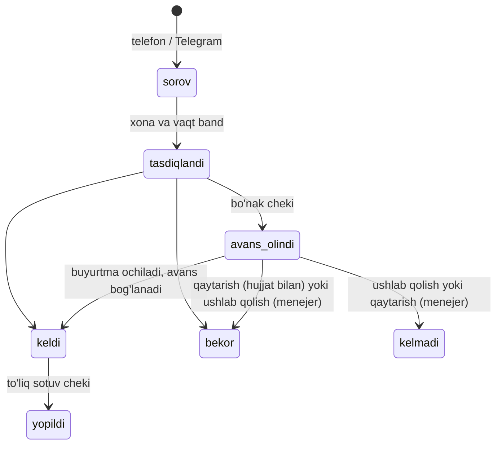

# Choyxona POS'ini xona, qozon va bo'nak belgilaydi

Bugungi choyxona choy ichiladigan joydan ko'ra **oldindan band qilinadigan xona va kilogramm bilan buyurtma qilinadigan osh**ga aylangan. Bir arxitektor 2025-yil noyabrida buni shunday ta'riflagan: choyxona endi "oldindan falon summali ovqat buyurtma qilib qo'yiladigan joy" ([Daryo, 17.11.2025](https://daryo.uz/2025/11/17/choyxona-tushunchasi-butunlay-ozgarib-ketdi-arxitektor-shuhrat-abdullayev-otaxonlar-uchun-tekin-guzarlar-kerakligi-haqida/)). Asosiy pul formulasi shunday: **xona puli + kg bo'yicha taom (osh, qozon kabob) + choy, non va salat**, ba'zan xizmat haqi bilan. Pulning bir qismi bronda **avans** sifatida olinadi, guruh hisobi esa kechqurun o'rtacha **5,5 soat** ochiq turadi ([Spot.uz, 03.03.2023](https://www.spot.uz/oz/2023/03/03/the-choyxona/)) [ESKI]. Bitta choyxonada **uchta buyurtma rejimi** yonma-yon ishlaydi: bronsiz stol yoki tapchan, bron va xona puli bilan xona (kabinka) sessiyasi, muddati va avansi bor oldindan buyurtma. Shu sababli choyxona birinchi format bo'lsa, PHASE3_PLAN'da osh markazi uchun "v1 ga kirmaydi" deb qoldirilgan qismlarning ko'pi v1 ga o'tadi: xonalar, uzoq ochiq hisob, joy narxi, bron, bo'nak va kredit cheklari, hisobni bo'lish va ofitsiant rejimi. Qonun bu oqimlar uchun tayyor chek shakllarini beradi. Avansga **bo'nak** cheki, keyin to'liq summaga **sotuv** cheki chiqariladi. Nasiyada avval to'liq **sotuv** cheki, keyin har bir to'lovga **kredit** cheki chiqariladi ([lex.uz, VM 943](https://lex.uz/ru/docs/4603329); [buxgalter.uz, 18.10.2023](https://buxgalter.uz/publish/doc/text193843_kak_prinimat_plateji_avansom_i_po_kreditu_razyasneniya_nalogovogo_komiteta)). Lekin xona puli va xizmat haqi uchun MXIK kodlari hamda aylanma soliq chegarasidagi ziddiyat hali tekshirilmagan. Bozorda bu formulani tayyor holda sotadigan dastur topilmadi. Mamlakatda choyxona va osh markazi tipidagi nuqtalar taxminan **8–15 ming** [XULOSA]. Eng katta bo'shliq: oddiy (premium bo'lmagan) choyxonaning 2024–2026-yillardagi narx, avans va nasiya raqamlari ochiq manbada deyarli yo'q. Shuning uchun hisobot oxirida pilot choyxonalar uchun tayyor savolnoma va kuzatuv varag'i berilgan.

## Hisobotni qanday o'qish kerak

Hisobot 2026-yil 21-oktabrdagi oltita tadqiqot eslatmasiga tayanadi: turlar va biznes model, ichki jarayon va xodimlar, guruhlar va bron, to'lov va fiskal qoidalar, dasturlar, bozor va hududlar. Shuningdek, shu kungi "Ovqatlanish formatlari POS talablari" tadqiqotidan hali to'g'ri bo'lgan faktlar olingan. Ikkalasi zid kelgan joyda yangi choyxona eslatmalari ustun. Belgilar:

- **[XULOSA]** — manbada yo'q, faktlardan chiqarilgan fikr. Uni taklif sifatida o'qing.
- **[ESKI]** — 2024-yil oktabrdan oldingi manba.
- **[ANIQ EMAS]** — qidiruv parchasi, bitta sharh yoki e'lon, yoki manbalar bir-biriga zid.
- **[YB]** — yetkazib beruvchining o'z da'vosi.

Choyxona xona narxlari va osh narxlari bo'yicha yagona tuzilgan ma'lumot **chaykhana.uz** katalogining ochiq API'sidan olindi: 159 ta joy, ma'lumotlar asosan 2019–2022-yillarda kiritilgan. Shuning uchun undagi hamma narxlar [ESKI]. Bu hujjat yuridik xulosa emas. Fiskal bo'yicha har bir qaror soliq maslahatchisi bilan tekshiriladi.

## 1. Beshta choyxona turi bitta formulaga tayanadi: xona puli va kg taom

### Qonundagi ta'rif va amaldagi choyxona bir-biridan uzoqlashgan

Umumiy ovqatlanish qoidalari choyxonani "asosiy xizmati choynakda choy berish" bo'lgan korxona deb ta'riflaydi. Unga non, milliy shirinliklar va bufet mahsulotlari ham ruxsat etiladi. Korxona turini ega o'zi belgilaydi ([lex.uz, VM 75, 2-ilova, 3-band](https://lex.uz/ru/docs/243233)). Amalda esa xonali choyxona osh, qozon kabob va banket sotadi. Bu choyxonani qonundagi "kafe"ga yaqinlashtiradi [XULOSA]. Mijozlar ham farqni sezadi. 2019–2020-yillardagi sharhlarda "Bu choyxonamas restoran bo'p ketibti, narxla qimmat" va "choyhonami yoki restaranmi... farqiga borolmadim" kabi gaplar bor ([chaykhana.uz](https://api.chaykhana.uz/v1/restaurants/2402)) [ESKI] [ANIQ EMAS]. POS uchun xulosa oddiy: tur nomiga qarab qoida o'zgartirilmaydi. Tur faqat qonun uni aniq nomlagan joyda hisobga olinadi (xizmat haqi va o'z-o'ziga xizmat). Qolgan hammasi sozlama bo'ladi [XULOSA].

Ochiq manbalardan beshta ishlab turgan format ajraladi.

| Tur | O'tirish joyi | Taom modeli | Asosiy tushum | Ish vaqti | Dalil |
|---|---|---|---|---|---|
| **A. Mahalla yoki guzar choyxonasi** | Zal va tapchanlar, xona kam yoki yo'q | Choy, non, oddiy taomlar; ma'lum kunlarda osh | Choy, non, arzon taom | Kunduz, erta | Yo'qolib bormoqda; arxitektor "tekin guzar"larni qayta tiklashni taklif qiladi ([Daryo, 2025](https://daryo.uz/2025/11/17/choyxona-tushunchasi-butunlay-ozgarib-ketdi-arxitektor-shuhrat-abdullayev-otaxonlar-uchun-tekin-guzarlar-kerakligi-haqida/)) |
| **B. Xonali choyxona** (asosiy format) | 5–20 xona yoki kabinka, qo'shimcha tapchan va stollar | Asosan oldindan buyurtma; osh va kabob kg bilan | Xona puli + kg taom + choy, non, salat; ba'zan mijozning o'z bozorligi | Tushdan keyin – kech, ba'zan 24/7 | Katalogdagi 159 joydan 77 tasi taomini "Buyurtma bo'yicha" deb yozgan ([chaykhana.uz](https://api.chaykhana.uz/v1/restaurants?page=0)) [ESKI] |
| **C. Yangi format resto-choyxona** | Dizaynli kabinkalar, VIP, terrasa, banket zali | To'liq menyu + oldindan buyurtma qilinadigan issiq taomlar | Yuqori chek, avans, tadbirlar, yetkazish | 12:00 – 00:00/01:00 | The Choyxona ([2GIS](https://2gis.uz/tashkent/firm/70000001061770279/tab/info)) |
| **D. Osh markazi** ("choyxona oshi" mahsulot sifatida) | Katta ochiq zal | Bronsiz, porsiya va kg; olib ketish va yetkazish | Porsiya va kg savdosi hajmi | Erta tongdan kechgacha | Kamolon Osh, Nomdor, Minor Osh menyulari |
| **E. Yo'l bo'yi (trassa) choyxonasi** | Tapchan, ochiq zal | Bronsiz, tez | Taom, choy | Uzoq | Faqat sayohatchi hikoyasi ([awd.ru, 2023](https://forum.awd.ru/viewtopic.php?t=421873)) [ESKI] [ANIQ EMAS] |

Bozorda sotilayotgan bitta qishloq kompleksi B turining tipik tuzilishini ko'rsatadi. Guliston (Sirdaryo) choyxonasi 150 000 dollarga sotuvga qo'yilgan. Unda 10 ta stolli xonalar, tapchanli soya bog', ikkita sauna, alohida baliq xonasi va 200 kishilik tadbir hovlisi bor ([OLX.uz, 27.09.2026](https://www.olx.uz/d/oz/obyavlenie/ishlab-turgan-chojxona-sotiladi-ID43fZD.html)) [ANIQ EMAS]. Bunday joyda bitta egada bir vaqtning o'zida xonalar, ochiq tapchan zonasi va tadbir bo'ladi. Demak, POS'da zallar, zonalar va har xil narx qoidalari birinchi kundan kerak.

### Xona puli: qat'iy narx, o'lcham bo'yicha farq va dam olish kuni ikki barobar

Katalogdagi 40 ta joy "joy narxi" maydonini to'ldirgan. Toshkentda bir xona uchun bir tashrifga **30 000 dan 300 000 so'mgacha** olingan: Rohat 30 000, Qorasuv 50 000, Anor, Turon va Yakkasaroy 100 000, Garimdori va Olchazor 150 000, Archazor 100 000–200 000, Sarbon 100 000–250 000, Anorzor 120 000–300 000 so'm. Viloyatlarda narx **0 dan 80 000 so'mgacha**: Hammabop (Farg'ona) 25 000, Sohil (Namangan) 10 000–20 000, Nodirbek (Farg'ona) 60 000–80 000. Rishtondagi "Choyxona nomer 1" va Andijondagi Bexizor esa 0 so'm deb yozgan ([chaykhana.uz API](https://api.chaykhana.uz/v1/restaurants?page=0)) [ESKI]. Narx xona turiga qarab o'zgaradi. Qo'qondagi Zamin oltita xona narxini beradi: 35 000 dan 75 000 so'mgacha ([chaykhana.uz](https://api.chaykhana.uz/v1/restaurants/1084)) [ESKI]. Toshkentdagi Qadrdon haqida mijoz yozgan narxnoma bor: "oddiy xona 140.000, billiard xona 300.000, katta zal 35 kishiga 300.000" ([chaykhana.uz](https://api.chaykhana.uz/v1/restaurants/1059)) [ESKI] [ANIQ EMAS]. Sharq choyxonasi "joy narxi hafta kunlari 75000, dam olish kunlari 150000" deb e'lon qilgan, ya'ni dam olish kuni narx **ikki barobar** ([t.me/choyxonachiuz, 06.10.2021](https://t.me/s/choyxonachiuz?before=776)) [ESKI].

Shikoyatlar yana ikki modelni ko'rsatadi. Diydor haqida "жой нархини жуда оширишди и обязаловка бор" deb yozilgan: xona puli bilan birga **majburiy minimal buyurtma** ham bor ([chaykhana.uz](https://api.chaykhana.uz/v1/restaurants/1067)) [ESKI] [ANIQ EMAS]. Sherxon haqida esa "choygayam alohida pul oladi" deyilgan. Demak, ayrim mijozlar choy xona puliga kirishini kutadi ([chaykhana.uz](https://api.chaykhana.uz/v1/restaurants/1073)) [ESKI] [ANIQ EMAS]. Kishi boshiga joy puli yoki soatlik xona ijarasi uchun birorta choyxona manbasi topilmadi. 2024–2026-yillarda e'lon qilingan birorta xona narxi ham topilmadi.

**[XULOSA]** POS'da xona puli uchun to'rtta model kerak: (1) xona uchun qat'iy narx, xonaning turi va o'lchamiga qarab; (2) hafta ichi, dam olish va bayram kunlari uchun alohida narx; (3) minimal buyurtma, yetmasa farq qo'shiladi; (4) nol. Kishi boshiga joy puli Rizqim'da allaqachon bor (`per_person`). Uni saqlash arzon, lekin choyxonada keng tarqalgani tasdiqlanmagan. Soatlik tarif keyinga qoldiriladi.

### Osh kilogramm bilan sotiladi, lekin "1 kg" ikki xil ma'noda ishlatiladi

Katalogda Toshkentdagi xonali choyxonalar "lazer" oshning kilosini **100 000–140 000 so'm**ga, devzira oshni 130 000–150 000 so'mga sotgan. Qozon kabob va bo'yin kabob 90 000 so'm/kg bo'lgan ([chaykhana.uz API](https://api.chaykhana.uz/v1/restaurants?page=0)) [ESKI]. Bitta taomning bir nechta **sifat darajasi** bor. Zamin devzira oshni uch darajada sotgan: oddiy 128 000, "birga bir" 164 000, sergo'sht 248 000 so'm/kg. Bu go'sht ulushiga qarab darajalar. Hammabop esa lazer osh, "Hammabop osh", "Boy oshi" va "Kuchli osh"ni 110 000 dan 180 000 so'mgacha sotgan, sho'rvalarni esa porsiya bilan (9 000–16 000) ([chaykhana.uz](https://api.chaykhana.uz/v1/restaurants/3158)) [ESKI]. Ko'l bo'yidagi baliq choyxonalari baliqni ham kg bilan sotadi ([chaykhana.uz API](https://api.chaykhana.uz/v1/restaurants?page=0)) [ESKI].

Bu eski narxlar bugungi tannarx bilan solishtirilsa, muhim narsa chiqadi. Statistika qo'mitasiga ko'ra, 2026-yil avgustida **1 kg guruchdan osh tayyorlash tannarxi** (700 g mol go'shti, 1 kg sabzi, yog', piyoz va no'xat bilan) Toshkentda **130 285 so'm**, Qoraqalpog'istonda 109 605 so'm bo'lgan ([stat.uz, 07.09.2026](https://stat.uz/uz/matbuot-markazi/qo-mita-yangiliklar/70097-1-kilogramm-palov-tajjorlash-anchaga-tushadi-4)). Katalogdagi 100–150 ming so'mlik "kg osh" narxi shu tannarx atrofida. Boshqa tomondan, osh markazi Kamolon bir porsiyani 24 000–28 000, bir kilogrammni 40 000–65 000 so'mga sotgan ([t.me/aslkamolon](https://t.me/s/aslkamolon?before=597)) [ESKI]. Bu tayyor oshning og'irligi. **[XULOSA]** Demak, choyxonada "1 kg osh" deganda ko'pincha **1 kg guruchdan pishgan osh** (taxminan 4–5 kishiga) tushuniladi, osh markazida esa tayyor oshning og'irligi. POS'da birlik nomi sozlanadigan bo'lishi kerak: "kg (guruch)" yoki "kg (tayyor)". Aks holda xodim ham, mijoz ham adashadi. Tannarx shunday bo'lsa, bugungi choyxona narxlari kilosiga taxminan 150–250 ming so'm bo'lishi kerak, lekin bu faqat taxmin va intervyuda tekshiriladi.

Osh markazlari esa "choyxona oshi"ni oddiy mahsulot sifatida sotadi. Kamolon Osh'da "Choyxona osh (kechki)" 53 000 so'm ([kamolonosh.uz](https://kamolonosh.uz/en/menu/product/choikhona-osh-1-kechki-d)), Nomdor'da 48 000 so'm ([nomdor.uz](https://nomdor.uz/uz/menu/product/osh-choikhona-)). Minor Osh 2026-yil aprelida choyxona oshining bir porsiyasini 55 000, 0,75 porsiyasini 53 000 so'mga sotgan. Qo'shimcha go'sht 30 000, qazi 11 000, bedana tuxumi 2 000, non 8 000 so'm bo'lgan ([Afisha.uz, 23.04.2026](https://www.afisha.uz/uz/restaurants/2026/04/23/minor-osh)). Kamolon tanlangan taomlarni "N kishilik" setlar bilan sotadi: shilpildoq 1 kishilik 65 000, 2 kishilik 110 000, 3 kishilik 165 000, 6 kishilik 300 000 so'm. Halimga 4 kg dan 20% chegirma qo'llaydi ([t.me/aslkamolon](https://t.me/s/aslkamolon)).

### Mijozning o'z mahsuloti va o'zi pishirishi alohida tushum qatori

Farg'onadagi Nodirbek choyxonasi shunday yozadi: "Bozorlik mijozlardan ham qabul qilinadi. Oshpaz xizmati xonaning narxi ichida" ([chaykhana.uz](https://api.chaykhana.uz/v1/restaurants/3157)) [ESKI]. The Choyxona'da ayrim mehmonlar o'zi pishirish uchun oshxonani band qiladi. U yerda o'z hovlisi va yozgi oshxonasi bor 22 kishilik kabinka xodimlar yordami bilan ijaraga beriladi ([Spot.uz, 2023](https://www.spot.uz/oz/2023/03/03/the-choyxona/); [Afisha.uz, 02.02.2023](https://www.afisha.uz/uz/restaurants/2023/02/02/the-choyxona/)) [ESKI]. Gap guruhlari bo'yicha etnografik tadqiqot ham choyxonada guruh "oshxona anjomlarini ijaraga olib", oshni o'zi pishirishi mumkinligini yozadi ([Global Informality Project](https://www.in-formality.com/wiki/index.php?title=Gap_%28Uzbekistan%29)) [ESKI]. Bu xizmatlarning narxi birorta manbada topilmadi.

**[XULOSA]** Oshning uchta rejimi bor va har biri POS'da alohida qator turi bo'ladi:

| Rejim | Mazmuni | POS qatori |
|---|---|---|
| Choyxona oshi | Porsiya, kg (guruch), lagan yoki N kishilik | Taom; qozon yoki retsept bo'yicha zaxiradan ayiriladi |
| "Mahsulot bizdan emas" | Guruh go'sht, guruch va sabzini olib keladi, oshpaz haq evaziga pishiradi | Xizmat qatori "osh damlash xizmati", miqdori kg guruch; zaxiradan faqat yog' yoki o'tin ayirilishi mumkin |
| "O'zi pishiradi" | Guruh qozon, o'choq yoki oshxonani ijaraga oladi (ko'pincha xona bilan birga) | Ijara qatori "qozon yoki oshxona ijarasi" (qat'iy yoki soatlik); choy, non, salat va ichimlik alohida sotiladi |

### Yangi format: kishi boshiga 250 ming so'mlik avans va 5,5 soatlik hisob

Eng yaxshi hujjatlashtirilgan misol The Choyxona (Toshkent, Bog'ishamol). Unda 8–16 kishilik 13 ta kabinka, o'z hovlisi bor 22 kishilik kabinka va 40 kishilik banket zali bor. 2GIS ma'lumotiga ko'ra o'rinlar 130 tagacha. To'lov naqd, karta, bank o'tkazmasi, kartadan kartaga o'tkazma va QR orqali qabul qilinadi ([2GIS](https://2gis.uz/tashkent/firm/70000001061770279/tab/info)). Spot.uz 2023-yilda 190 tagacha mehmon degan, ya'ni manbalar zid ([Spot.uz, 2023](https://www.spot.uz/oz/2023/03/03/the-choyxona/)) [ESKI]. Asoschining 2023-yildagi intervyusi choyxona iqtisodining eng aniq raqamlarini beradi:

- bronda avans **kishi boshiga kamida 250 000 so'm** xarajat kutilishiga qarab belgilanadi;
- 16 kishilik kabinkada 10 kishi **10 mln so'm** hisob yopgan;
- eng katta hisob ikki kabinka uchun **45 mln so'm** bo'lgan;
- hisob ochilishidan yopilishigacha o'rtacha **5,5 soat** o'tadi;
- stollar kuniga taxminan **2 marta** almashadi (soha me'yori 3–4);
- hafta ichida 130–140 mehmon keladi, payshanba, juma va shanba deyarli doim to'la;
- har bir qozon faqat bitta kabinka uchun pishiriladi, taom ertangi kunga qoldirilmaydi;
- oldindan buyurtmasiz faqat kabob, kurtoba (taxminan 30 daqiqa) va Yevropa taomlarini buyurtma qilish mumkin.

([Spot.uz, 03.03.2023](https://www.spot.uz/oz/2023/03/03/the-choyxona/)) [ESKI]. 2GIS hozir o'rtacha chekni "400 000 so'm" deb ko'rsatadi, lekin kishi boshigami yoki guruhgami, aytilmagan ([2GIS](https://2gis.uz/tashkent/firm/70000001061770279/tab/info)). Joy har payshanba 12:30–14:30 da bronsiz tushlik uchun "PLOV set" taklif qiladi. 2024-yil aprelda bu set 95 000 so'm bo'lgan: osh, non, salat, achchiq-chuchuk, shirinlik va choy ([t.me/thechoyxona, 17.04.2024](https://t.me/s/thechoyxona?before=201)). E'lon 2026-yil oktabrida ham davom etmoqda ([t.me/thechoyxona](https://t.me/s/thechoyxona)). Kompaniya "The Choyxona Group" nomi bilan 2025-yil yanvar–avgustida umumiy ovqatlanishdagi eng yirik 20 soliq to'lovchi orasida 15-o'rinda turgan (2,8 mlrd so'm soliq) ([Spot.uz, 20.10.2025](https://www.spot.uz/oz/2025/10/20/catering-tax/)). Bu shuni ko'rsatadiki, choyxona formati katta va rasmiy biznes bo'la oladi.

Bu bitta premium joyning raqamlari. Mahalla yoki o'rta choyxona uchun 2024–2026-yillardagi chek, guruh hajmi va hisob davomiyligi bo'yicha manba topilmadi. **[XULOSA]** Toshkentdagi o'rta xonali choyxonada 8–10 kishilik guruh uchun taxminiy hisob: xona puli, 2–3 kg osh, kabob, salat, choy va non. Bu taxminan 1,5–4 mln so'm, ya'ni kishi boshiga 150–400 ming so'm atrofida bo'lishi mumkin. Bu raqam tekshirilmagan va faqat suhbat savollarini tuzish uchun berilgan.

### Menyu: oshning turlari, kg taomlar va xizmatlar

Katalogda eng ko'p uchraydigan taom belgilari: "Buyurtma bo'yicha" (77 joy), qozon kabob (19), osh (15), sho'rva (14), dimlama (10), mastava (9), kabob (8), moshkichiri (6), baliq va qaynatma sho'rva (5 tadan). Achchiq osh, jiz, devzira osh va cho'poncha 4 tadan joyda uchraydi ([chaykhana.uz API](https://api.chaykhana.uz/v1/restaurants?page=0)) [ESKI]. Ba'zi choyxonalar spirtli ichimlikni qat'iyan taqiqlaydi va bu ularning reklamasi. Sharq choyxonasi "ichkilik iste'mol qilinayotgan bo'lsa choyxonadan chiqarib yuboriladi" deb yozgan ([t.me/choyxonachiuz](https://t.me/s/choyxonachiuz?before=776)) [ESKI]. Yangi formatda esa vino kartasi bor ([2GIS](https://2gis.uz/tashkent/firm/70000001061770279/tab/info)).

**[XULOSA]** POS uchun tayyor choyxona menyu shabloni quyidagicha bo'lishi mumkin: choy (choynak; ko'k yoki qora; "xona puliga kiradi" belgisi), non (dona), salatlar, osh (tur × daraja × birlik: porsiya, kg guruch, lagan, N kishilik), kg bo'yicha go'shtli taomlar (qozon kabob, jiz, qovurma, dimlama, tandir), shashlik (six), sho'rvalar (porsiya), xamir taomlar, baliq (kg yoki porsiya), ichimliklar va **xizmatlar** (xona puli, oshpaz xizmati, qozon ijarasi, banket zali).

## 2. Bir oqshom besh soat davom etadi: xodimlar, buyurtma va pulning ichki yo'li

### Rollar ish e'lonlaridan ma'lum, hisobni kim yopishi esa noma'lum

Choyxona ish e'lonlari aniq rollar to'plamini ko'rsatadi: ofitsiant (ko'pincha faqat erkak), shashlikchi yoki mangalchi, "choyxona taomlarini biladigan" oshpaz, tandir ustasi, idish yuvuvchi va umumiy "ishchilar". Toshkent Yunusoboddagi choyxona ofitsiantdan "mijozlarga xizmat ko'rsatish, buyurtmani qabul qilib tez yetkazish, choyxona qoidalariga rioya qilish"ni talab qiladi. Maosh oyiga 3,0–4,5 mln so'm, erkak, 15–30 yosh, ovqat va turar joy beriladi ([ISHBOR](https://t.me/s/ishbor?before=6306)). Urganchdagi choyxona e'lonida ofitsiantlarga kuniga 100 000–120 000 so'm, ish vaqti 11:00–00:00. Shashlikchilar uchun haq "boshqacha" deb alohida yozilgan ([Xorazm ish](https://t.me/s/Xorazm_ish?after=30236)). Kassir vazifasi chakana savdo e'lonida aniq ta'riflangan: "Ertalab kassani qabul qilish, kechqurun topshirish" ([Xorazm ish](https://telegram.me/s/Xorazm_ish)).

Ko'rilgan kanallarda "choyxonachi", "choyxona administratori" yoki "choyxona kassiri" degan birorta e'lon topilmadi. **[XULOSA]** Kichik va o'rta choyxonada kassa, bron va xarid odatda egasi yoki uning qarindoshi qo'lida bo'ladi. Choyxonachining ishi (choy, non, dasturxon) esa ofitsiant yoki ishchiga yuklanadi. Taxminiy shtat quyidagicha. Kichik mahalla choyxonasida 5–8 kishi: ega kassada, 1–3 ofitsiant, 1 mangalchi, 1 oshpaz, 1 ishchi. Katta kabinkali choyxonada 15–30 kishi: ega yoki menejer, 6–12 ofitsiant, 2–3 mangalchi, osh ustasi bilan bir nechta oshpaz, administrator, kassir yoki buxgalter, tandirchi va idish yuvuvchilar. Hisobni kim ochadi va kim yopadi, ofitsiant pulni o'zida ushlaydimi, buni hech bir manba aytmaydi. Bu suhbatda birinchi aniqlanadigan narsalardan biri.

### Ish haqi modeli POS'dan ofitsiant bo'yicha sotuvni talab qiladi

E'lonlarda uchta to'lov modeli bor. Birinchisi, **kunlik stavka**: viloyatlarda kuniga 70 000–150 000, Toshkentda 150 000–300 000 so'm. Ikkinchisi, **kafolatlangan summa va o'z sotuvidan foiz**. Masalan, Toshkent Mirobod kafesida "100.000 гарант +%, выходит 200.000 в среднем" va "чаевые ваши" deb yozilgan. Moti'da 7 kunlik sinovdan keyin "4% от общей". Urganchdagi fast-foodda "Kunlik: 3 foiz" ([ishkop.uz](https://ishkop.uz/%D0%B2%D0%B0%D0%BA%D0%B0%D0%BD%D1%81%D0%B8%D0%B8/%D0%95%D0%B6%D0%B5%D0%B4%D0%BD%D0%B5%D0%B2%D0%BD%D0%B0%D1%8F-%D0%BE%D0%BF%D0%BB%D0%B0%D1%82%D0%B0-%D0%BE%D1%84%D0%B8%D1%86%D0%B8%D0%B0%D0%BD%D1%82/%D0%A2%D0%B0%D1%88%D0%BA%D0%B5%D0%BD%D1%82); [Xorazm ish](https://t.me/s/Xorazm_ish?after=30236)). Uchinchisi, **oylik**: choyxona ofitsiantiga 3,0–4,5 mln, oshpazga 4–6 mln so'm ([OLX.uz](https://www.olx.uz/oz/rabota/tashkent/q-oshpaz/)). Forum foydalanuvchilariga ko'ra, hisobdagi 10–25% xizmat haqi ofitsiantga bormaydi ([Travelask](https://travelask.ru/questions/4701093_uz_tas_chto-naschet-chaevyh-v-uzbekistane-obratili-vnimanie-chto-ve)) [ESKI] [ANIQ EMAS].

**[XULOSA]** Bundan uch talab chiqadi. Birinchidan, har bir qator va har bir hisob ofitsiantga biriktiriladi, chunki ko'p ofitsiantga o'z sotuvidan 2–5% to'lanadi. Ikkinchidan, kun oxiri hisobotida har bir ofitsiant uchun "sotuv × foiz" va "garant" ko'rinadi. Uchinchidan, choy puli xizmat haqidan alohida yoziladi. Foiz modeli ofitsiantni sotuvni yozishga undaydi. Kunlik stavka esa bunday rag'bat bermaydi. Shuning uchun kunlik stavkadagi joylarda hisobsiz sotuv xavfi yuqoriroq.

### Bitta xona oqshomi: choydan oshgacha bir necha bosqich

Bir guruh oqshomining tartibi manbalardan qisman tiklanadi. Choyxona oshi buyurtma qilinadi va kutayotganda choy ichiladi ([Afisha.uz, 13.11.2024](https://www.afisha.uz/uz/gorod/2024/11/13/plove)). Nahor oshida avval non va choy, keyin osh beriladi, ikki kishiga bitta lagan ([meros.uz](https://meros.uz/object/nahorgi-osh)) [ANIQ EMAS]. Kabob va kurtobani oldindan buyurtma qilish kerak, ular taxminan 30 daqiqa pishadi ([Spot.uz, 2023](https://www.spot.uz/oz/2023/03/03/the-choyxona/)) [ESKI]. Shashlik six bilan sotiladi: Toshkentda 2025-yilda bir six 17 000–20 000 so'm bo'lgan ([WeProject, 28.04.2025](https://www.weproject.media/articles/detail/chto-mozhno-pokushat-v-tashkente-za-50-000-sum-luchshie-mesta-i-blyuda/?amp=y)).

**[XULOSA]** Kabinka oqshomining ishchi modeli (hammasi intervyuda tekshiriladi):

1. **Bron.** Telefon yoki Telegram orqali. Sana, xona, mehmon soni, oldindan buyurtma (N kg osh, kabob) va avans yoziladi.
2. **Kelish.** Ofitsiant xona hisobini ochadi, avans unga bog'lanadi. Choy va non darhol beriladi.
3. **1-bosqich.** Salat, ichimlik va shashlik. Shashlik mangal sexiga boradi.
4. **2…n-bosqichlar** (taxminan 5 soat). Yana choy, non va shashlik. Belgilangan vaqtda xonaning qozonidan osh keladi.
5. **Schyot.** Taomlar + xona puli yoki minimal summa + xizmat haqi − avans.
6. **To'lov.** Naqd, karta, QR, ko'pincha aralash. Kassir yoki ega yopadi, choy puli alohida yoziladi.

Ish kuni ertalab bozordan boshlanadi. Bozorlik pul bilan qilinadi, sixlar tayyorlanadi va bronlarga qarab qozon rejasi tuziladi. Kassa boshlang'ich naqd bilan ochiladi. Smenalar e'lonlarga ko'ra 09:00/11:00 dan 23:00/00:00 gacha davom etadi. Yopishda naqd sanaladi, ofitsiantlar bo'yicha sotuv va foiz hisoblanadi, kunlik ish haqi beriladi va egaga hisobot yuboriladi.

### Xarid va go'sht narxi: choyxona bronga qarab bozorlik qiladi

Go'sht narxi tez o'zgaradi. 2026-yil martida Chorsuda ulgurji mol go'shti kilosi 75 000–108 000 so'm bo'lgan va bir oyda 8% gacha oshgan ([Spot.uz, 24.03.2026](https://www.spot.uz/oz/2026/03/24/meat)). The Choyxona egasi asosiy nazorat nuqtalari sifatida xarid, logistika va yetkazib berishni ataydi. U naqd oqimi, qoldiq, daromad va xarajatni har kuni "xolis" buxgalter orqali solishtiradi. O'g'irlik bo'lganini va qo'lga tushgan xodimlar ishdan bo'shatilganini tan oladi ([Spot.uz, 2023](https://www.spot.uz/oz/2023/03/03/the-choyxona/)) [ESKI]. **[XULOSA]** Taom xona uchun buyurtma bo'yicha pishirilgani sababli ertangi xarid bronlarga bog'liq. Bronlardagi osh kilogrammidan "ertaga nima olish kerak" ro'yxatini chiqarish choyxona egasiga ko'rinadigan foyda, lekin v1 uchun shart emas.

## 3. Mehmonlar va guruhlar: gap, gashtak va bitta to'lovchi

### Kimlar keladi va qachon

The Choyxona'ni band qiladiganlar orasida "yigitlar bazmi" o'tkazuvchilar, "gap o'ynash" uchun keladigan guruhlar va o'zi pishirish uchun kabina olganlar bor. Avval auditoriya 35 yoshdan katta bo'lgan. Endi 15–16 yoshlilar ham keladi, ko'pincha ota-onasi bilan tug'ilgan kun uchun ([Spot.uz, 2023](https://www.spot.uz/oz/2023/03/03/the-choyxona/)) [ESKI]. Joy 8-mart kuni kabinkalarda ayollar uchun tadbir, Navro'zda sumalak, Ramazonda iftorlik o'tkazadi ([t.me/thechoyxona](https://t.me/s/thechoyxona?before=201)). Afisha'ning 2025-yildagi Toshkent iftorlik ro'yxatidagi yagona choyxona shu bo'lgan. U har bir kechki buyurtmaga bepul iftorlik seti bergan. Restoranlarda iftorlik setlari 99 000 dan 600 000 so'mgacha turgan, ba'zilari "ikki kishilik" yoki "to'rt kishilik" ([Afisha.uz, 04.03.2025](https://www.afisha.uz/ru/gorod/2025/03/04/iftar-2025)). An'anaviy choyxona esa haligacha erkaklar maskani. Kun.uz 2023-yilda "choyxonalarga odatda faqat erkaklar boradi" deb yozgan ([Kun.uz, 12.03.2023](https://www.kun.uz/news/2023/03/12/zamonaviy-choyxona)) [ESKI]. Ayollar gapi uy, kafe yoki restoranda o'tadi ([Wikipedia, Гаштак](https://ru.wikipedia.org/wiki/%D0%93%D0%B0%D1%88%D1%82%D0%B0%D0%BA)).

Nahor oshi to'y va aza marosimlariga bog'liq ([uz.wikipedia](https://uz.wikipedia.org/wiki/Nahor_oshi)). To'y qoidalari tadbirni 200 mehmon bilan, nahor oshini 250 mehmon bilan cheklaydi va 06:00–23:00 oralig'ida o'tkazishni talab qiladi ([Kun.uz, 22.04.2025](https://kun.uz/news/2025/04/22/ozbekistonda-toy-otkazish-tartibi-yangilanadi)). **[XULOSA]** Bu cheklovlar kichik tadbirlarni (nahor oshi, ma'raka, kichik ziyofat) to'yxonadan choyxona va kabinkaga surishi mumkin. Shuning uchun bronda "tadbir turi" belgisi (gap, tug'ilgan kun, ziyofat, korporativ, nahor oshi yoki ma'raka, iftorlik, oilaviy) yuklamani oldindan ko'rish va menyu shablonini tanlash uchun foydali.

### Gap uchta moliyaviy modelda ishlaydi, choyxona esa faqat hisobni ko'radi

Gap — bir yoshdagi va bir jinsdagi odamlarning muntazam yig'ilishi. Odatda 3–12 kishi, ba'zan 30 dan ortiq. Ular do'stlik, qarindoshlik, maktab, mahalla yoki ish orqali bog'langan. Uchrashuv a'zoning uyida yoki kafe, restoran yoki choyxonada o'tadi. Tushlik puli ikki xil to'lanadi. Ko'pincha hamma kechki ovqat oxirida teng ulush qo'shadi va bu ovqat hamda ijarani qoplaydi. Yoki a'zolar navbat bilan mezbon bo'lib to'laydi. "Gap o'ynash"da esa har bir a'zo har uchrashuvda kelishilgan summani beradi va navbatdagi kishi butun summani oladi. 2013–2014-yillarda bitta uchrashuvga 50 000–500 000 so'm, boy tadbirkorlarda 1 mln so'mgacha qo'shilgan. Guruhni jo'ra boshi boshqaradi ([Global Informality Project](https://www.in-formality.com/wiki/index.php?title=Gap_%28Uzbekistan%29)) [ESKI]. 2025-yil yanvaridagi fatvo savol-javobi hozirgi amaliyotni tasvirlaydi: a'zolar oyda bir marta yig'iladi, kim olishini qur'a bilan aniqlaydi va "olgan kishi guruhni o'z hisobidan mehmon qiladi" ([islomqa.com, 12.01.2025](https://islomqa.com/question/gap-oyini-yoki-gashtak-qilib-bergan-odam-mehmondorchilik-qilib-bersa-bu-ribo-bolib-qolmaydimi/)). 12 a'zoli guruh oyda bir marta yig'ilsa, har bir a'zo yiliga bir marta mezbon bo'ladi ([mytashkent.uz, 2006](https://mytashkent.uz/2006/09/04/gap/)) [ESKI]. Mustahkam erkaklar guruhida qozon yonidagi navbatchilik haftadan haftaga o'tadi ([Radio Svoboda, 2006](https://www.svoboda.org/a/367712.html)) [ESKI].

Choyxonalar doimiy gap guruhlariga chegirma, oylik hisob yoki qarz beradimi, buni hech bir manba aytmaydi. **[XULOSA]** "Gap o'ynash" puli a'zolar orasidagi pul, u choyxona POS'idan o'tmaydi. POS faqat choyxona hisobini kim to'laganini yozadi. Guruh uchun to'rtta to'lov yo'li kerak: navbatchi hammasini to'laydi; teng N ulush (xona puli va xizmat haqi bilan birga); jo'ra boshi yig'ilgan naqd bilan to'laydi ("gap puli" izohi bilan); bir kishi karta bilan to'laydi, qolganlar unga o'tkazadi. To'rtinchi yo'lni Click'ning "Hodisa" xizmati qo'llab-quvvatlaydi: u umumiy hisobni, jumladan "restoran hisobi"ni ishtirokchilarga bo'lib, har biriga hisob-faktura yuboradi ([Click, 10.05.2024](https://co.click.uz/xizmat-haqida/uslugi)). Shuning uchun schyotda **"kishi boshiga"** summa ko'rsatilishi bir kishi to'lagan holatda ham foydali.

### Bron telefon orqali olinadi, avans kishi boshiga hisoblanadi, bekor qilish qoidasi topilmadi

The Choyxona asoschisi "biz joy band qilmasdan ishlay olmaymiz" deydi. Uning so'zlariga ko'ra, sotib olingan bron dasturi ularning sozlamalari uchun yetarlicha moslashuvchan bo'lmagan va uni almashtirishga to'g'ri kelgan ([Spot.uz, 2023](https://www.spot.uz/oz/2023/03/03/the-choyxona/)) [ESKI]. Uning Telegram kanalida bron faqat telefon orqali: "Бронируйте кабинку заранее: 99 844 88 88". Kanalda xona narxi, minimal buyurtma, avans yoki xizmat foizi yozilmagan ([t.me/thechoyxona](https://t.me/s/thechoyxona)). Shosh choyxonasi kanalida ham faqat telefon raqamlari bor ([t.me/shosh_choyxona](https://t.me/shosh_choyxona)). 2025-yildagi Toshkentning yettita choyxonasi sharhi aloqa sifatida faqat Instagram manzillarini beradi ([WeProject, 07.07.2025](https://weproject.media/articles/detail/chaykhana-v-tashkente-7-mest-gde-vy-smozhete-prochuvstvovat-uzbekskiy-kolorit/)). Onlayn bron Toshkentda faqat restoranlarda boshlanmoqda. Yandex Go'ning "Куда сходить" bo'limida 2026-yil fevralida 10 dan ortiq restoran bron qilinadi ([repost.uz, 13.02.2026](https://repost.uz/ray-dlya-introvertov)). Oshme Telegram boti 2023-yilda 100 dan ortiq joyni qamragan ([IT Park, 02.05.2023](https://www.it-park.uz/ru/itpark/news/startup-story-oshme-servis-pomogayushchiy-vybrat-restoran-i-zabronirovat-stolik-onlayn)) [ESKI]. Bu kanallarning birortasida choyxona topilmadi.

Avans miqdori bo'yicha yagona raqam — The Choyxona'ning kishi boshiga 250 ming so'mlik asosi. Bekor qilish, kelmaslik va minimal summa qoidalari birorta choyxona uchun topilmadi. To'y bo'yicha 2026-yilgi maslahat avval to'liq summani so'rashni va qaytarish shartlarini yozib qo'yishni tavsiya qiladi ([Afisha.uz, 24.08.2026](https://www.afisha.uz/ru/weddings/2026/08/24/wedding-budget)). Raqobat qo'mitasi esa ayrim joylar "oldindan depozit" talab qilayotganini tanqid qilgan (5-bo'lim).

**[XULOSA]** Bron obyektida quyidagilar bo'ladi: sana va vaqt, xona yoki zona, rejalashtirilgan va haqiqiy mehmon soni, tadbir turi, aloqa (ism, telefon, Telegram), manba (telefon, Instagram, Telegram, kelib band qilgan), oldindan buyurtma qilingan taomlar, avans (summa, usul, kim qabul qilgan), minimal summa. Holatlar: so'rov → tasdiqlandi → avans olindi → keldi → yopildi, yoki bekor qilindi, yoki kelmadi. Standart bron davomiyligi restoranlardagi 2 soat emas, **4–6 soat**. Kuniga ikki seans bo'ladi (tushlik va kechki). Xonalarni banket uchun birlashtirish mumkin bo'lishi kerak. Telefon raqami bo'yicha qidirish mijoz yoki guruhning tarixini darhol ko'rsatishi kerak. Avans bron vaqtida tushum emas: u yakuniy hisobdan ayiriladigan oldindan to'lov. Avansni ushlab qolish alohida, menejer huquqi bilan bajariladigan amal.

### Nasiya keng tarqalgan deyiladi, lekin choyxona raqami yo'q

Nasiya kechiktirilgan to'lov bilan sotuvdir ([izoh.uz](https://izoh.uz/word/nasiya)). Daftaron ilovasi "O'zbekistonda 1 milliondan ortiq kichik biznes nasiya savdoni qog'oz daftarlarda yuritadi" deydi ([daftaron.uz](https://daftaron.uz/)) [YB]. Shunga o'xshash NasyaPing va pDaftar ilovalari muddat kelganda eslatma yuboradi va muddatni 30 yoki 60 kunga uzaytirishga ruxsat beradi ([nasiyaping.biz](https://nasiyaping.biz/); [pdaftar.uz](https://pdaftar.uz/ru)). Mahalliy POS'lardan Biznex "qarzga sotuv"ni to'lov turi sifatida taklif qiladi ([biznex.uz](https://www.biznex.uz/)) [YB]. Choyxonalarda nasiya qanchalik keng tarqalgani, limiti va qaytmaslik darajasi bo'yicha birorta manba topilmadi. **[XULOSA]** Nasiya uch shaklda bo'lishi mumkin: mahalla doimiy mijozlarining kichik choy, non va osh qarzlari; ishonchli guruh yoki jo'ra boshining "keyingi hafta" yoki "oy oxirida" to'lovi; marosim tashkilotchisining tadbirdan keyingi to'lovi. Soxta nasiya xodim naqdni yashirishining oson yo'li. Shuning uchun nasiyaga yopilgan har bir hisob aniq mijozga (telefon) bog'lanadi, menejer tasdiqlaydi, egaga ogohlantirish boradi va Z-hisobotda nasiya alohida ko'rinadi.

## 4. Bitta zalda uchta buyurtma rejimi yashaydi

Choyxonaning har bir turida uchta rejim bor, lekin ularning og'irligi farq qiladi. Osh markazi va yo'l bo'yi choyxonasida deyarli hamma narsa bronsiz porsiya savdosi. Xonali choyxonada asosiy tushum bron va oldindan buyurtmadan keladi, stol va tapchanlar ikkinchi o'rinda. Yangi formatda bron qilingan kabinkalar ustun, bronsiz mehmon uchun cheklangan menyu bor. 2025-yil iyulidagi sharhda bir guruh kechqurun bronsiz kelib, issiq taom ololmaganini yozgan ([Yandex Maps](https://yandex.com/maps/org/restoran_the_choyxona/193687795731/)) [ANIQ EMAS]. Bu egasining 2023-yildagi gapiga mos: issiq taom oldindan buyurtma qilinadi ([Spot.uz, 2023](https://www.spot.uz/oz/2023/03/03/the-choyxona/)) [ESKI]. Xonali choyxonalarda ichki va tashqi stollar ham bor ([chaykhana.uz](https://api.chaykhana.uz/v1/restaurants/1066)) [ESKI]. Bir sharhda ko'chada o'tirganda xizmat kechikishi aytilgan ([chaykhana.uz](https://api.chaykhana.uz/v1/restaurants/1091)) [ESKI] [ANIQ EMAS].

| | **1. Bronsiz stol yoki tapchan** | **2. Xona (kabinka) sessiyasi** | **3. Oldindan buyurtma** |
|---|---|---|---|
| Qachon | Kunduz va kechqurun, yozda ochiq zona; payshanba oshi | Kechqurun 4–6 soat; payshanba–shanba to'la | Bir yoki bir necha kun oldin; nahor oshi, ma'raka, guruh oshi, bayram yetkazishi |
| Nima sotiladi | Porsiya osh (qozondan), choy, non, salat, six | Xona puli + kg taomlar + bosqichma-bosqich choy, non, salat, six | N kg osh, qozon kabob, N kishilik set, lagan |
| Hisob | Qisqa ochiq hisob; xona puli odatda yo'q [XULOSA]; xizmat haqi zona bo'yicha | Uzoq ochiq hisob, ko'p bosqich; xona puli avtomatik; minimal summa; avans ayiriladi; ko'pincha bitta to'lovchi yoki teng bo'lish | Muddati (pishib bo'lish vaqti) bor; avans bilan; kelganda xona hisobiga yoki olib ketishga o'tadi |
| Oshxona | Qozondan tarqatish, mangal markasi | Har bosqich sexlarga; osh xona qozonidan belgilangan vaqtda | KDS'da vaqt bo'yicha alohida navbat; ertangi xarid ro'yxatiga ta'sir qiladi |
| Fiskal | Yopishda bitta sotuv cheki | Bronda bo'nak cheki → yopishda to'liq sotuv cheki | Avansga bo'nak cheki → topshirishda to'liq sotuv cheki |
| Rizqim'dagi asos | `orders` (`channel = pos_hall`, stolsiz yoki `table_id` = tapchan), `menu_batches`, stop-list | `orders` (`pos_hall`, `table_id` = xona, `guests_count`), `service_fee_settings` (joy narxi, xizmat haqi), `order_bills`, `payments` | Yangi `bookings` + bog'langan qatorlar; olib ketishda `orders` (`pos_takeaway`) |

**[XULOSA] POS buni qanday modellashtiradi.** Asosiy qoida: hamma rejim oxirida bitta oddiy `orders` qatoriga aylanadi. Oshxona, stop-list, hisobot va fiskal shunda hamma rejim uchun bir xil ishlaydi (POS_SPEC 0-bo'lim qarori). Farq faqat buyurtma qayerdan boshlanishida.

1. **Stol yoki tapchan.** Kassir yoki ofitsiant xaritadan stolni bosadi. Buyurtma darhol ochiladi. Xona puli qoidasi bu stolga qo'llanmaydi, agar ega tapchanga alohida joy puli qo'ymagan bo'lsa. Porsiya osh ochiq qozondan (`menu_batches`) ayiriladi va tugaganda hamma joyda "tugadi" bo'ladi.
2. **Xona sessiyasi.** Bron bo'lsa, mehmon kelganda kassir "Keldi"ni bosadi. Bron buyurtmaga aylanadi: xona `table_id` bo'ladi, mehmon soni ko'chadi, oldindan buyurtma qatorlari "ushlab turish" (`fire_mode = hold`) holatida va pishib bo'lish vaqti bilan qo'shiladi, avans esa shu buyurtmaning oldindan to'lovi sifatida bog'lanadi. Xona puli qatori xona tarifi bo'yicha (kun turiga qarab) avtomatik qo'shiladi. Bronsiz kelgan guruh uchun xuddi shu oqim bronsiz boshlanadi. Har bir yangi qo'shimcha buyurtma vaqti va ofitsianti bilan alohida "bosqich" bo'ladi. N soatdan uzoq ochiq xona egaga ogohlantirish beradi.
3. **Oldindan buyurtma.** Bron yoki olib ketish buyurtmasi kelajakdagi muddat bilan yaratiladi. Oshxona uni darhol emas, "pishib bo'lish vaqti"dan oldin (masalan, 2 soat oldin osh uchun) o'z navbatida ko'radi. Olib ketish yoki yetkazish bo'lsa, muddat kelganda oddiy `pos_takeaway` buyurtma sifatida yopiladi.

## 5. Fiskal va huquq: bo'nak, sotuv va kredit cheklari tartibi

### Har bir to'lov chek talab qiladi, P2P esa soliq nishonida

Har bir ovqatlanish shoxobchasida bank kartasi terminali bo'lishi shart. To'lov oldindan, tanlagandan keyin, ovqatdan keyin yoki o'zi hisob-kitob qilib amalga oshirilishi mumkin. Ofitsiant xizmatida mehmon ofitsiant bergan hisob yoki kassa cheki bo'yicha to'laydi ([lex.uz, VM 75, 2-ilova, 14-band](https://lex.uz/ru/docs/243233)). Kichik choyxona uchun alohida istisno topilmadi. Onlayn kassa majburiyatidan faqat ro'yxatdagi chekka aholi punktlari va vending avtomatlari ozod. O'sha ro'yxatning o'zi ochiq manbada topilmadi ([lex.uz, VM 943, 1-ilova, 3-band](https://lex.uz/ru/docs/4603329); [buxgalter.uz](https://buxgalter.uz/publish/doc/text163978_pochemu_net_isklyucheniy_pri_perehode_na_onlayn-kkm)) [ESKI]. Yuridik shaxslar uchun yagona UzQR 2026-yil 1-iyuldan majburiy ([buxgalter.uz, 30.06.2026](https://buxgalter.uz/publish/doc/text215897_edinyy_qr-kod_obyazatelen_dlya_yurlic_s_1_iyulya_-_mojno_li_ispolzovat_drugie_qr-kody)). Eng muhimi, **2026-yil 22-oktabrdan** umumiy ovqatlanishda soliq organlari tizimi bilan integratsiya qilinmagan buyurtma dasturlaridan foydalanish taqiqlanadi ([lex.uz, VM 393](https://lex.uz/ru/docs/8343102)). Buzish uchun jarima oxirgi chorak sof tushumining 2%, takrorlansa 20% ([Soliq kodeksi, 227¹-modda](https://lex.uz/ru/docs/4674902)). Chek bermaslik yoki karta va QR to'lovni rad etish uchun jarima 5 mln so'm ([Soliq kodeksi, 221-modda](https://lex.uz/ru/docs/4674902)).

Choyxonalar uchun eng xavfli odat — shaxsiy kartaga o'tkazma. BMTTD so'roviga ko'ra, choyxonalarning **45%** i mijozni P2P o'tkazmaga yo'naltiradi. Bu barcha formatlar ichida eng yuqori ko'rsatkich ([BMTTD, 2026](https://www.undp.org/sites/g/files/zskgke326/files/2026-05/ga_report_uzb.pdf)). Soliq qo'mitasi 2026-yil 13-maydan shoxobcha egalarining P2P tushumlarini tahlil qilmoqda. Yiliga taxminan 500 mln so'mdan ortiq karta tushumi bor tadbirkorlar chaqirilgan. Xatlarda soliq bazasi yashirilgani yozilgan, oqibati esa qo'shimcha soliq va 20% jarima ([gazeta.uz, 13.05.2026](https://www.gazeta.uz/oz/2026/05/13/p2p/); [spot.uz, 13.05.2026](https://www.spot.uz/oz/2026/05/13/p2p-raids)). Tushumni hisobda ko'rsatmaslik soliq bazasini yashirish hisoblanadi va yashirilgan summaning 20% i miqdorida jarimaga olib keladi ([Soliq kodeksi, 223-modda](https://lex.uz/docs/4674902)). Banklarga katta P2P tushumlar haqida xabar berishni yuklaydigan loyiha 2026-yil iyunida chiqqan. Markaziy bank uni Konstitutsiyaga zid deb e'tiroz bildirgan. Oktabr holatiga u qabul qilingani tasdiqlanmagan ([gazeta.uz, 24.06.2026](https://www.gazeta.uz/oz/2026/06/24/p2p/); [gazeta.uz, 09.07.2026](https://www.gazeta.uz/oz/2026/07/09/p2p/)). **[XULOSA]** POS'da P2P oddiy to'lov turi bo'lmaydi. Kassir ekranida uning o'rniga summasi bor dinamik QR taklif qilinadi. U ham tez, ham avtomatik fiskal chek beradi.

### MXIK: uchta katering guruhi va ikkita tayyor xizmat kodi

Soliq qo'mitasi 2022-yil noyabrida katering kodlarini 306 tadan 47 taga qisqartirgan, ulardan 26 tasi taomlar uchun. Kodlar uchta guruhga bo'lingan. **10202001** — taomnoma: taomlar, non, choy va boshqa alkogolsiz ichimliklar. **10202002** — ovqatlanish shoxobchasining boshqa xizmatlari: bron, yetkazish, bir martalik idish, bolalar xonasi, to'xtash joyi. **10202003** — tadbir va banket uchun katering, tadbir xarajatlari bilan. Xuddi shu xabarga ko'ra, xizmat haqi va xona bezagi alohida toifalarga qo'yilgan, lekin ularning kodlari berilmagan. Chekdagi taom nomi menyudagi nom bilan bir xil bo'lishi kerak ([spot.uz, 28.11.2022](https://www.spot.uz/oz/2022/11/28/mxik/); [spot.uz (ru)](https://www.spot.uz/ru/2022/11/28/catering-codes/)) [ESKI]. Taom kodlari toifa bo'yicha umumiy. Osh "katering korxonasi tayyorlagan asosiy taomlar" kodiga tushadi, har bir taomga alohida kod berilmaydi ([buxgalter.uz, 08.06.2023](https://buxgalter.uz/oz/publish/doc/text191011_tasnif_soliq_uz_saytida_tugri_mhik_qanday_topiladi)) [ESKI]. Ikkita to'liq xizmat kodi topildi: **10202002003000002** "boshqa bron va joy band qilish xizmatlari" va **10202002004000001** "boshqa to'lov turlari, majburiy depozit uchun oldindan to'lov" ([buxgalter.uz, 23.02.2023](https://buxgalter.uz/publish/doc/text188318_kak_oformit_cheki_predoplaty_i_prodaji_restoranu_3_prakticheskih_soveta)) [ESKI]. Bitta mahalliy POS hujjatida osh, non va choy uchun nuqtali "kodlar" berilgan. Ular 17 xonali MXIK formatida emas, ularga tayanmaslik kerak ([docs.biznex.uz](https://docs.biznex.uz/tax-modul/mxik/)).

Xizmat haqi, joy puli, kabinka ijarasi, mijoz mahsulotidan pishirish xizmati va qozon ijarasi uchun rasmiy kod **topilmadi**. tasnif.soliq.uz tadqiqot muhitidan ochilmadi. **[XULOSA]** Taklif qilinadigan bog'lanish quyidagicha, go-live'dan oldin tasnif'da tekshiriladi:

| Tushum qatori | Taklif qilingan guruh yoki kod | Izoh |
|---|---|---|
| Choy, ichimliklar | 10202001, "choy, qahva va boshqa alkogolsiz ichimliklar" sinfi | sotuv |
| Non | 10202001, "non va non mahsulotlari" sinfi | sotuv |
| Osh, shashlik, boshqa taomlar | 10202001, "asosiy taomlar" sinfi | sotuv |
| N kishilik set | 10202001002000000 (to'plam uchun "dona (to'plam)") ([buxgalter.uz](https://buxgalter.uz/publish/doc/text199516_kakoy_ikpu_predpriyatiyu_obshchepita_primenit_k_setu)) [ANIQ EMAS] | tekshirish |
| Bron xizmati (alohida haq olinsa) | 10202002003000002 | sotuv cheki |
| Avans | 10202002004000001 yoki bo'nak cheki | pastdagi ketma-ketlik |
| Xizmat haqi, joy puli, xona puli | 10202002 guruhi, aniq kod noma'lum | alohida qator |
| Oshpaz xizmati, qozon yoki oshxona ijarasi, banket | 10202002 yoki 10202003, aniq kod noma'lum | alohida qator; mijozning o'z mahsuloti chekka kirmaydi |

### QQS: 12%, 6% yoki QQSsiz; chegarada ziddiyat bor

Standart QQS stavkasi 12% ([Soliq kodeksi, 258-modda](https://lex.uz/docs/4674902)). 2026-yil 1-iyundan 2030-yil 1-yanvargacha asosiy faoliyati umumiy ovqatlanish bo'lgan korxonalar ixtiyoriy soddalashtirilgan rejimni tanlashi mumkin. Unda QQS barcha aylanmaga **6%**, foyda solig'i 0%, kirish QQSi hisobga olinmaydi. Rejimga kirish va chiqish xabardan keyingi oyning 1-kunidan kuchga kiradi ([lex.uz, PF-100, 5–8-bandlar](https://lex.uz/docs/8236831)). Aylanma solig'i 2026-yil 1-yanvardan YaTT va o'zini o'zi band qilganlar uchun **1%** (daromad 1 mlrd so'mgacha), yuridik shaxslar uchun **4%**. Ovqatlanish uchun alohida stavka yo'q ([Soliq kodeksi, 461, 467-moddalar](https://lex.uz/docs/4674902); [buxgalter.uz, 29.12.2025](https://buxgalter.uz/oz/publish/doc/text212722_sk-2026_yakka_tartibdagi_tadbirkorlar_va_uzini_uzi_band_qilgan_shahslar_uchun_aylanmadan_olinadigan_soliq_buyicha_uzgarishlar)). Bu yerda ziddiyat bor. lex.uz'dagi Soliq kodeksi matnida aylanma soliq chegarasi hali **1 mlrd so'm**. PF-100 esa 2026-yil 1-iyundan umumiy rejimga o'tish chegarasini **12 000 BHM** deb belgilaydi ([lex.uz, PF-100, 2-band](https://lex.uz/docs/8236831)). Bu BHM qiymatiga qarab taxminan 4,9–5,3 mlrd so'm. Ziddiyatni yechadigan manba topilmadi.

**[XULOSA]** Kichik mahalla choyxonasi odatda 1% aylanma soliqdagi YaTT bo'ladi, chekda QQS qatori bo'lmaydi. Katta resto-choyxona MChJ bo'ladi va 4% aylanma soliq, 12% QQS yoki 6% QQS rejimida ishlaydi. Shuning uchun POS'da soliq rejimi do'kon sozlamasi bo'ladi va oy boshidan almashtiriladi. Chegara qiymati qo'lda sozlanadi, ega chegaraga yaqinlashganini hisobotda ko'radi (keyingi versiyada).

### Ikki ketma-ketlik: avans va nasiya

943-son qaror chekdagi to'lov turlarini sanaydi: **sotuv, qaytarish, bo'nak, bo'lib to'lash, kredit**. Bo'nak, bo'lib to'lash va kredit cheklarida QR-kod va fiskal belgi bo'lmaydi. 22.10.2026 dagi tahrir faqat to'lov shaklini o'zgartirgan ("naqd pul, bank kartalari, QR-kod orqali to'lov yoki aralash"), turlarni o'zgartirmagan ([lex.uz, VM 943, 1-ilova, 7-band](https://lex.uz/ru/docs/4603329)). Soliq qo'mitasining tushuntirishi ikkala oqimni belgilaydi. Avans olinganda olingan summaga "avans" cheki beriladi. U soliq hisobotiga tushmaydi. Xizmat ko'rsatilib, oxirgi to'lov olinganda **to'liq qiymatga** sotuv cheki beriladi, u QQS hisobotiga tushadi. Bo'lib to'lash yoki kreditda esa topshirish paytida to'liq qiymatga sotuv cheki, keyin har bir to'lovga kredit cheki beriladi ([buxgalter.uz, 18.10.2023](https://buxgalter.uz/publish/doc/text193843_kak_prinimat_plateji_avansom_i_po_kreditu_razyasneniya_nalogovogo_komiteta)) [ESKI]. Bitta misol: 10 mln so'mlik shartnomaga 5 mln avans olinsa, avval 5 mln lik avans cheki, keyin **5 mln emas, 10 mln lik** sotuv cheki chiqadi. Avans cheki soliq hisobotida bo'lmagani uchun ikki marta hisoblanish yo'q ([buxgalter.uz, 07.07.2023](https://buxgalter.uz/publish/doc/text191727_kakoy_chek_kkt_vydat_pri_poluchenii_avansovyh_platejey_ili_predoplaty_v_uzbekistane)) [ESKI].

**Choyxona misoli: bron avansi (bo'nak → sotuv).** 12 kishilik guruh payshanba uchun kabinka band qiladi va 1 000 000 so'm avansni Click orqali to'laydi. Payshanba oqshomi hisobi: taomlar 3 800 000, xona puli 300 000, xizmat haqi 10% (taomlardan) 380 000, jami **4 480 000 so'm**.

| Qadam | Chek turi | Summa | Qatorlar va MXIK | To'lov shakli | QR va fiskal belgi |
|---|---|---|---|---|---|
| Bron kuni | **Bo'nak** | 1 000 000 | 1 qator: "Avans (bron)", 10202002004000001 yoki 10202002003000002 | QR | yo'q |
| Payshanba, yopish | **Sotuv** | **4 480 000** (to'liq) | hamma taomlar 10202001 kodlari bilan; xona puli va xizmat haqi 10202002 qatorlari; QQS 12% bo'lsa ichida 480 000 | 1 000 000 avans hisobidan + 3 480 000 bugun (naqd va karta bo'lsa "aralash") | bor |
| Bron bekor, avans qaytarildi | chek yo'q (buxgalter.uz tavsiyasi) | −1 000 000 | ariza, shaxsni tasdiqlovchi hujjat nusxasi, qaytarish dalolatnomasi, naqd bo'lsa chiqim orderi, asl bo'nak cheki | — | — |
| Kelmadi, avans ushlab qolindi | ehtimol **sotuv** (bron xizmati) [XULOSA] | 1 000 000 | 10202002003000002 | — | bor |

Qaytarishda chek bermaslik tavsiyasi buxgalter.uz muallifiniki ([buxgalter.uz, 07.07.2023](https://buxgalter.uz/publish/doc/text191727_kakoy_chek_kkt_vydat_pri_poluchenii_avansovyh_platejey_ili_predoplaty_v_uzbekistane)) [ESKI]. Banket avansi bo'yicha qarama-qarshi fikr ham bor. Bir ekspert avansga darhol "depozit" qatori bilan sotuv cheki chiqarishni, keyin yakuniy chekda uni chegirma sifatida ko'rsatishni taklif qiladi ([buxgalter.uz, 23.02.2023](https://buxgalter.uz/publish/doc/text188318_kak_oformit_cheki_predoplaty_i_prodaji_restoranu_3_prakticheskih_soveta)) [ESKI]. **[XULOSA]** Rizqim asosiy yo'l sifatida Soliq qo'mitasi tushuntirishiga mos bo'nak → sotuv ketma-ketligini qo'llaydi.

**Choyxona misoli: nasiya (sotuv → kredit).** Doimiy mijozning hisobi 850 000 so'm. U 350 000 ni naqd to'laydi, 500 000 ni "keyingi haftaga" qoldiradi.

| Qadam | Chek turi | Summa | Izoh |
|---|---|---|---|
| Xizmat ko'rsatilgan kun | **Sotuv** | **850 000** (to'liq) | Fiskal, QR bilan, QQS hisobotiga tushadi. Chek to'lovgacha kechiktirilmaydi |
| Bir hafta o'tib | **Kredit** | 500 000 | QR va fiskal belgisiz. Mijoz hisobidagi qarz yopiladi |
| Bo'lib to'lansa | **Kredit** (har biri) | 200 000 + 300 000 | Har bir to'lovga alohida chek |

To'liq to'lanmagan sotuv chekida to'lov shakli maydoni qanday to'ldirilishi hech bir manbada yozilmagan. Bo'nak va kredit cheklari fiskal emas, shuning uchun avans qoldig'i va nasiya qarzi faqat POS ichidagi daftarda yashaydi. **[XULOSA]** Bu daftar ro'yxatdan o'tgan virtual kassa oqimi ichida bo'lishi kerak, aks holda u yana "integratsiyasiz buyurtma dasturi"ga o'xshab qoladi.

Fiskal oqim uchun yana ikki qoida muhim. Birinchidan, xato chek (MXIK, birlik, miqdor, summa yoki QQS) **tuzatish cheki** bilan to'g'rilanadi. Buni nomuvofiqlik topilgan oy uchun soliq hisoboti muddatigacha qilish mumkin. Kassasiz hisob-kitob qilingan holat ham shu yo'l bilan rasmiylashtiriladi (2026-yil 23-yanvardagi qo'shimcha). Ikkinchidan, real vaqtda yuborib bo'lmasa chek offlayn chiqariladi, lekin birinchi offlayn chek operatorga 48 soat ichida yetishi kerak ([lex.uz, VM 943, 31 va 38¹-bandlar](https://lex.uz/ru/docs/4603329)). Choyxonada hisob 5–6 soat ochiq turadi, shuning uchun uzilish odatda shu chegaraga yetmaydi. Lekin uzoq ochiq hisoblar lokal saqlanishi kerak.

### Xizmat haqi va joy puli faqat oldindan e'lon qilinsa qonuniy

Raqobat qo'mitasi 2025-yil 21-noyabrda umumiy ovqatlanishning **barcha turlarini, jumladan choyxonani** ogohlantirgan. Shikoyatlarga ko'ra, ayrim joylar menyu narxi ustiga 10–15% (20% gacha) xizmat haqi qo'shgan va oldindan depozit talab qilgan. Qo'mita qo'shimcha xizmatni majburlamaslikni, narx, xizmat tartibi va ofitsiant xizmati haqini o'z vaqtida aytishni va ko'rsatilmagan xizmat uchun pul olmaslikni talab qilgan ([raqobat.gov.uz, 21.11.2025](https://raqobat.gov.uz/uz/raqobat-qomitasi-respublikamizdagi-barcha-turdagi-umumiy-ovqatlanish-korxonalarini-ogohlantiradi/); [spot.uz, 21.11.2025](https://www.spot.uz/oz/2025/11/21/restaurants-warned)). Buxgalter.uz tahririyati buni taqiq emas deb o'qiydi. Xizmat haqi haqiqatda xizmat ko'rsatilgan va aniq foizi oldindan aytilgan bo'lsa qonuniy ([buxgalter.uz, 21.11.2025](https://buxgalter.uz/publish/doc/text211989_mnenie_redakcii_o_chem_predupredil_zavedeniya_obshchepita_komitet_po_konkurencii)). 2026-yil mayida Qo'mita Qoraqalpog'istondagi kafega oldindan aytilmagan 10% xizmat haqi sifatida olingan **5 370 000 so'mdan ortiq** pulni mijozlarga qaytarishni buyurgan ([raqobat.gov.uz, 18.05.2026](https://raqobat.gov.uz/uz/raqobat-qomitasiga-savdo-qurilish-umumiy-ovqatlanish-korxonalari-va-reklama-xizmatlari-sohasida-tushgan-murojaatlari-ijobiy-hal-etilib-istemolchilik-huquqlari-tiklanmoqda/)). Qoidalarga ko'ra, korxona xizmatlar ro'yxatini, ularni ko'rsatish shartlarini va narxlarini ko'rinadigan joyga osib qo'yishi shart ([lex.uz, VM 75, 2-ilova, 8-band](https://lex.uz/ru/docs/243233)). Joy puli bo'yicha alohida manba yo'q. **[XULOSA]** Joy puli va xona puli ham xuddi shu mantiqqa bo'ysunadi. Ular menyuda, e'londa va bron tasdig'ida oldindan aniq summasi bilan aytiladi, haqiqiy xizmatga (joy, xona, dasturxon) bog'lanadi, schyot va chekda alohida qator bo'ladi. Ofitsiant uni sabab bilan olib tashlay oladi. Olingan avans yakuniy hisobga o'tadigan oldindan to'lov sifatida qonuniy ko'rinadi. Xavfli hudud — qaytarilmaydigan majburiy "minimal summa depoziti".

### Alkogol faqat yuridik shaxsga, kalyan esa choyxonada yo'q

Ovqatlanish korxonasida alkogol sotishni faqat **yuridik shaxs** soliq organiga xabar yuborgandan keyin amalga oshiradi ([lex.uz, ZRU-844, 32-modda, 20.02.2025 tahriri](https://lex.uz/ru/docs/6472104)). **[XULOSA]** Demak, YaTT choyxonasi alkogol sota olmaydi. Ovqatlanish korxonalarida tamaki va nikotin vositalaridan foydalanish taqiqlangan. Kalyan uchun maxsus joy faqat **faqat kalyan xizmati** ko'rsatadigan alohida binoda tashkil qilinadi ([lex.uz, ZRU-844, 24–25-moddalar](https://lex.uz/ru/docs/6472104)). Alkogol va tamakini 21 yoshdan kichik xodim sota olmaydi ([lex.uz, VM 75, 2-ilova, 5-band](https://lex.uz/ru/docs/243233)). 2026-yil 1-iyundan ovqatlanish korxonalari alkogol va tamaki uchun naqd pul qabul qila oladi ([lex.uz, PF-100](https://lex.uz/docs/8236831)). Ba'zi yangi format choyxonalar reklamasida kalyan uchraydi. **[XULOSA]** POS'da kalyan pozitsiyasi standart bo'yicha o'chiq bo'ladi. Alkogol toifasi faqat yuridik shaxs va "xabarnoma yuborilgan" belgisi bilan yoqiladi.

### Tekshirilishi shart bo'lgan nuqtalar

| # | Nima | Nega muhim | Kim yopadi |
|---|---|---|---|
| T1 | tasnif.soliq.uz'da choy, non, asosiy taomlar, xizmat haqi, joy puli, kabinka ijarasi, oshpaz xizmati, qozon ijarasi uchun aniq 17 xonali kodlar va birliklar | Fiskal rejimda MXIK'siz taomni sotib bo'lmaydi | Buxgalter, tasnif.soliq.uz, provayder |
| T2 | Sotuv chekida avans qismi qanday ko'rsatiladi (alohida maydonmi yoki to'lov shakli ichidami) | Avans ofseti chekda to'g'ri chiqishi | Fiskal provayder, Soliq qo'mitasi so'rovi |
| T3 | Ushlab qolingan avansga qanday chek chiqadi | Kelmagan bron | Soliq maslahatchisi |
| T4 | To'liq to'lanmagan (nasiya) sotuv chekida to'lov shakli | Nasiya oqimi | Provayder, Soliq qo'mitasi |
| T5 | Ovqatsiz xona yoki hovli ijarasi ovqatlanish xizmatimi yoki mulk ijarasimi | Kod va soliq tartibi o'zgarishi mumkin | Soliq maslahatchisi |
| T6 | Aylanma soliq chegarasi: 1 mlrd so'm (Soliq kodeksi) yoki 12 000 BHM (PF-100); joriy BHM qiymati | Rejim va QQS sozlamasi | Buxgalter, lex.uz yangilanishi |
| T7 | Tanlangan provayder bo'nak va kredit cheklarini API orqali qo'llaydimi | v1 ning asosiy talabi | Provayder (P3-32) |
| T8 | VM 393 bo'yicha "integratsiya" ta'rifi va provayder orqali ulanish yetarliligi | Butun POS ning qonuniyligi | Soliq qo'mitasi va OFD'ga rasmiy so'rov (oldingi tadqiqot tavsiyasi) |
| T9 | PF-175 bo'yicha markirovkali ichimliklar ovqatlanishda stolda skanerlanadimi | Suv va ichimlik sotuvi | Provayder, buxgalter |

## 6. Hech bir dastur choyxona formulasini tayyor holda sotmaydi

Birorta O'zbekiston choyxonasi qaysi POS'da ishlashi ochiq manbada tasdiqlanmadi. Faqat choyxona uchun qilingan dastur ham topilmadi. Uchta mahalliy mahsulot choyxonani segment sifatida tilga oladi. Biznex o'zini "Restoran, kafe va choyxonalar uchun kassa va boshqaruv tizimi" deydi ([biznex.uz](https://www.biznex.uz/)) [YB]. BROS o'zini "Restoran, choyxona, kafe va oshxonalar uchun" deydi va kuniga 50 tadan kam buyurtmali joyga oyiga 15 dollar so'raydi ([bros.uz](https://bros.uz/)) [YB]. VelionPOS OLX'da asosan do'kon kassasi sifatida sotiladi ([olx.uz](https://www.olx.uz/d/oz/obyavlenie/dokon-uchun-qulash-pos-dastur-ID4r2iS.html)) [ANIQ EMAS]. Hech birida xona, joy puli yoki vaqt hisobi e'lon qilinmagan. Biznex e'lon qilgan funksiyalar choyxonaga eng yaqin: bron, chekni bo'lish, bitta stolda bir nechta hisob, "qarzga sotuv" va internetsiz ishlash. Dastur-xon avtomatik xizmat foizini beradi, lekin faqat bulutda ishlaydi ([dastur-xon.uz](https://dastur-xon.uz/)) [YB]. Rossiyadagi eng yirik chaikhana tarmog'i Chaihona №1 maxsus dastur emas, umumiy **R-Keeper 7 + StoreHouse** ishlatadi ([dreamjob.ru, 01.07.2025](https://dreamjob.ru/employers/289735/vakansii/122277006)).

Analog bizneslarda kerakli bo'laklar alohida-alohida bor. iiko'ning "vaqtga asoslangan xizmatlari" xonani stolga bog'laydi. U start va stop qiladi, vaqtni qadam bo'yicha yuqoriga yaxlitlaydi, minimal davomiylikni hisobga oladi, kun vaqtiga qarab tarifni almashtiradi va schyot chiqqanda xizmatni avtomatik to'xtatadi ([iiko.github.io](https://iiko.github.io/front.api.doc/v6/ru/TimeRatedServices.html)). Paloma365 kabinka va saunalarni band yoki bo'sh holati bilan xaritada ko'rsatadi, kun vaqti, hafta kuni va davomiylikka qarab narx beradi ([paloma365.kz](https://paloma365.kz/for-time-pricing)) [YB]. Restoplace avansni kishi boshiga, soat bo'yicha va hafta kuniga qarab oladi ([restoplace.cc](https://restoplace.cc/servis-dlya-kalyannoy)) [YB]. Square va SevenRooms birgalikda bron avansini yakuniy hisobga avtomatik qo'llaydi ([Square community](https://community.squareup.com/t5/Product-Updates/Improvement-SevenRooms-x-Square-for-Restaurants-reservation/ba-p/810372)). Minimal summa modeli birorta POS hujjatida topilmadi.

**[XULOSA]** Choyxona pul formulasi (xona puli + taomlar + xizmat haqi − avans, 4–6 soat ochiq guruh hisobi bilan) mahalliy POS'larda tayyor yo'q. U "maxsus taom" yoki qo'lda chegirma bilan aylanib o'tiladi. The Choyxona bron dasturini moslashuvchan emasligi uchun almashtirgani shuni tasdiqlaydi. Rizqim uchun farqlovchi to'plam: xona obyekti (sig'im, kun turi bo'yicha tarif, minimal summa), avansni bo'nak cheki bilan olish va avtomatik ayirish, kg va daraja bo'yicha osh, nasiya kredit cheki bilan. Nasiya va internetsiz ishlash esa endi gigiyena darajasidagi talab, chunki Biznex ularni allaqachon e'lon qiladi.

## 7. Bozor: 8–15 ming nuqta, Toshkentdan boshlash mantiqli

Rasmiy statistikada "choyxona" alohida toifa emas. 2025-yil 1-sentabr holatiga umumiy ovqatlanishda **25 840** tijorat korxonasi bo'lgan. Ularning 2025-yil yanvar–avgust aylanmasi qariyb 133 trln so'm, bu bir yil oldingidan 12,8% ko'p ([stat.uz, 24.09.2025](https://stat.uz/en/press-center/news-of-committee/64144-umumij-ov-atlanish-korkhonalari-133-trln-s-mlik-savdo-ilgan-4)). "Yashash va ovqatlanish" sohasida 2025-yil 1-mart holatiga 27 166 tadbirkorlik subyekti bo'lgan. Toshkent shahri 5 975 (22%), Samarqand 3 117 (11,5%), Toshkent viloyati 2 902, Farg'ona 1 950, Buxoro 1 942, Andijon 1 231, Namangan 1 233, Sirdaryo 616 ([surxonstat.uz, 17.03.2025](https://www.surxonstat.uz/uz/matbuot-markazi/qo-mita-yangiliklar/13716-17-03-2025-09-02)). Yangi korxonalar soni 2022-yildan beri o'smoqda: 2025-yil yanvar–aprelida 2 361 ta, bir yil oldingidan 7,1% ko'p ([stat.uz, 21.05.2025](https://stat.uz/en/press-center/news-of-committee/61806-yashash-va-ovqatlanish-sohasida-yangi-tashkil-etilgan-korxonalar-soni-ko-paymoqda-s-3)). 2GIS'da 2026-yil 21-oktabrda "Чайхана" qidiruvi Toshkentda 1 919, Samarqandda 1 143, Buxoroda 543 natija bergan. Natijalar aralash: birinchi o'ntalikda milliy restoran va osh markazlari ham bor. Shuning uchun bu son yuqori chegara. 2GIS ko'rsatgan o'rtacha chek Toshkentda 40 000–250 000, Samarqandda 35 000–300 000 so'm ([2GIS Toshkent](https://2gis.uz/tashkent/search/%D0%A7%D0%B0%D0%B9%D1%85%D0%B0%D0%BD%D0%B0); [2GIS Samarqand](https://2gis.uz/samarkand/search/%D0%A7%D0%B0%D0%B9%D1%85%D0%B0%D0%BD%D0%B0)).

**[XULOSA]** Uchta hisob usuli taxminan bir diapazonga keladi. Rasmiy korxonalarga YaTT, norasmiy nuqtalar va filiallar qo'shilib, choyxona va milliy kafe ulushi 20–35% deb olinsa, 7–16 ming chiqadi. Mahallalar soni bo'yicha hisoblansa, 6–10 ming va unga shahar choyxonalari qo'shiladi. 2GIS natijalarining 40–70% i haqiqiy choyxona deb olinsa, Toshkentda 800–1 350 ta. Ishchi diapazon: respublikada **8–15 ming** choyxona va osh markazi tipidagi nuqta. Ulardan 3–6 mingtasi to'lovga qodir mustaqil shahar choyxonalari, ya'ni Rizqim'ning asosiy segmenti. 300–800 tasi allaqachon iiko yoki R-Keeper ishlatadigan tarmoq va premium joylar. 4–8 mingtasi mahalla va qishloq choyxonalari, ular faqat juda arzon yoki bepul tarif bilan ochiladi. Bozor parchalangan. Umumiy ovqatlanishdagi eng yirik 20 soliq to'lovchi soha soliqlarining atigi 19,4% ini to'laydi ([Spot.uz, 20.10.2025](https://www.spot.uz/oz/2025/10/20/catering-tax/)). Bu SaaS POS uchun qulay tuzilma.

Hududiy farqlar bo'yicha ishonchli 2024–2026 manba kam. Raqamli dalil ikkita. Birinchisi, osh tannarxi Toshkentda eng yuqori (130 285 so'm/kg), Qoraqalpog'istonda eng past (109 605) ([stat.uz, 07.09.2026](https://stat.uz/uz/matbuot-markazi/qo-mita-yangiliklar/70097-1-kilogramm-palov-tajjorlash-anchaga-tushadi-4)). Ikkinchisi, 2024-yil dekabrida osh markazlarida porsiya Toshkentda 35 700, Namanganda 22 200 so'm bo'lgan ([Afisha.uz, 03.01.2025](https://www.afisha.uz/ru/restaurants/2025/01/03/plov)). Farg'ona vodiysining uchta viloyati "yashash va ovqatlanish" subyektlarining atigi 16% ini beradi, garchi aholining kattaroq qismi shu yerda yashasa ham. **[XULOSA]** Bu vodiyda norasmiylik yoki YaTT shakli ko'pligiga ishora qilishi mumkin. Vodiy bo'yicha 1963-yilgi etnografiya yozda haftada bir, juma kuni o'tkaziladigan gap ziyofatlarini qayd etgan ([Sovetskaya etnografiya, 1963](https://eo.iea.ras.ru/wp-content/uploads/1963/05/eoarchive_1963_5_116_mirhasilov.pdf)) [ESKI]. Janubdagi qishki gashtak ("o'tirish") haqida faqat folklor maqolalari xulosasi bor ([in-academy.uz](https://in-academy.uz/index.php/ejsspc/article/download/24256/15931/23132)) [ANIQ EMAS].

**[XULOSA, TEKSHIRILMAGAN] Hududiy portret va navbat:**

| Hudud | Tipik choyxona | POS ehtiyoji | Navbat |
|---|---|---|---|
| Toshkent shahri va viloyati | Kabinkali resto-choyxona, xonali choyxona, osh markazi; chek eng yuqori; karta va QR ko'p | Bron, avans, xizmat haqi, xona puli, aralash to'lov | 1 |
| Samarqand, Buxoro | Turistik oqim; keng chek diapazoni | Ko'p tilli menyu (chek davlat tilida), xorijiy karta, guruh oldindan buyurtmasi | 2 |
| Farg'ona vodiysi | Mahalla hayotining markazi; yozda suv bo'yidagi so'ri va tapchanlar; arzon, oqim katta | Arzon tarif, naqd va nasiya, mavsumiy zonalar | 3 |
| Xorazm, Qashqadaryo, Surxondaryo | Qishloq va mahalla choyxonalari ko'p; yozda kechki cho'qqi | Arzon tarif, nasiya | 4 |
| Qoraqalpog'iston | Eng arzon narx, past zichlik | — | 5 |

Raqamli tayyorgarlik past, lekin o'smoqda. CERR va Savdo-sanoat palatasining 5 000 dan ortiq tadbirkor qatnashgan so'roviga ko'ra, raqamli to'lov tizimlaridan atigi 25% foydalanadi ([uzbekembassy.in, 21.08.2026](https://www.uzbekembassy.in/?p=37573)). 2025-yilda bizneslarga taxminan 108 000 QR-kod berilgan ([UzDaily](https://www.uzdaily.uz/en/uzbekistan-is-building-digital-payment-infrastructure-can-it-become-sme-finance-infrastructure/)). Aholining 72% i 2025-yilda raqamli to'lov qilgan yoki olgan ([Daryo, 16.03.2026](https://daryo.uz/en/2026/03/16/72-of-people-in-uzbekistan-use-digital-payments-central-bank-survey-finds/)). BMTTD so'roviga ko'ra, ovqatlanish korxonalarining atigi 36% ida boshqaruv dasturi bor, 32% i naqd to'lovda har doim ham chek bermasligini tan oladi ([BMTTD, 2026](https://www.undp.org/sites/g/files/zskgke326/files/2026-05/ga_report_uzb.pdf)).

## 8. Choyxona POS talablari: nima v1 da, nima keyin

### Talablar ro'yxati

Jadvalda har bir talab Rizqim'dagi mavjud yoki rejalashtirilgan tushunchaga bog'langan. "v1" — choyxona pilotidan oldin kerak; "keyin" — pilotdan keyin, natijaga qarab. Hamma bandlar **[XULOSA]**, qaror egasiniki.

| # | Talab | Qachon | Rizqim'dagi asos | Nima qo'shiladi yoki o'zgaradi |
|---|---|---|---|---|
| R1 | Zal va zonalar; xona, tapchan, stol obyekti (sig'im, xaritadagi joy); yozgi zonani mavsumda yopish | v1 | POS_SPEC 2.4; `halls`, `dining_tables.kind` (`room`/`tapchan`/`table`) — 10.2 da rejada | Zal yoki zona uchun `is_active` mavsumiy ishlatiladi; xona holatlari: bo'sh, band, bron kutilmoqda, schyot chiqdi, N soatdan ortiq |
| R2 | Uzoq ochiq xona hisobi: ko'p bosqich, har biri vaqti va ofitsianti bilan | v1 | `orders` (`channel = pos_hall`, `table_id`, `guests_count`), `order_items.added_by`, `sent_at`, `fire_mode` | `order_items.round_no`; "N soatdan uzoq ochiq" ogohlantirishi; schyot qulfi (2.9) |
| R3 | Xona puli: xona uchun qat'iy, xona turi bo'yicha, hafta ichi / dam olish / bayram tarifi, nol; kishi boshiga ixtiyoriy | v1 | `service_fee_settings` joy narxi `per_table` / `per_person`, `orders.place_fee_amount` | Xona darajasidagi tarif (`room_tariffs`: xona yoki xona turi × kun turi × narx); avtomatik qator; schyot va chekda alohida qator, o'z MXIK'i bilan |
| R4 | Minimal summa ("obyazalovka"): kishi boshiga yoki xona uchun; yetmasa farq qatori | v1 (oddiy qoida) | — | `dining_tables.min_spend` yoki kishi boshiga summa; farq "xona haqi" qatori sifatida; olib tashlash faqat menejer PIN'i bilan |
| R5 | Soatlik xona tarifi va taymer | keyin | — | iiko modeli: start/stop, yaxlitlash qadami, minimal davomiylik |
| R6 | Xizmat haqi zal yoki zona bo'yicha, menyu va bron tasdig'ida oldindan e'lon qilingan, alohida qator, sabab bilan olib tashlanadi | v1 | `service_fee_settings.service_charge_percent`, `hall_id` (10.3 da rejada), `orders.discount` ruxsati | O'z-o'ziga xizmat zonasi 0%; bron tasdig'i matnida foiz va xona puli |
| R7 | Kg bo'yicha osh va go'shtli taomlar, sifat darajalari, birlik yorlig'i | v1 | MENU.md 2-bo'lim: variant `unit = kg`, `quantity_step`, `min_quantity`, kasr `quantity` | Variantga birlik yorlig'i ("kg (guruch)" / "kg (tayyor)"); darajalar variant sifatida (lazer, devzira; oddiy, birga-bir, sergo'sht) |
| R8 | N kishilik setlar, lagan, kasr porsiya | v1 | Variantlar (dona), `batch_consumption` (1 / 0,75 / 0,7 / 0,5 / 2) | — |
| R9 | Qo'shimchalar (qazi, go'sht, bedana tuxumi), izohlar | v1 | Modifikatorlar (MENU.md 1-bo'lim), qator izohi | — |
| R10 | Zaxirasiz xizmat qatorlari: oshpaz xizmati, osh damlash (mijoz mahsulotidan), qozon yoki oshxona ijarasi, banket zali | v1 | Oddiy taom sifatida kiritish mumkin | Mahsulot turi "xizmat": zaxira va qozondan ayirmaydi, oshxonaga marka chiqarmaydi (sozlanadi), MXIK 10202002/3 guruhidan, birlik "xizmat" yoki "kg guruch" |
| R11 | Choy va non: tez tugmalar; yoki har mehmonga avtomatik "choy-non" qatori | v1 | Dona variantlar; `per_person` joy narxi mexanizmi | "Kishi boshiga avtomatik qator" qoidasi (sozlanadi); hisobotda choynak va non soni mehmon soniga nisbatan |
| R12 | Bronsiz porsiya osh qozondan (payshanba oshi, osh markazi zali) | v1 | `menu_batches`, `batch_consumption`, stop-list, Telegram menyusiga real-time | O'zgarishsiz; osh markazi profili choyxona ichidagi rejim sifatida qoladi |
| R13 | Sexlar: osh va qozon, mangal, salat va bar, choy; marka yoki KDS | v1 | `kitchen_stations`, `kitchen_station_routes`, `printers`, KDS (P3-13, P3-24) | Mangal markasida six soni va turi; kun oxirida "mangal sanog'i va schyotdagi sixlar" solishtiruvi (keyin) |
| R14 | Bron daftari: xona × sana × vaqt, to'qnashuvni taqiqlash, holatlar, telefon bo'yicha qidirish, tadbir turi, 4–6 soatlik slot, xonalarni banketga birlashtirish | v1 | — | Yangi `bookings` jadvali; kassada va web panelda bron taqvimi |
| R15 | Oldindan buyurtma muddat bilan; kelganda xona hisobiga yoki olib ketishga o'tadi | v1 | `order_items.fire_mode = hold`, `orders` (`pos_takeaway`) | Bronga bog'langan qatorlar; "pishib bo'lish vaqti"; KDS'da vaqt bo'yicha alohida navbat |
| R16 | Avans: bo'nak cheki bilan olish, yopishda avtomatik ayirish, qaytarish (hujjat bilan) va ushlab qolish (menejer) | v1 | `payments`, `fiscal_receipts`, `FiscalGateway` (P3-11 da bo'nak uchun "joy") | `booking_payments` (bo'nak cheki identifikatori bilan); yopishda ofset; qaytarish va ushlab qolish jurnali va egaga ogohlantirish |
| R17 | Hisobni bo'lish: teng N, taom bo'yicha; aralash to'lov; schyotda kishi boshiga summa | v1 | POS_SPEC 2.9; `order_bills`, `order_bill_items`, `payments` (10.2) | Schyotda "kishi boshiga" qatori; har bir bo'lingan schyot alohida sotuv cheki |
| R18 | Nasiya: mijoz yoki guruh hisobi (telefon), limit, menejer tasdig'i; sotuv cheki, keyin har to'lovga kredit cheki; qarzdorlar ro'yxati | v1 (asosiy) | — | `customer_accounts`, `customer_account_entries`; "nasiyaga yopish" to'lov turi (kassaga tushmaydi); Z-hisobotda alohida; egaga ogohlantirish. Eslatmalar keyin |
| R19 | Ofitsiant rejimi telefonda: o'z xonalari, bosqich qo'shish, yuborish, schyot so'rash | v1 | `waiter` roli, PIN sessiyasi, `pos/apps/waiter` (2.1) | Hozirgi PHASE3_PLAN'da "kirmaydi" — v1 ga o'tadi |
| R20 | Xodim PIN'i, menejer tasdig'i, harakatlar jurnali, egaga Telegram ogohlantirishlari | v1 | AUTH.md, `audit_logs`, POS_SPEC 2.2 va 2.10 | Choyxona chegaralari: avans ushlab qolish, nasiya, xona puli yoki xizmat haqini olib tashlash, choy va nonsiz yopilgan xona, N soatdan uzoq ochiq xona |
| R21 | Smena; kassadan chiqim kategoriyalari (bozorlik, ish haqi, avans xodimga); kunlik ish haqini kassadan berish | v1 | `pos_shifts`, `cash_movements` (`category`, `note`) | `cash_movements.employee_id`; kategoriyalar ro'yxati; chek rasmi (keyin) |
| R22 | Ofitsiant bo'yicha sotuv, "garant + %", choy puli alohida | v1 | POS_SPEC 2.13 ofitsiant bo'yicha sotuv | Xodim kartasida foiz va garant; choy puli maydoni |
| R23 | Fiskal: sotuv, qaytarish, **bo'nak, kredit**; har qatorda MXIK, birlik, QQS; rejim (12%, 6%, QQSsiz); to'lov shakli (aralash) | v1 | P3-11 `FiscalGateway`, `fiscal_receipts`, do'kon STIR va soliq rejimi | Bo'nak va kredit "joy" emas, to'liq oqim; xizmat qatorlari ham MXIK'siz sotilmaydi |
| R24 | P2P oddiy to'lov turi emas; dinamik UzQR | v1 (P2P yo'q); dinamik QR provayderga bog'liq | POS_SPEC 2.9 | — |
| R25 | Internetsiz cheklangan rejim + 48 soatlik chek chegarasi | v1 | POS_SPEC 5, P3-31 | Ochiq xona hisoblari qurilmada lokal saqlanadi |
| R26 | Buyurtmani xonadan xonaga ko'chirish, xonalarni birlashtirish | v1 | POS_SPEC 2.4, `tables.manage` | — |
| R27 | Doimiy guruh: jo'ra boshi, odatiy kun, xona va menyu, navbatchi to'lovchi, takrorlanuvchi bron | keyin (v1.1) | — | `regular_groups`. v1 da telefon raqami bo'yicha mijoz kartasi va tarixi yetarli |
| R28 | Telegram Mini App: xona bron so'rovi, menyuni oldindan tanlash, avansni Payme yoki Click bilan to'lash, guruhga "bron havolasi" | keyin (v1.1) | Mini App, Payme va Click fiskal cheki (P3-14) | Bron ekrani; to'lov tizimi cheki bo'nak sifatida (T2, T7 tekshiriladi) |
| R29 | Ertangi xarid ro'yxati (bronlardagi osh kg → guruch, go'sht, sabzi), retsept me'yori, go'sht narxi jurnali, yetkazib beruvchi nasiyasi | keyin | — | — |
| R30 | Alkogol toifasi faqat yuridik shaxs va "xabarnoma" belgisi bilan; kalyan pozitsiyasi o'chiq | keyin | — | — |
| R31 | Iftorlik seti va qattiq boshlanish vaqtli bron; mavsumiy menyu | keyin | — | — |
| R32 | Aylanma soliq chegarasi hisoblagichi | keyin | — | — |

### PHASE3_PLAN choyxonaga qanday qayta yo'naltiriladi

**[XULOSA]** Hozirgi reja osh markazi uchun tuzilgan. Uning yadrosi (fiskal, smena, menyu, qozon, sexlar, internetsiz rejim) choyxonada ham kerak, shuning uchun hech narsa tashlanmaydi. Osh markazining "tez kassa"si choyxona ichida 1-rejim (bronsiz stol va qozon oshi) bo'lib qoladi. O'zgarishi kerak bo'lgan joylar quyidagilar.

| Joy | Hozir | Taklif |
|---|---|---|
| Maqsad 4 | "Bitta osh markazida pilotga tayyor" | "Bitta xonali choyxonada (Toshkent, 8–20 xona) pilotga tayyor" |
| Birinchi format | Osh markazi + tezkor kassa | Choyxona: uchta rejim (stol yoki tapchan, xona sessiyasi, oldindan buyurtma); osh markazi uning ichki rejimi |
| v1 ga kirmaydi ro'yxati | Zal xaritasi va xonalar, ofitsiant ilovasi, hisobni bo'lish, xizmat haqi va joy narxi bilan uzoq hisob, bo'nak va kredit, bron | Bular **v1 ga o'tadi** (R1–R4, R6, R14–R19). Kirmaydiganlar qoladi: kombo, agregator API, mijoz ekrani, tarozi, iPad, doimiy guruh, Mini App bron |
| P3-11 Fiskal yadro | Bo'nak va kredit uchun "joy" | Bo'nak va kredit to'liq oqim sifatida sandbox drayverda; xizmat qatorlari MXIK bilan |
| P3-12 POS API | Stolsiz buyurtma, to'lov, smena | + zallar va stollar, xona sessiyasi, xona puli va minimal summa qatori, schyotlarni bo'lish, avans ofseti, nasiya to'lov turi, ko'chirish va birlashtirish |
| Yangi P3-17 | — | **Bron va oldindan buyurtma API**: `bookings`, `booking_payments`, bron qatorlari, pishib bo'lish vaqti, to'qnashuv tekshiruvi, "Keldi" → buyurtma; `customer_accounts` |
| P3-13 Sozlamalar | Sexlar, printerlar | + xona tariflari, zal bo'yicha xizmat haqi, mangal va choy sexlari |
| P3-21 Kassa | Asosiy ekran: qozon hisoblagichlari va katta tugmalar | Asosiy ekran: **zal xaritasi** (xona holatlari, bron belgisi, ochiq soatlar); tez kassa ikkinchi rejim |
| Yangi P3-25 | — | **Ofitsiant rejimi** (telefon): o'z xonalari, bosqich qo'shish, yuborish, schyot so'rash; offlaynda faqat ko'rish |
| P3-23 Web panel | MXIK, sexlar, printerlar, smenalar | + bron taqvimi, xona tariflari, nasiya hisoblari va qarzdorlar |
| P3-24 KDS | Sexlar, qozon paneli | + mangal sexi (six soni), oldindan buyurtmalar vaqt navbati |
| P3-33 E2E | Osh markazi oqimi | + choyxona oqimi: bron → avans (bo'nak) → keldi → 3 bosqich → bo'lingan schyot → sotuv cheki avans ofseti bilan → Z; nasiya → kredit cheki |
| "Bosqich tugaganini qanday bilamiz" | Osh buyurtmasi 30 soniyada | + **payshanba oqshomi sinovi**: 10 ta xona bir vaqtda 5 soat ochiq, har birida 4+ bosqich, 2 ta ofitsiant telefonda, 1 ta bron avans bilan, 1 ta nasiya; chek summasi va Z to'g'ri |
| Sizdan kerak bo'ladiganlar | Pilot osh markazi | Pilot choyxona va uning soliq rejimi; provayderning bo'nak va kredit cheklarini qo'llashi (T7) |

### POS_SPEC'ning 2, 6 va 10-bo'limlariga o'zgarishlar

**2-bo'lim (umumiy yadro).** 2.4 ga xona holatlari va xona tarifi bog'lanishi qo'shiladi, mavsumiy zona yopilishi ham. 2.6 ga birlik yorlig'i ("kg (guruch)"), "xizmat" turidagi mahsulot va choy-non tez tugmalari qo'shiladi. 2.7 ga xona darajasidagi kun turi tarifi, minimal summa, kishi boshiga avtomatik "choy-non" qatori va "bron tasdig'ida oldindan e'lon" qoidasi qo'shiladi. 2.9 ga avans ofseti (avans → sotuv cheki to'lov qismida), "nasiyaga yopish" to'lov turi, schyotda kishi boshiga summa va har bir bo'lingan schyot alohida sotuv cheki bo'lishi yoziladi. 2.10 ga avansni qaytarish va ushlab qolish (menejer, hujjat bilan) qo'shiladi. 2.13 ga ofitsiant foizi va garant, nasiya qarzdorlari, avans qoldiqlari va choynak/non hamda mehmon nisbati hisobotlari qo'shiladi.

**6-bo'lim (format profili).** Sarlavha "Choyxona (birinchi format) va uning ichidagi osh markazi rejimi" bo'ladi. Jadval uchta rejim atrofida qayta yoziladi (4-bo'limdagi jadval). "Joy narxi: 14-bo'limdagi savol" o'rniga to'rt model (qat'iy xona puli kun turi bilan, minimal summa, kishi boshiga, nol) va ularning v1 da qo'llab-quvvatlanishi yoziladi. "To'lov: ko'p naqd va P2P o'tkazma; nasiya — v1 da yo'q" qatori "P2P oddiy tur emas, dinamik QR; nasiya v1 da, kredit cheki bilan; avans bo'nak cheki bilan" deb almashtiriladi. Yangi qatorlar: oshning uch rejimi (choyxona oshi, mijoz mahsulotidan, o'zi pishiradi), mangal sexi, oldindan buyurtma vaqti, ofitsiant rejimi majburiy, standart bron sloti 4–6 soat. 9-bo'limdagi tavsiya "choyxona birinchi" deb o'zgartiriladi. Xavf ochiq yoziladi: fiskal oqim murakkabroq (bo'nak va kredit), bir nechta qurilma bir vaqtda ishlaydi, shuning uchun internetsiz rejim osh markazidagidan sezgirroq.

**10-bo'lim (ma'lumotlar modeli).** Yangi jadvallar: `room_tariffs` (`table_id` yoki xona turi, kun turi, narx, amal qilish sanalari); `bookings` (`uuid`, `branch_id`, `table_id`, `starts_at`, `ends_at`, `guests_planned`, `event_type`, `contact_name`, `contact_phone`, `source`, `status`, `min_spend`, `order_id`, `note`); `booking_items` (oldindan buyurtma qatorlari, `due_at`); `booking_payments` (summa, usul, `fiscal_receipt_id` bo'nak cheki, holat: olingan, ayirilgan, qaytarilgan, ushlab qolingan); `customer_accounts` (telefon, ism, limit, guruh nomi) va `customer_account_entries` (qarz, to'lov, `fiscal_receipt_id` kredit cheki). Keyin `regular_groups` qo'shiladi. Yangi ustunlar: `orders.booking_id`, `orders.due_at`; `order_items.round_no`; `dining_tables.min_spend`; mahsulotda `kind` (`dish` / `service`), `mxik_code`, `vat_rate`; variantda `unit_label`; `cash_movements.employee_id`; `payments.provider` qiymatlariga `account` (nasiya) va `prepayment` (avans ofseti). `p2p` qiymati xavf belgisi bilan qoladi yoki olib tashlanadi. 14-bo'limdagi 10 va 11-savollar javob oladi (nasiya v1 da; xona puli xona va kun turi bo'yicha).

## 9. Pul va mahsulot oqib ketadigan o'n bir joy

Choyxona o'g'irligi bo'yicha O'zbekistonda birorta sud yoki matbuot ishi topilmadi. Bitta yirik choyxona egasi o'g'irlik bo'lganini tan oladi va uni "texnik jihatdan imkonsiz" qilishga intilishini aytadi ([Spot.uz, 2023](https://www.spot.uz/oz/2023/03/03/the-choyxona/)) [ESKI]. Ovqatlanish korxonalarining 32% i naqd to'lovda har doim ham chek bermasligini tan oladi ([BMTTD, 2026](https://www.undp.org/sites/g/files/zskgke326/files/2026-05/ga_report_uzb.pdf)). Mahalliy POS sotuvchilari egalarga har bir kassa amali bo'yicha Telegram ogohlantirishini sotadi, bu talab borligini ko'rsatadi ([Spot.uz, 18.03.2025](https://www.spot.uz/ru/2025/03/18/r-keeper/)) [YB]. Quyidagi sxemalar **[XULOSA]**, ular suhbatda tekshiriladi.

| # | Qayerda oqadi | Qanday | POS nazorati |
|---|---|---|---|
| L1 | Hisobsiz choy, non va salat | Ular markasiz beriladi, naqd to'lanadi va yozilmaydi | Kishi boshiga avtomatik "choy-non" qatori yoki berishdan oldin bosish; hisobotda choynak va non soni mehmon soniga nisbatan; choy-nonsiz yopilgan xona haqida ogohlantirish |
| L2 | Uzoq xona hisobidan bosqich tushib qolishi | Qo'lda yozilgan yakuniy hisobga ayrim bosqichlar kiritilmaydi, farq cho'ntakka ketadi | Har bir bosqich vaqti va ofitsianti bilan kiritiladi; schyot faqat POS'dan chiqadi; schyotdan keyin o'chirish menejer PIN'i va ogohlantirish bilan |
| L3 | Stolda naqd olinib, hisob "karta" deb yopilishi yoki o'chirilishi | Naqd cho'ntakka, hisob boshqa usul bilan yoki umuman yopilmaydi | Yopish faqat `pos.take_payment` huquqi bilan; karta to'lovida tranzaksiya raqami majburiy; to'langan buyurtmani bekor qilish faqat qaytarish cheki bilan; fiskal chek chiqmaguncha yopilmaydi |
| L4 | Shaxsiy kartaga P2P | Pul egasining yoki ofitsiantning kartasiga tushadi | P2P to'lov turi yo'q; uning o'rniga dinamik QR; ofitsiant kartasiga o'tkazma haqida xodim qo'llanmasi |
| L5 | Mangal va qozondan hisobsiz chiqim | Qo'shimcha sixlar yoki porsiyalar hisobsiz beriladi yoki olib ketishga sotiladi | Mangal markasidagi six soni schyotdagi six bilan solishtiriladi; ertalab tayyorlangan sixlar minus qolgani; qozon hosili sotilgan porsiya bilan solishtiriladi (`menu_batches`) |
| L6 | Avans hisobga olinmaydi yoki o'zlashtiriladi | Avans yakuniy hisobdan ayirilmaydi (mijoz shikoyati) yoki umuman yozilmaydi | Avans bo'nak cheki bilan bronga bog'lanadi va yopishda avtomatik ayiriladi; ochiq avans qoldiqlari hisoboti; ushlab qolish faqat menejer va ogohlantirish bilan |
| L7 | Bozorlikda narx yoki miqdorni oshirish | Bozor xaridi naqd, cheksiz | Kassadan chiqim kategoriya, miqdor va narx bilan; keyin chek rasmi va narx tarixi |
| L8 | Xizmat haqi yoki xona pulini "tanish"lar uchun olib tashlash yoki begonalarga qo'shish | Foiz qo'lda qo'shiladi yoki olib tashlanadi | Foiz va xona puli avtomatik; olib tashlash sabab va huquq bilan; hisobotda alohida |
| L9 | Soxta nasiya | Naqd olinib, hisob "qarzga" yopiladi | Nasiya faqat telefon bilan aniqlangan mijozga, menejer tasdig'i, egaga ogohlantirish, Z-hisobotda alohida |
| L10 | Ish haqi va avanslar kassadan yozilmasdan beriladi | Kassa kamomadi "ish haqi" deb tushuntiriladi | Kassadan chiqim xodimga bog'lanadi; kunlik to'lovlar hisoboti |
| L11 | Yopilmagan yoki o'chirilgan bronsiz tapchan hisoblari | Qisqa hisob ochilmaydi yoki yopilmasdan o'chiriladi | Ochiq hisob bilan smena yopilmaydi; bekor qilish sabab bilan; egaga yopilish vaqtida ochiq hisoblar ro'yxati |

## 10. Ochiq manbalar javob bermagan savollar

| Mavzu | Nima noma'lum | Qanday yopiladi |
|---|---|---|
| Joriy narxlar | 2024–2026-yillarda oddiy choyxonaning xona puli va osh kg narxi; topilganlari 2019–2022 katalogidan | Suhbat (E4, E7), choyxonalarning Telegram va Instagram narx postlarini qo'lda yig'ish |
| "1 kg osh" birligi | Guruch kilosimi yoki tayyor osh kilosimi; necha kishiga | E7, S1, S4 |
| Xona puli modellari | Kishi boshiga joy puli, soatlik ijara, minimal summa qanchalik keng tarqalgan; dam olish va bayram tariflari | E4, E5 |
| Avans | Miqdori yoki foizi, qanday olinadi, bekor qilish va kelmaslik qoidalari, chek beriladimi | E10, A12, K9 |
| Bron | Necha kun oldin, qaysi kanaldan qancha, ikki marta band qilish holatlari | E9, A2 |
| Rejimlar ulushi | Bronsiz stol, xona va oldindan buyurtma tushumdagi ulushi; tapchanda joy puli bormi | E3, K1, K2, K16 |
| Gap guruhlari | Choyxona ularga chegirma, oylik hisob yoki qarz beradimi; hisobni bo'lish ulushlari | E12, E13, K8 |
| Nasiya | Qanchalik keng tarqalgan, limit, qaytmaslik | E14, A11 |
| Rollar | Hisobni kim ochadi va yopadi, ofitsiant naqd ushlaydimi, shtat soni | E19, A4, O7, K12 |
| Ish haqi | Mangalchi va oshpaz haqi asosi (kunlik, six boshiga, foiz); ish haqi kassadan beriladimi | E20, S8 |
| Choy va non | Choynak hisobidami, kishi boshigami, xona puliga kiradimi | E5, O3, K4 |
| Yo'qotishlar | Qaysi sxemalar uchraydi, hajmi | E22, K3–K11 |
| Dasturlar | Choyxonalar qaysi dastur yoki daftar ishlatadi, nimadan noroziligi | E24 |
| Bozor | Choyxonalar soni, YaTT va MChJ ulushi, mahalla binolarining ijara tartibi | siat.stat.uz jadvallari, soliq organiga so'rov, hokimiyat |
| Hududlar | Vodiy, Samarqand, Buxoro, Xorazm choyxonalarining narx va amaliyoti | Viloyatda kamida bitta suhbat |
| Mavsum | Ramazon, to'y mavsumi va yozning tushumdagi ulushi | E27 |
| Fiskal | T1–T9 (5-bo'lim): MXIK kodlari, avans ofseti, ushlab qolingan avans, to'lanmagan sotuv, xona ijarasi, soliq chegarasi, provayder imkoniyati, VM 393 ta'rifi, markirovka | Buxgalter, provayder, Soliq qo'mitasiga rasmiy so'rov |
| Iste'molchi huquqi | Raqobat qo'mitasi qat'iy joy pulini foizli xizmat haqidan farqli baholaydimi; kalyan va spirtli ichimlik bo'yicha qoidaning rasmiy o'zbekcha matni | Yurist, lex.uz rasmiy matn |
| P2P | Banklar hisobot berish loyihasining yakuniy holati | Kuzatish (gazeta.uz, spot.uz, lex.uz) |

## 11. Pilot choyxonalar uchun savolnoma va kuzatuv varag'i

### Qanday foydalanish kerak

Bu bo'lim tanish choyxona egalariga to'g'ridan-to'g'ri berilishi yoki ular bilan suhbatda o'qib berilishi uchun yozilgan. Har bir choyxonada to'rt qism o'tkaziladi:

1. **Ega bilan suhbat** — 45–60 daqiqa, choyxona bo'sh paytda (masalan, dushanba yoki seshanba tushdan keyin).
2. **Administrator yoki kassir bilan suhbat** — 20–30 daqiqa, alohida. Egasi yo'qligida o'tkazish yaxshi, aks holda to'lov, chek va yo'qotish haqida ochiq javob olish qiyin.
3. **Ofitsiant hamda oshpaz yoki mangalchi bilan qisqa suhbatlar** — har biri bilan 10–15 daqiqa.
4. **Payshanba, juma yoki shanba oqshomida kuzatuv** — 18:00 dan 24:00 gacha, bir kishi.

Suhbatdan oldin ruxsat bilan quyidagilarning rasmi so'raladi: menyu va narxlar, bitta schyot (hisob), bitta fiskal chek, bron daftarining bir sahifasi, nasiya daftarining bir sahifasi (ismlarsiz), Z-hisobot. Savollar ochiq beriladi ("qanday qilasiz?"), "ha yoki yo'q" emas. Raqam so'raladigan joyda albatta raqam yoziladi. Javoblar savol ID'si bilan bitta jadvalga yoziladi: shunda bir nechta choyxonani solishtirish oson.

**Choyxona egasiga o'qib beriladigan kirish matni.** "Assalomu alaykum. Biz choyxonalar uchun kassa va hisob dasturini tayyorlayapmiz: xonalar, bron, avans, osh kilosi, nasiya va soliq cheki bilan. Dasturni stol orqasida emas, sizning haqiqiy ishingizga qarab qilmoqchimiz. Shuning uchun choyxonangiz qanday ishlashini so'raymiz. Javoblaringiz faqat dasturni loyihalash uchun ishlatiladi, choyxona nomi va raqamlar hech kimga berilmaydi. Istagan savolingizga javob bermasligingiz mumkin. Suhbat taxminan bir soat davom etadi."

### A. Choyxona egasi uchun

| ID | Mavzu | Savol |
|---|---|---|
| E1 | Joy | Choyxonangizni qanday ataysiz (mahalla choyxonasi, xonali choyxona, resto-choyxona, osh markazi)? Nechta xona yoki kabinka bor, har biri necha kishilik? Nechta stol va tapchan bor? Yozgi joy bormi? |
| E2 | Vaqt | Soat nechadan nechagacha ishlaysiz? Eng band kunlar va soatlar qaysi? Payshanba–shanba oqshomida bir vaqtda nechta xona band bo'ladi? |
| E3 | Rejimlar | Taxminan necha foiz mehmon xonada, necha foizi stol yoki tapchanda o'tiradi? Olib ketish va yetkazish qancha? Bronsiz kelib, joy topolmay qaytib ketganlar bo'ladimi? |
| E4 | Xona puli | Xona yoki joy uchun alohida haq olasizmi? Qanday: xona uchun qat'iy, kishi boshiga, soatiga yoki minimal buyurtma? Xona kattaligiga, hafta ichi yoki dam olish kuniga, bayramga qarab farq qiladimi? Narxlar ro'yxatini ko'rsata olasizmi? |
| E5 | Choy va non | Xona puliga nima kiradi (choy, non, oshpaz xizmati)? Choy va non alohida pullikmi? Choynak hisobidami yoki kishi boshigami? |
| E6 | Xizmat haqi | Xizmat haqi olasizmi? Necha foiz, qaysi joylarda? Menyuda yoki devorda yozilganmi? 2025-yil noyabrdagi Raqobat qo'mitasi ogohlantirishidan keyin nimani o'zgartirdingiz? |
| E7 | Osh | Osh qanday sotiladi: porsiya, kilogramm, lagan yoki "N kishilik"? "1 kg osh" deganda guruchning kilosini tushunasizmi yoki tayyor oshning og'irligini? 1 kg osh necha kishiga yetadi va hozir qancha turadi? Oddiy, birga-bir yoki sergo'sht kabi darajalar bormi? |
| E8 | O'z mahsuloti | Mehmon go'shti yoki bozorligini o'zi olib kelsa nima bo'ladi? Pishirish uchun qancha olasiz? Guruh o'zi pishirsa, qozon yoki oshxona ijarasi bormi, qancha? |
| E9 | Bron | Bronni qanday qabul qilasiz (telefon, Telegram, Instagram, kelib)? Qayerga yozasiz? Odatda necha kun oldin band qilishadi? Bir xonani ikki marta band qilib qo'yish yoki mehmon kelmay qolishi bo'lganmi, qanchalik tez-tez? |
| E10 | Avans | Bron uchun avans (zaklad) olasizmi? Qancha: aniq summa, kishi boshiga yoki foiz? Qanday to'lanadi (naqd, karta, Click/Payme, kartaga o'tkazma)? Bekor qilinsa yoki kelishmasa qaytarasizmi? Avansga chek berasizmi? |
| E11 | Oldindan buyurtma | Osh, qozon kabob yoki butun qo'y kabi taomlarni necha soat oldin bilishingiz kerak? Oxirgi muddat bormi? Oldindan buyurtma qilingan taomni mehmon kelmasa nima qilasiz? |
| E12 | Gap guruhlari | Nechta doimiy guruhingiz (gap, gashtak, ulfatlar) bor? Qanchalik tez-tez keladi? Doim bir xil kun va xonadami? Ularga chegirma, alohida menyu yoki oy oxirida to'lash imkoni berasizmi? |
| E13 | Kim to'laydi | Guruh hisobini odatda kim to'laydi: navbatdagi mezbon, jo'ra boshi yig'ilgan pul bilan, hamma teng bo'lib yoki har kim o'zi yeganini? Hisobni bo'lib berishni so'rashadimi? |
| E14 | Nasiya | Doimiy mijoz yoki guruhlarga qarzga berasizmi? Hozir taxminan nechta qarzdor va umumiy qancha? Qayerga yozasiz? Qaytmay qolgan qarzlar bo'lganmi? |
| E15 | To'lov | Taxminan necha foiz naqd, necha foiz karta, QR (Click, Payme, Uzum, UzQR) va kartaga o'tkazma? O'tkazma kimning kartasiga tushadi? Soliqdan xat yoki tekshiruv bo'lganmi? |
| E16 | Kassa | Qaysi onlayn-kassa yoki virtual kassa ishlatasiz, qaysi kompaniya xizmat ko'rsatadi, oyiga qancha to'laysiz? Har bir to'lovga chek chiqadimi? Avans va nasiyaga-chi? |
| E17 | Soliq | Qaysi soliq tartibidasiz (YaTT, MChJ; aylanma soliq yoki QQS 12% yoki 6%)? Buxgalteringiz bormi? 22-oktabrdan buyurtma dasturlari soliq tizimiga ulanishi kerakligi haqida eshitganmisiz? |
| E18 | Ichimlik | Spirtli ichimlik sotasizmi yoki mehmon olib kelishi mumkinmi? Kalyan bormi? |
| E19 | Xodimlar | Qanday lavozimlar bor va har birida necha kishi (ofitsiant, kassir, administrator, oshpaz, osh ustasi, mangalchi, tandirchi, idish yuvuvchi)? Smenalar qanday? |
| E20 | Ish haqi | Ofitsiantga qanday to'laysiz: kunlik, oylik, sotuvdan foiz yoki garant va foiz? Foiz qaysi summadan? Mangalchi va oshpazga-chi? Kunlik haqni kassadan berasizmi? Xizmat haqining qancha qismi ofitsiantga boradi? |
| E21 | Bozorlik | Mahsulotni kim, qachon sotib oladi? Pul kassadan olinadimi? Chek olinadimi? Qarzga mahsulot beradigan yetkazib beruvchilar bormi? |
| E22 | Yo'qotish | Qanday yo'qotishlarga duch kelgansiz: yozilmagan choy-non, hisobdan tushib qolgan taom, kassa kamomadi, qozondan ortiqcha ketgan osh, sixlar, avans? Hozir qanday nazorat qilasiz? |
| E23 | Kun yakuni | Kun oxirida kassani kim sanaydi va kimga topshiradi? Farq qanchalik tez-tez chiqadi va qancha? |
| E24 | Dastur | Hozir qanday dastur, daftar yoki Excel ishlatasiz? Avval nimadir ishlatganmisiz? Nimasi yoqmagan? |
| E25 | Hisobot | Har kuni egasi sifatida qaysi raqamlarni ko'rishni xohlaysiz? Hozir ularni qayerdan bilasiz? |
| E26 | Uskuna | Qanday uskunangiz bor (kompyuter, planshet, telefon, printer, bank terminali)? Xonalarda Wi-Fi ishlaydimi? Elektr yoki internet o'chsa nima qilasiz, oxirgi oyda necha marta bo'ldi? |
| E27 | Mavsum | Ramazon, to'y mavsumi, Navro'z va yozda ish qanday o'zgaradi? Nahor oshi va ma'raka buyurtmalari olasizmi? |
| E28 | Narx | Bunday dastur uchun oyiga qancha to'lashga tayyorsiz? O'rnatish va menyuni kiritish uchun-chi? |

### B. Administrator yoki kassir uchun

| ID | Mavzu | Savol |
|---|---|---|
| A1 | Smena | Kassani qanday ochasiz va yopasiz? Boshlang'ich naqd qancha, kimga topshirasiz? |
| A2 | Bron | Bron qabul qilganda nimalarni yozasiz (ism, telefon, mehmon soni, xona, taomlar, avans)? Bir kunda nechta bron olasiz? |
| A3 | Kelish | Mehmon kelganda xonani kim "ochadi"? Avans hisobga qanday qo'shiladi? |
| A4 | Xona hisobi | Kechqurun xona hisobi qayerda yuritiladi: daftar, qog'oz, kompyuter? Qo'shimcha buyurtmalar qanday kiradi va kim yozadi? |
| A5 | Schyot | Hisob qanday chiqadi: qo'lda, kalkulyatorda yoki printerda? Unda xona puli, xizmat haqi va avans alohida yoziladimi? |
| A6 | E'tiroz | Mehmon hisobga e'tiroz bildirsa nima qilasiz? Oxirgi holatni aytib bera olasizmi? |
| A7 | Bo'lish va aralash | Hisobni bo'lib to'lash va naqd hamda karta bilan aralash to'lash qanchalik tez-tez bo'ladi? Qanday kiritasiz? |
| A8 | O'tkazma | Mehmon kartaga o'tkazma bilan to'lamoqchi bo'lsa nima qilasiz? Kimning kartasiga? |
| A9 | Chek | Qachon chek chiqmaydi (internet yo'q, kassa ishlamaydi, avans, nasiya, mehmon so'ramaydi)? |
| A10 | Kassadan chiqim | Bozorlik yoki ish haqi uchun kassadan pul berilsa qanday yoziladi? |
| A11 | Nasiya | Qarzga berishga kim ruxsat beradi? Qayerga yoziladi? Qarz qaytarilganda nima qilasiz? |
| A12 | Bekor | Bron bekor bo'lsa, avansni qaytarish kimning qaroriga bog'liq? Qaytarilganda nima yoziladi? |
| A13 | Oqshom | Payshanba–shanba oqshomida eng ko'p vaqtingizni nima oladi? |
| A14 | Bitta narsa | Ishingizda bitta narsani o'zgartira olsangiz, nima bo'lardi? |

### C. Ofitsiant uchun

| ID | Mavzu | Savol |
|---|---|---|
| O1 | Yuklama | Bir oqshomda nechta xona yoki stolga xizmat qilasiz? |
| O2 | Buyurtma | Buyurtmani qanday yozasiz (yodda, daftarda, telefonda)? Oshxona va mangalga qanday yetkazasiz? |
| O3 | Choy va non | Choy va nonni kim, qayerdan olib keladi? Ular qayerda yoziladi? |
| O4 | Bosqichlar | Bir xonadan bir oqshomda necha marta qo'shimcha buyurtma olasiz? Eng ko'p nima qo'shiladi? |
| O5 | Shashlik | Shashlik buyurtmasini mangalchiga qanday berasiz (masalan, "10 ta aralash")? Tayyor bo'lganini qanday bilasiz? |
| O6 | Oldindan buyurtma | Oldindan buyurtma qilingan oshni qachon olib kirish kerakligini qanday bilasiz? |
| O7 | Pul | Hisobni kim olib boradi va pulni kim oladi? Siz naqd olsangiz, kassaga qachon topshirasiz? |
| O8 | Telefon | Buyurtmani telefonda kiritishga tayyormisiz? Qanday telefoningiz bor? Xonalarda internet ishlaydimi? |
| O9 | Tugadi | Taom tugaganini qanday bilasiz? Tugagan taomni va'da qilib qo'ygan paytlar bo'lganmi? |
| O10 | Bekor | Mehmon taomni bekor qilsa yoki qaytarsa nima bo'ladi? Kim ruxsat beradi? |
| O11 | Haq | Ish haqingiz qanday hisoblanadi (kunlik, foiz, choy puli)? Foiz qaysi summadan olinadi va uni kim hisoblaydi? |
| O12 | Qiyinchilik | Ishda eng ko'p nima vaqt oladi yoki chalkashlik qiladi? |

### D. Oshpaz, osh ustasi va mangalchi uchun

| ID | Mavzu | Savol |
|---|---|---|
| S1 | Qozon | Bir oqshomda nechta qozon osh qilasiz? Har biri necha kg guruchli va necha kishiga? |
| S2 | Xabar | Oldindan buyurtma qilingan osh haqida qachon va qanday xabar olasiz? Oshni tayyorlashga necha soat kerak? |
| S3 | Xarid | Ertalab necha kg go'sht, guruch va sabzi olinadi? Miqdorni kim hisoblaydi? |
| S4 | Me'yor | 1 kg guruchli oshga qancha go'sht, sabzi va yog' ketadi (oddiy, birga-bir, sergo'sht)? |
| S5 | O'z mahsuloti | Mehmon o'z mahsulotini olib kelsa nima qilasiz? Yog', o'tin yoki gaz kimniki? |
| S6 | Sixlar | Ertalab nechta six tayyorlanadi, kechqurun nechtasi qoladi? Sixlarni kim sanaydi? |
| S7 | Mangal navbati | Shashlik buyurtmasi sizga qanday yetadi (og'zaki, qog'oz, printer)? Bir paytda ko'p buyurtma kelsa navbat qanday? |
| S8 | Haq | Haqingiz qanday hisoblanadi: kunlik, six boshiga yoki sotuvdan foiz? |
| S9 | Qoldiq | Qolgan taom bilan nima qilinadi? |
| S10 | Ekran | Oshxonaga ekran yoki printer qo'yilsa, qayerga qo'yish qulay va kim qaraydi? |
| S11 | Xato | Eng ko'p xato yoki kechikish qayerda bo'ladi? |

### E. Kuzatuv varag'i: payshanba, juma yoki shanba oqshomi (18:00–24:00)

Varaq boshida yoziladi: choyxona nomi, sana, hafta kuni, ob-havo (yozgi zona ochiqmi), kuzatuvchi, xonalar va stollar soni. Kuzatuvchi bir burchakda o'tiradi, xodimlarga xalaqit bermaydi. Har soatda (19:00, 20:00, 21:00, 22:00, 23:00) K1–K2 qayta yoziladi. K3 uchun boshidan uchta xona tanlanadi va oqshom oxirigacha kuzatiladi.

| ID | Nimani kuzatish | Qanday yozish |
|---|---|---|
| K1 | Band xonalar, stollar va tapchanlar | Har soatda: "band xona / jami", "band stol va tapchan / jami" |
| K2 | Kelgan guruhlar | Har bir guruh: kelgan vaqt, necha kishi, bron bilanmi yoki bronsiz, xonaga yoki stolga |
| K3 | Uchta xonaning to'liq oqshomi | Har biri uchun: kelgan vaqt; birinchi choy kelgan vaqt; har bir qo'shimcha buyurtma vaqti va tarkibi; buyurtma oshxonaga qanday yetgani (og'zaki, qog'oz, printer, ekran); osh kirgan vaqt; hisob so'ralgan va yopilgan vaqt |
| K4 | Choy va non | K3 dagi xonalarga necha marta choynak va non olib kirildi; har safar biror joyga yozildimi |
| K5 | Mangal | Soatiga taxminan necha six chiqadi; buyurtma mangalchiga qanday yetadi; buyurtmadan tayyor bo'lguncha necha daqiqa |
| K6 | Oldindan buyurtma oshi | Rejalashtirilgan va haqiqatda berilgan vaqt; kechikish bo'ldimi |
| K7 | Schyot | Qanday ko'rinishda (qo'lda, printer); xona puli, xizmat haqi va avans alohida qatordami; kishi boshiga summa yozilganmi (ruxsat bo'lsa rasmga olinadi) |
| K8 | To'lov | Har bir yopilgan hisob: to'lov usuli yoki usullari; bo'lindimi; kim to'ladi (bitta kishi, teng bo'lish, har kim o'zi) |
| K9 | Chek va avans | Fiskal chek berildimi; avans hisobga olindimi va qanday |
| K10 | O'tkazma | Kartaga o'tkazma holatlari soni va kimning kartasiga |
| K11 | Nizolar | Hisobga e'tiroz, o'chirilgan yoki qaytarilgan taom, chegirma: nima bo'ldi va kim hal qildi |
| K12 | Xodimlar | Lavozim bo'yicha nechta xodim ishladi; kim pul ushladi; kim hisobni yopdi |
| K13 | Qurilmalar | Qanday qurilma va printerlar bor, qayerda turadi; xonalarda telefon interneti va Wi-Fi bormi |
| K14 | Tugadi | Taom tugadimi; qachon va qanday e'lon qilindi; tugagan taom va'da qilindimi |
| K15 | Yopilish | Yopilish vaqtida ochiq qolgan hisoblar soni; kassani sanash qancha davom etdi va kim ishtirok etdi |
| K16 | Qaytganlar | Necha guruh joy yo'qligi yoki issiq taom yo'qligi sababli qaytib ketdi |

## Xulosa

Choyxonani birinchi format qilish Rizqim mahsulotining markazini o'zgartiradi. Osh markazida asosiy obyekt **qozon** edi va har bir sotuv darhol yopilardi. Choyxonada asosiy obyekt **xona oqshomi**: u bron va avans bilan oldindan boshlanadi, besh soat davomida bosqichma-bosqich o'sadi va bitta sotuv cheki bilan tugaydi. Uning yonida qozon va bronsiz stol ham yashayveradi. Shuning uchun choyxona tanlovi osh markazi ishini bekor qilmaydi, uni ichiga oladi. Lekin v1 og'irlashadi: bron, avans ofseti, nasiya va ofitsiant telefoni birinchi pilotdan oldin kerak bo'ladi. Fiskal provayder bo'nak va kredit cheklarini qo'llay olishi esa endi "keyinroq" emas, provayder tanlovining sharti.

Qiymat aynan murakkab joyda. Bozordagi tizimlar choyxona formulasini "maxsus taom" va qo'lda chegirma bilan yamaydi. The Choyxona kabi katta joy esa bron dasturini o'zgartirishga majbur bo'lgan. Rizqim xona puli, kg osh, avans va nasiyani chek ketma-ketligi bilan birga to'g'ri bajarsa, 22-oktabrdagi taqiqdan qo'rqqan choyxona egasiga bitta tushunarli taklif bo'ladi: "jarimadan himoya qiladigan va xonangizni tushunadigan kassa". Ochiq savollarning ko'pi kodda emas, choyxonaning o'zida yopiladi: "1 kg osh" nimani anglatadi, avans qancha va qachon qaytariladi, kim pul ushlaydi. Ikki-uch choyxonada o'tkazilgan suhbat va bitta payshanba oqshomi kuzatuvi R3, R4, R11, R16 va R18 talablarining aniq shaklini belgilaydi. Shu sababli ular P3-12 va P3-17 kodi yozilishidan oldin o'tkazilishi kerak.
